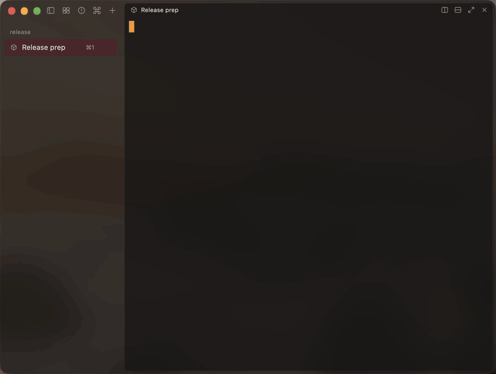
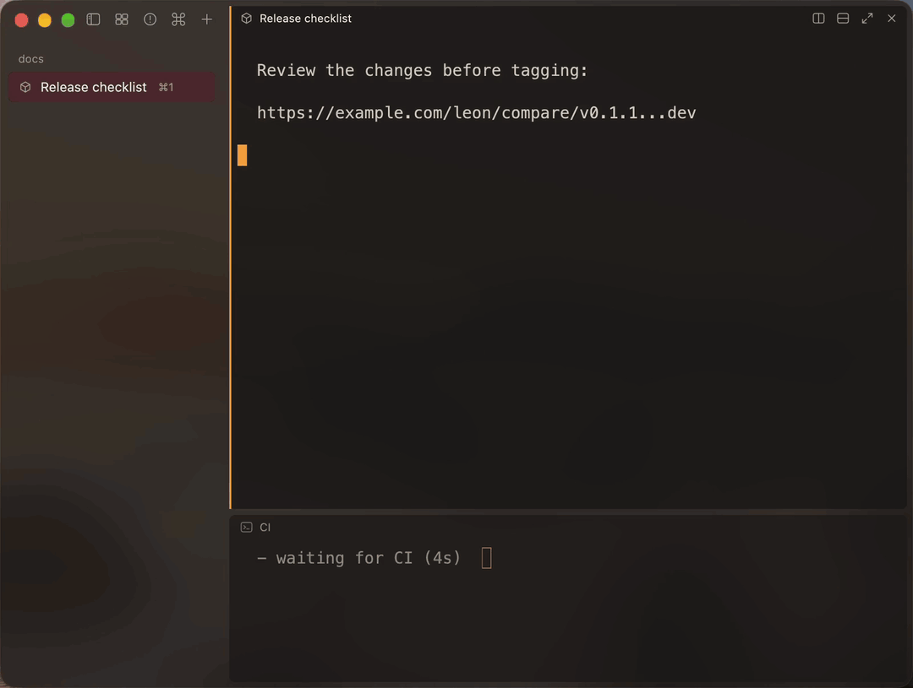
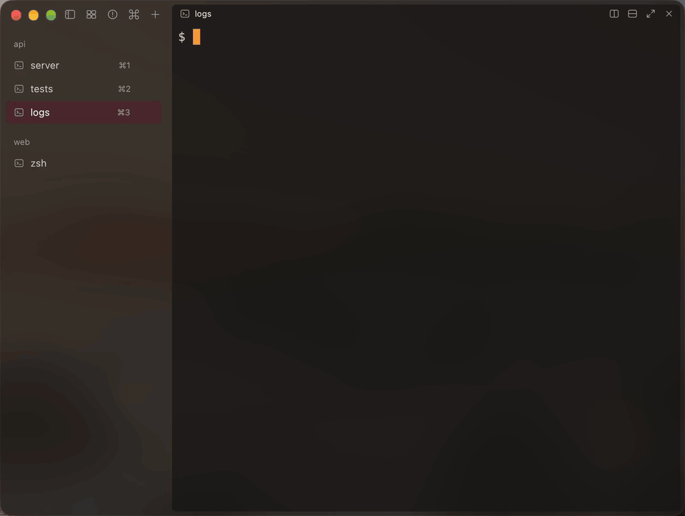
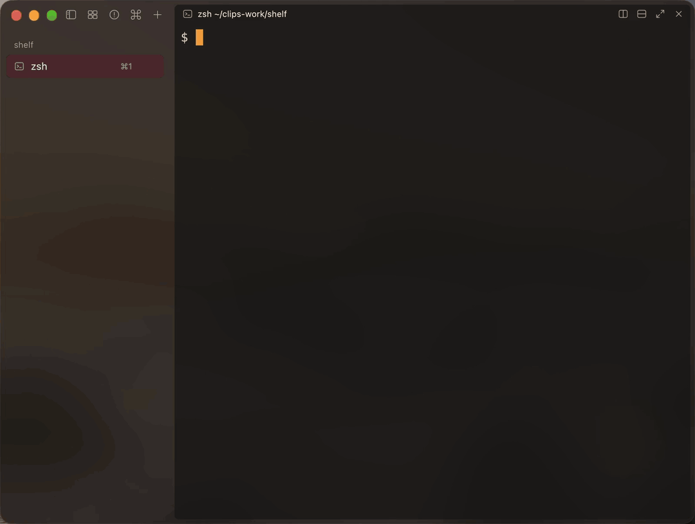

# Changelog

Everything that changes in leon, newest first. The format follows
[Keep a Changelog](https://keepachangelog.com/en/1.1.0/), and the API follows
[Semantic Versioning](https://semver.org/spec/v2.0.0.html) through its `api_version`.

0.1.0 is the first release. Its section sums up what it brings and links the detail of each
feature in [docs/changelog-detail.md](docs/changelog-detail.md); each milestone from
[docs/roadmap.md](docs/roadmap.md) that built it keeps its notes in
[docs/changelog-milestones.md](docs/changelog-milestones.md). Milestones that haven't landed have
no section: the app on Linux (M15's second part; Linux has the server, the CLI and `leon attach`).
`.github/workflows/release.yml` builds and publishes each release ([docs/releases.md](docs/releases.md)).
This file keeps the latest release's section; earlier ones, 0.1.0's included, are in
[docs/changelog-archive.md](docs/changelog-archive.md).

## Reading `api_version`

`api_version` is the version of the socket API, separate from the build's version. `help.all`
and `server.version` both report it, and `leon api call server.version` prints it. The current
one is `1.18.0`.

- **MAJOR** goes up when a stable method changes in a way that can break a client: a field or a
  method removed or renamed, a type narrowed, a new required parameter, a different meaning.
- **MINOR** goes up when the stable API grows: a new method, or a new optional parameter or result
  field on an existing one.
- **PATCH** goes up for fixes that keep every schema as it was.

Only methods marked `stable` are covered. `experimental` and `internal` methods can change in any
release. A client should check that the major version is the one it was written for and ignore
fields it doesn't know. The full policy is in
[docs/integrators.md](docs/integrators.md#compatibility).

## [Unreleased]

## [0.2.0] - 2026-11-20

leon is a terminal multiplexer for people who run several terminal programs and coding agents at
once. In 0.2.0, an agent can start other agents and hear back from them. You can see and drive
your sessions from a browser or a phone over your tailnet. A pane keeps its scrollback in about a
ninth of the memory it took. Leon.app adds a card for links, closing and renaming tabs and
sessions, cursor shaders, input methods, and keys that echo at once. `leon --version` prints
`leon 0.2.0 (<commit>)`, and the socket API is `1.18.0`. To update: `leon self-update`, Install in
the app, or `brew upgrade` ([Install](README.md#install)).

### Agents

- **Agents orchestrating agents.** `leon agent start` runs Claude Code, Codex or any agent in a tab
  or pane, working for you; its hooks report to your `leon inbox`, and leon types a notice into
  your prompt when your turn ends. New experimental methods `agent.link`, `agent.list`,
  `agent.inbox`, and `kind` on `dev.leon.terminal.report_status`; `api_version` 1.13.0.
  `leon agent start --worktree` gives a worker its own git worktree, which `leon agent close`
  removes only when that loses no work
  ([detail](docs/changelog-detail.md#agents-orchestrating-agents)).

  
- **Permission prompts stay yours.** An agent in leon can't type into a pane that waits on one,
  or move your keys onto it; only your own focus move puts them there. It keeps agents from
  answering; it is not a sandbox ([detail](docs/changelog-detail.md#agents-orchestrating-agents)).

### leon in the browser

- **leon in the browser, over your tailnet.** `serve_web` serves a view-only page of your sessions,
  tabs and panes to your own machines; `api_version` goes to `1.16.0` ([detail](docs/changelog-detail.md#leon-in-the-browser)).
- **HTTPS for the browser page.** `serve_web_cert` and `serve_web_key` name the files `tailscale cert`
  wrote; leon reads and reloads them; `api_version` goes to `1.17.0` ([detail](docs/changelog-detail.md#https-for-the-browser-page)).
- **Drive leon from the browser.** The tailnet web page types, pastes, copies, sends the mouse,
  opens and closes sessions, tabs and panes, and lists Activity ([detail](docs/changelog-detail.md#drive-leon-from-the-browser)).
- **The web page on a phone.** Activity first, one pane at a time, a drawer for sessions and tabs,
  and a key row with Esc, a sticky Ctrl, Tab and the arrows ([detail](docs/changelog-detail.md#the-web-page-on-a-phone)).

### Leon.app

- **A link card.** Resting the mouse on a link, or right-clicking it, shows its address with Copy and
  Open in Browser; `link_card` turns it off, and `api_version` is `1.14.0` ([detail](docs/changelog-detail.md#the-link-card)).

  
- **Closing and renaming tabs and sessions.** Close Tab (⌥⌘W), Close Session (⌥⇧⌘W), a × on hover,
  right-click menus and double-click to rename ([detail](docs/changelog-detail.md#closing-and-renaming-tabs-and-sessions)).

  
- **Cursor shaders.** Leon.app draws a Shadertoy-style cursor shader file you name with
  `cursor_shader` over its window, on macOS; `api_version` goes to `1.15.0` ([detail](docs/changelog-detail.md#cursor-shaders)).

  
- **Input methods and the emoji picker in Leon.app's panes.** Japanese, Chinese and other input
  methods compose at the cursor ([detail](docs/changelog-detail.md#input-methods-and-the-emoji-picker)).
- **A key's echo is shown at once** in Leon.app, not at the next display tick ([detail](docs/changelog-detail.md#a-keys-echo-shown-at-once)).
- **Leon.app doesn't wait on its own server once its window is up.** Keys, splits, copies and the
  window's other calls to This Mac's server queue in order off its thread, and a config reload shows at once ([detail](docs/changelog-detail.md#leonapp-doesnt-wait-on-its-own-server)).
- **Overlays give the keys back.** The palette, switcher, find bar, overview and rename field each
  take the focus while open and, however they close, give it to the overlay still open, else the pane ([detail](docs/changelog-detail.md#overlays-give-the-keys-back)).
- **What's new, in the app.** The first launch of a new version says "Updated to leon X.Y.Z" once,
  with What's New, which opens that version's page on the website ([detail](docs/changelog-detail.md#whats-new-in-the-app)).

### Scrollback

- **Scrollback that costs what its text costs.** A pane keeps its 10,000 lines in about a ninth of
  the memory; `leon.set("scrollback", N)` sets how many, reported by `server.settings` (`api_version`
  `1.18.0`) ([detail](docs/changelog-detail.md#scrollback-that-costs-what-its-text-costs)).

### Docs

- **A website.** <https://aindong.github.io/leon-cli/>: the docs, What's new per release and a demo
  ([detail](docs/changelog-detail.md#the-website)).
- **Diagrams and benchmark charts in the docs** ([detail](docs/changelog-detail.md#diagrams-and-benchmark-charts)).
