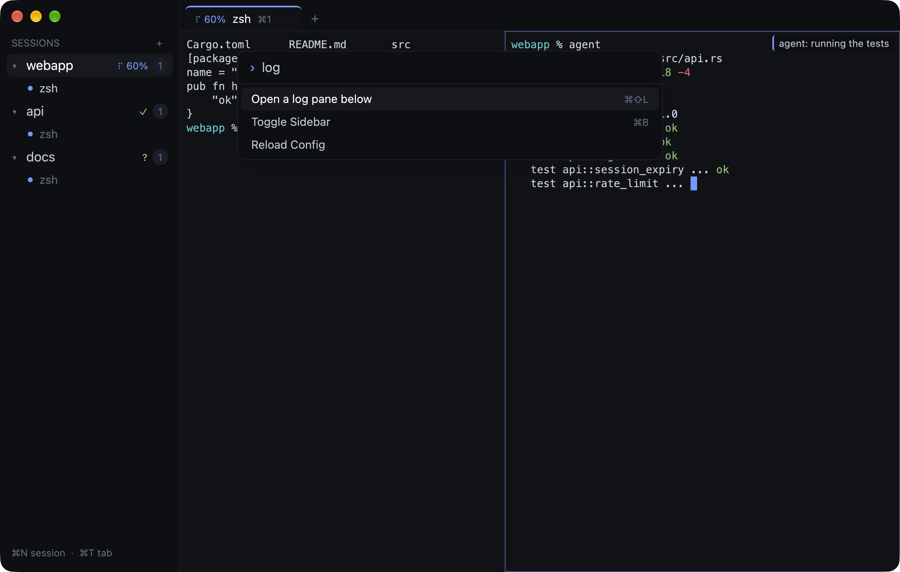
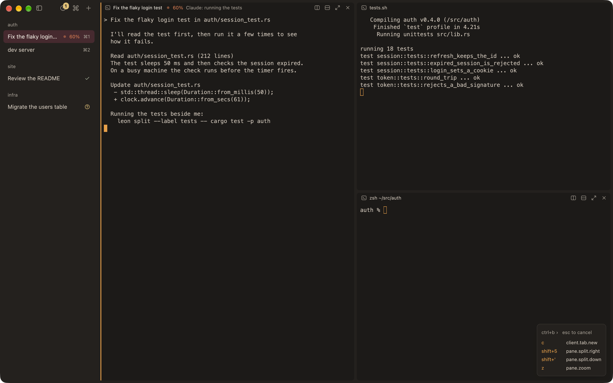
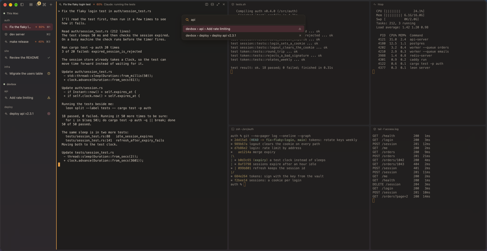
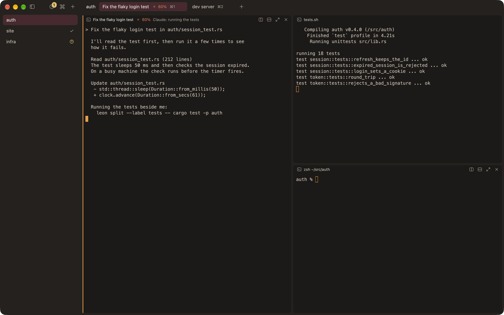
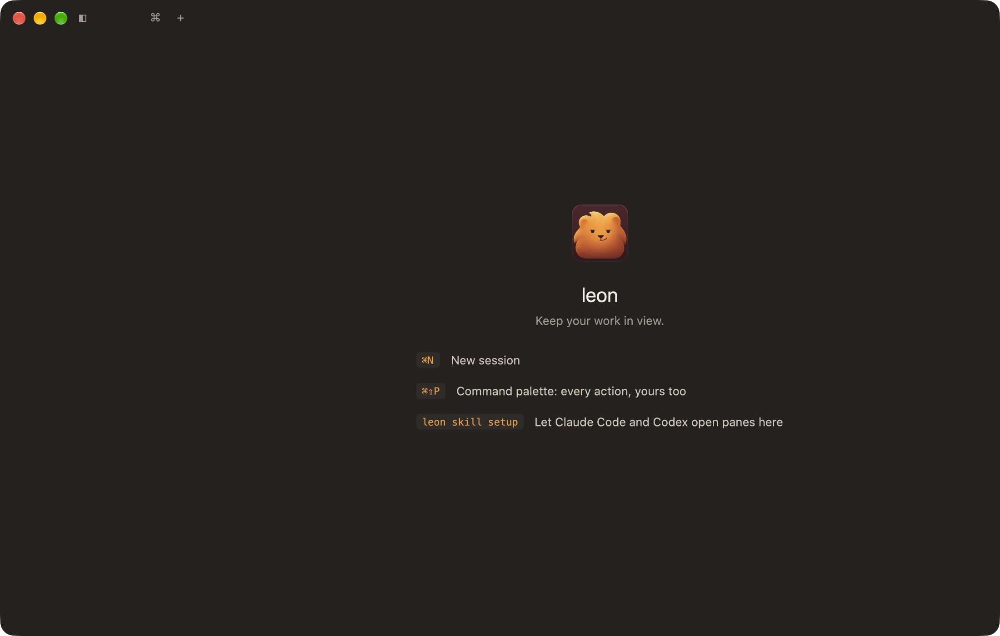

# leon

<p align="center"></p>

**A fast, scriptable terminal multiplexer for macOS.** Sessions, tabs and split panes live in a
server with a stable API. You drive them from a native app, from the `leon` command, from
Lua, or let your coding agent drive them for you. It's built in Rust, with GPUI for the app.

- **Persistent layout.** Programs keep running when the app quits: closing the window or ⌘Q only
  detaches, and the app opens again on the same sessions, tabs, splits and live screens. When the
  server itself stops, sessions, tabs, splits and each pane's directory are saved and come back on
  its next start, with the same stable IDs you script against (the programs in them don't).
- **Scriptable from the shell.** `leon run`, `send`, `capture` and `wait` open terminals, type into
  them, read their screens and wait for programs, with fixed exit codes and `--json` everywhere.
- **Agent-ready.** One command teaches Claude Code and Codex to open panes beside themselves, run
  your tests there and read the results.
- **Lua inside.** Key bindings, modes, your own actions, and scripts that react to events.


Programs report what they're doing (working, blocked, done) and the app shows it once in each
place: a symbol on the tab's row, and the symbol with the program's own words in the pane's header.
Tabs take the title the program set. The command palette (⌘⇧P) runs any action, yours included:



Key bindings from your `init.lua` work in the app, sequences too, with a hint of what can follow:



## Install

Each release has `Leon-<version>-macos-arm64.zip` (Apple Silicon), a tarball and a `.deb` for
Linux on arm64 and x86_64, and `SHA256SUMS`. `shasum -a 256 -c --ignore-missing SHA256SUMS`
catches a damaged download; the sums aren't signed, so it can't tell a tampered release from a
real one. `leon --version` names the release and the commit it was built from. Or build from a
checkout, as below.

### macOS

You need macOS 11 or later. From a release, unzip `Leon.app` into `~/Applications` and link its
`leon` command:

```text
ditto -x -k Leon-*-macos-arm64.zip ~/Applications
xattr -dr com.apple.quarantine ~/Applications/Leon.app   # signed ad hoc, not notarized
mkdir -p ~/.local/bin && ln -s ~/Applications/Leon.app/Contents/MacOS/leon ~/.local/bin/leon
```

To build it yourself you need a Rust toolchain. From a checkout of this repository:

```sh
scripts/install.sh
```

That builds `Leon.app`, copies it to `~/Applications`, and links the `leon` command into
`~/.local/bin` (use `--prefix DIR` for `DIR/bin`). It never uses root, prints each thing it does,
is safe to run again, and refuses to replace anything at those paths that it didn't install.
`scripts/install.sh --uninstall` removes both. Open **Leon** from Finder, Spotlight or the Dock, or
type `leon`.

The app is a client of the leon server: it attaches to the one running (from the shell or an
earlier launch) or starts it. Quitting the app leaves the server and your programs running;
`leon server stop`, or **Quit and End All Sessions…** in the leon menu, ends them.

To build only the app: `scripts/bundle.sh` writes `target/release/Leon.app`.

### Linux

On Linux leon is the server, the CLI and `leon attach` (agents and Lua scripts too); the app isn't
there yet, so `leon` alone in a terminal runs `leon attach`. Install a release's `.deb` or tarball
as below, or build the packages with Docker, from a checkout:

```sh
scripts/package-linux.sh                 # or --arch amd64 / --arch arm64
```

That writes a tarball and a `.deb` to `target/linux/<arch>/` and checks that both install and run
in clean containers. Install the `.deb` on Debian or Ubuntu with `dpkg` (as root):

```sh
dpkg -i target/linux/$(dpkg --print-architecture)/leon_*.deb
```

or unpack the tarball anywhere and put its `leon` on your `PATH`:

```sh
tar xzf target/linux/*/leon-*-"$(uname -m)"-linux.tar.gz -C ~/.local
ln -s ~/.local/leon-*-linux/leon ~/.local/bin/leon
```

Or build from source with a Rust toolchain and no Docker: `cargo build --release -p leon` gives a
headless `target/release/leon`. The binary needs glibc 2.34 or newer (Debian 12, Ubuntu 22.04,
RHEL 9 and later). The socket goes in `$XDG_RUNTIME_DIR/leon` when your session sets it.

## The first five commands

From any terminal (the server starts by itself):

```sh
leon new demo                                    # 1. a session called "demo"
leon -s demo run --label py -- python3           # 2. run a program in a new tab
leon -s demo send -b py 'print(6 * 7)'           # 3. type into it (no Enter yet)
leon -s demo send-key -b py enter                # 4. press Enter
leon -s demo capture -b py --trim                # 5. read its screen: 42
```

Targets (`-s` session, `-b` block) are an ID, a label, a position or the end of an ID. Inside a
leon terminal you can drop `-s`: commands act on your own session. `leon ls` lists sessions;
`leon --help` lists everything, with the exit codes at the bottom.

## Split it

```sh
leon -s demo split -b py --split below --ratio 30 -- top     # a pane under py, 30% high
leon -s demo focus up
leon -s demo zoom                                            # fill the window; again to undo
```

In the app: ⌘D splits right, ⌘⇧D splits down, ⌘⌥ and an arrow moves between panes, and dragging a
divider resizes.

## In any terminal: `leon attach`

```text
leon attach                  # pick a session, tab or block (type to filter), Enter attaches
leon attach demo             # straight to the session "demo"
ssh -t box leon attach       # the same, on another machine's leon
```

`leon attach` shows the tab's split panes and a status bar, and sends your keys to the focused
pane. After the prefix, ctrl+b (`--prefix` or the config's `leon.mode("attach", { prefix })` to
change it):

| Keys | Action |
|---|---|
| ctrl+b d | Detach; every program keeps running |
| ctrl+b ←↑↓→, ctrl+b h/j/k/l | Focus the pane that way |
| ctrl+b %, ctrl+b " | Split right, split down |
| ctrl+b z | Zoom the pane (again to undo) |
| ctrl+b c | New tab |
| ctrl+b n, ctrl+b p | Next, previous tab |
| ctrl+b s | Back to the picker |

Your `init.lua` bindings work there too, except `cmd` keys (a terminal never sends them) and a
binding on the prefix key itself.

## Work on your devbox

Commands that talk to the server take `-H` to act on the leon server on another machine instead, through your own
`ssh` (no account, relay or VPN; `~/.ssh/config` and `ProxyJump` work). Put `leon` on the other
machine's PATH or in `~/.local/bin`; the first command there starts its server, and programs keep
running after you disconnect.

```text
leon hosts add devbox ssh://me@devbox.example.com
leon -H devbox run -- make test     # runs on the devbox
leon -H devbox attach               # its sessions, in this terminal
leon hosts check
```

A dropped Wi-Fi link is retried for a minute: `leon events` and the app resume without losing or
repeating an event, and `leon attach` reconnects and redraws (keys typed while the link is down are
lost). Use ssh keys or an agent: each connection is its own ssh session.

The app shows every host from `leon hosts` in the sidebar, under This Mac, each with its sessions
and tabs and a dot for its connection. A remote pane works like a local one, with the host's name in
its header; New Session, New Tab and splits act on the machine of the focused pane, and the palette
has New Session on each machine and Add Host… (a label, then an `ssh://` endpoint). Click a host's
label to fold it away. The app's ssh never asks for a password: a host that needs one says
`needs login: run leon hosts check devbox in a terminal`; do that once (accept the host key, unlock
your key), and the app's next try gets in. While a link is down the host's panes keep their last
screens under a "reconnecting" note.


## Let an agent drive it

```sh
leon skill setup
```

installs a skill and a session-start hook for Claude Code and Codex. Then, working in a leon
terminal, ask "run the tests beside you", and the agent does what you would:

```sh
id=$(leon split --label tests --keep-open -- cargo test)
leon wait "$id"
leon capture -b "$id" --trim | tail -20
leon block close "$id"
```

It knows where it is from `LEON_SESSION` and `LEON_BLOCK`, labels what it opens, and closes only
what it created. See [docs/agents.md](docs/agents.md).

## Know what needs you

⌘K switches to any session, tab or block on any host, the most recent first, and ⌘⇧A lists what
needs you: blocked first (with what it is waiting for), then errors, finished runs you haven't
looked at, and work in progress. The toolbar button for it shows how many blocks are blocked, and so
does the Dock. Leon.app also sends a notification when a block blocks or fails, or when a run of 30 s
or more ends while you're in another app; clicking it takes you to the pane. A tool that can't print
OSC 7501 reports for its own block with `leon notify`:

```text
leon notify --state blocked --title "Deploy" --body "approve the rollout?"
```




## App shortcuts

| Keys | Action |
|---|---|
| ⌘N | New session |
| ⌘T | New tab |
| ⌘D | Split right |
| ⌘⇧D | Split down |
| ⌘⌥←, ⌘⌥→, ⌘⌥↑, ⌘⌥↓ | Focus the pane that way |
| ⌘⇧↩ | Zoom the pane (again to undo) |
| ⌘W | Close the pane |
| ⌘⌥F, ⌘⌥⇧F | Float the pane above the others, put it back in the tiles (drag its header to move it, an edge to resize it) |
| ⌘J | Show or hide the scratch drawer: a shell at the bottom that keeps running while hidden |
| ⌘⌃←, ⌘⌃→, ⌘⌃↓ | Dock the pane as a drawer on the left, right or bottom (drag its edge to resize it) |
| ⌘⇧], ⌘⇧[ | Next, previous tab |
| ⌘1 … ⌘9 | Go to tab 1–9 |
| ⌘C, ⌘V | Copy the selection, paste |
| ⌘A | Select everything in the pane, scrollback too |
| ⌘F | Find in the pane: ↩ and ⇧↩ step, ⌥C case, ⌥R regex, esc closes |
| ⌘G, ⌘⇧G | Next, previous match |
| ⌘⇧C | Copy mode: vi keys over the scrollback (h j k l, w b, 0 $, g ⇧G, ⌃U ⌃D), v and ⇧V select, / and ? search with n and ⇧N, y copies, esc or q leaves |
| ⌘⇧H | Hints: a label on every URL, path, hash, IP and long number on screen; type one to copy it, in upper case to type it into the pane |
| ⇧PageUp, ⇧PageDown | Scroll a page back, forward |
| ⌘↑, ⌘↓ | Scroll to the oldest line, back to the bottom |
| ⌘B | Show or hide the sidebar |
| ⌘⇧S | Tabs in the sidebar or in the titlebar (saved for the next launch) |
| ⌘⇧P | Command palette: type to find an action, ↩ runs it, esc closes |
| ⌘K | Switch to any host › session › tab (or a block by its title): ↩ goes there, ⌘↩ moves it beside this pane (same machine) |
| ⌘⇧A | Activity: every block that needs you on every host (blocked, error, done, working); click one to go there |
| ⌘=, ⌘⇧=, ⌘-, ⌘0 | Bigger, bigger, smaller, default font size (every pane) |
| ⌘Q | Quit; every program keeps running (leon › Quit and End All Sessions… ends them) |

These are defaults: a `leon.bind` in your `init.lua` replaces one key by key, and `leon.unbind`
removes one (⌘Q stays). Key sequences such as `ctrl+b>c` show a hint of what can follow.
A pane whose program reports its status (OSC 7501, as agents do) shows a pulsing dot while working,
a warning, question or key icon when it is blocked, a check when done or a cross on an error, on its tab and in its pane header (a collapsed
session's label shows its most urgent one); done and error clear when you go to the pane. Pane
headers name the program and where it is, and hold split, zoom and close buttons; "Show or Hide
Pane Headers" in the palette turns them off. Every button names its action and shortcut on hover.
Drag the sidebar's edge to resize it.

The wheel and trackpad scroll a pane back through its scrollback (fetched from the server as you
go). New output doesn't move what you are reading; a "↓ N new lines" pill takes you back down, and
so does typing. Drag to select, double-click a word, triple-click a line, shift+click to extend,
option+drag for a rectangle; a line that wrapped copies as one line. With
`leon.set("copy_on_select", true)` in your `init.lua` a selection is copied as you make it. A
program that asks for the mouse (vim, htop, tmux) gets clicks and the wheel; hold shift to select
anyway. Hold ⌘ over a link (OSC 8, or a URL, even one that wraps) to underline it and ⌘-click to
open it; anything but an `http(s)` link shows its full address first. The window opens at most of the screen the first time, then
where you left it.

Tabs live in one place. ⌘⇧S moves them from the sidebar to the titlebar, beside the session's name,
and the sidebar then lists only sessions; the app remembers the choice:



With no session open, the app says what to do next:



## Script it in Lua

`~/.config/leon/init.lua` defines key bindings, modes and actions; `leon do` runs scripts.

```lua
leon.action{
  name = "name_session",
  title = "Name this session",
  args = { label = "string" },
  run = function(ctx, args) return leon.session.set_label{ label = args.label } end,
}
```

```sh
leon config check
leon config reload
leon do name_session label=api
leon do -e 'print(#leon.session.view().windows .. " tabs")'
```

See [docs/lua.md](docs/lua.md).

## Docs

- [docs/cli.md](docs/cli.md): every command and flag.
- [docs/lua.md](docs/lua.md): the config and scripts, with examples that a test runs.
- [docs/agents.md](docs/agents.md): agents driving leon.
- [docs/integrators.md](docs/integrators.md): writing a client for leon's socket API in any
  language, and the compatibility promise. [docs/api.md](docs/api.md): every method.
  [CHANGELOG.md](CHANGELOG.md): what changed.
- [docs/recipes.md](docs/recipes.md): project and git worktree sessions as a Lua recipe.
- [docs/architecture.md](docs/architecture.md): how it's built. [docs/spec.md](docs/spec.md): the
  interface it matches. [docs/roadmap.md](docs/roadmap.md): what's next.

## Develop

```sh
cargo build
cargo test
cargo clippy --all-targets -- -D warnings
```

GPUI is built with its `runtime_shaders` feature, so you don't need Xcode's Metal toolchain.
