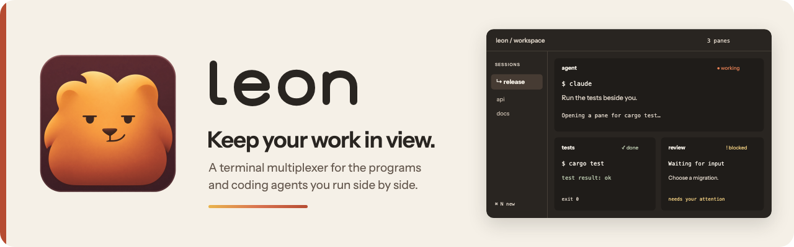

# leon

<p align="center"></p>

**leon is a terminal multiplexer for people who run several terminal programs and coding agents at
once.** A server keeps your sessions, tabs and split panes, and the programs in them, running. You
work with them from a native macOS app, from the `leon` command in any terminal, from Lua scripts,
or through your coding agent, which can open a pane beside itself, run your tests there and read
the result. Programs can report whether they are working, blocked or done, so you can see which
one needs you. It runs on macOS and Linux (the app is macOS only for now) and is written in Rust.


## Features

- **Persistent layout.** Programs keep running when the app quits: closing the window or ⌘Q only
  detaches, and the app opens again on the same sessions, tabs, splits and live screens. When the
  server itself stops, sessions, tabs, splits and each pane's directory are saved and come back on
  its next start, with the same IDs you script against (the programs in them don't).
- **The `leon` command.** `leon run`, `send`, `capture` and `wait` open panes, type into
  them, read their screens and wait for programs, with fixed exit codes and `--json` output.
  `leon attach` shows a session in any terminal, over ssh too.
- **The macOS app.** Sidebar or titlebar tabs, splits, floating panes, a scratch drawer, a
  command palette, a session switcher, scrollback with find and copy mode, and themes.
- **Agents.** `leon skill setup` teaches Claude Code and Codex to work in panes beside
  themselves, and their panes offer to resume the same conversation after a restart.
- **Status and attention.** A program that writes an OSC 7501 report (agents do) shows its state
  on its tab and pane. The Activity list, the Dock badge and notifications tell you what is
  blocked, failed or finished.
- **Remote hosts.** `-H devbox` acts on the leon server on another machine through your own `ssh`,
  and the app shows each host's sessions beside your own.
- **Lua.** Key bindings, modes, your own actions, and scripts that react to events.
- **An API.** Every client uses the same socket API, which describes itself (`leon api list`)
  and has a compatibility promise for anyone writing their own client.

## Install

### Homebrew

```sh
brew install --cask aindong/leon/leon   # macOS: Leon.app, with the leon command
brew install aindong/leon/leon          # the CLI alone, on macOS or Linux
```

Pick one: the cask's `leon` is the one inside the app. `brew upgrade` brings new releases.
Leon.app is not notarized by Apple, so macOS will not open it while it carries the quarantine flag
that Homebrew puts on a download. After the cask installs, and before you open the app, remove it:

```sh
xattr -dr com.apple.quarantine /Applications/Leon.app
```

### From a release

Each release is at <https://github.com/aindong/leon-cli/releases/latest>: `Leon-<version>-macos-<arch>.zip`
(Leon.app), a tarball of the CLI for macOS and for Linux, and a `.deb`, each for arm64 and x86_64.
On macOS, unzip the app into `/Applications` and run the `xattr` command above (a file from a
browser is quarantined too). On Linux, with the file for your machine downloaded:

```sh
dpkg -i leon_*.deb                               # Debian or Ubuntu, as root
tar xzf leon-*-linux.tar.gz -C ~/.local          # anywhere else: unpack it,
ln -s ~/.local/leon-*-linux/leon ~/.local/bin/   # and put its leon on your PATH
```

Every file is signed: [docs/releases.md](docs/releases.md#checking-a-download) says how to check
one.

### Updating

```sh
leon self-update --check   # is there a newer release?
leon self-update           # download it, check its signature, and replace this leon
```

leon updates only when you ask, and checks the release's signature before it installs anything.
A leon from Homebrew is updated by `brew upgrade`, and one from a `.deb` by installing the new
`.deb`; `leon self-update` tells you which. A running server keeps the old version until
`leon server stop`. The details are in [docs/updates.md](docs/updates.md).

### From source

To build leon yourself you need a Rust toolchain ([rustup](https://rustup.rs)) and git. The two
sections below build it on macOS and on Linux.

### macOS

You need macOS 11 or later. From a checkout of this repository:

```sh
scripts/install.sh
```

That builds `Leon.app`, copies it to `~/Applications`, and links the `leon` command into
`~/.local/bin` (use `--prefix DIR` for `DIR/bin`). It never uses root, prints each thing it does,
is safe to run again, and refuses to replace anything at those paths that it didn't install.
`scripts/install.sh --uninstall` removes both. Open **Leon** from Finder, Spotlight or the Dock, or
type `leon`. To build only the app, `scripts/bundle.sh` writes `target/release/Leon.app`.

The app is a client of the leon server. It attaches to the one running (from the shell or an
earlier launch) or starts it. Quitting the app leaves the server and your programs running;
`leon server stop`, or **Quit and End All Sessions…** in the leon menu, ends them.

### Linux

On Linux leon is the server, the CLI and `leon attach` (agents and Lua scripts too); the app isn't
there yet, so `leon` alone in a terminal runs `leon attach`. Build it with `cargo`:

```sh
cargo build --release -p leon
```

That gives a headless `target/release/leon`; put it on your `PATH`. It needs glibc 2.34 or newer
(Debian 12, Ubuntu 22.04, RHEL 9 and later). The socket goes in `$XDG_RUNTIME_DIR/leon` when your
session sets it. With Docker you can build packages instead:

```sh
scripts/package-linux.sh                 # or --arch amd64 / --arch arm64
```

That writes a tarball and a `.deb` to `target/linux/<arch>/` and checks that both install and run
in clean containers. Install the `.deb` on Debian or Ubuntu with `dpkg` (as root):

```sh
dpkg -i target/linux/$(dpkg --print-architecture)/leon_*.deb
```

or unpack the tarball anywhere and put its `leon` on your `PATH`:

```sh
tar xzf target/linux/*/leon-*-"$(uname -m)"-linux.tar.gz -C ~/.local
ln -s ~/.local/leon-*-linux/leon ~/.local/bin/leon
```

### Release files

`scripts/release.sh` builds, from a clean clone of one commit, the files a release has:
`Leon-<version>-macos-<arch>.zip` (Leon.app, signed ad hoc and not notarized), the CLI tarball for
macOS, a tarball and a `.deb` for Linux on arm64 and x86_64, and `SHA256SUMS`. It runs on macOS and
needs Docker for the Linux packages. `leon --version` names the release and the commit it was
built from. A pushed tag does the same on GitHub, signs every file and publishes the release:
[docs/releases.md](docs/releases.md).

## The first five commands

A two-minute quickstart, from any terminal (the server starts by itself). Python stands in for any
program you want to drive:

```sh
leon new demo                                    # 1. a session called "demo"
leon -s demo run --label py -- python3 -q        # 2. run a program in a new tab
leon -s demo wait -b py --text '>>>'             #    and wait for its prompt
leon -s demo send -b py 'print(6 * 7)'           # 3. type into it (no Enter yet)
leon -s demo send-key -b py enter                # 4. press Enter
leon -s demo wait -b py --text 42                #    and wait for the answer
leon -s demo capture -b py --trim                # 5. read its screen: 42
```

Targets (`-s` session, `-b` block, leon's name for a pane) are an ID, a label, a position or the
end of an ID. Inside a leon terminal you can drop `-s`: commands act on your own session. `leon ls`
lists sessions; `leon --help` lists everything, with the exit codes at the bottom.

## Split it

```sh
leon -s demo split -b py --split below --ratio 30 -- top     # a pane under py, 30% high
leon -s demo focus up
leon -s demo zoom                                            # fill the window; again to undo
```

In the app: ⌘D splits right, ⌘⇧D splits down, ⌘⌥ and an arrow moves between panes, and dragging a
divider resizes. `leon attach demo` shows the session in this terminal (ctrl+b d detaches). When
you are done, `leon kill demo` ends the session and its programs.

## In any terminal: `leon attach`

```text
leon attach                  # pick a session, tab or block (type to filter), Enter attaches
leon attach demo             # straight to the session "demo"
ssh -t box leon attach       # the same, on another machine's leon
```

`leon attach` shows the tab's split panes and a status bar, and sends your keys to the focused
pane. After the prefix, ctrl+b (`--prefix` or the config's `leon.mode("attach", { prefix })` to
change it):

| Keys | Action |
|---|---|
| ctrl+b d | Detach; every program keeps running |
| ctrl+b ←↑↓→, ctrl+b h/j/k/l | Focus the pane that way |
| ctrl+b %, ctrl+b " | Split right, split down |
| ctrl+b z | Zoom the pane (again to undo) |
| ctrl+b c | New tab |
| ctrl+b n, ctrl+b p | Next, previous tab |
| ctrl+b s | Back to the picker |

Your `init.lua` bindings work there too, except `cmd` keys (a terminal never sends them) and a
binding on the prefix key itself.

## Work on your devbox

Commands that talk to the server take `-H` to act on the leon server on another machine instead,
through your own `ssh` (no account, relay or VPN; `~/.ssh/config` and `ProxyJump` work). Put `leon`
on the other machine's PATH or in `~/.local/bin`; the first command there starts its server, and
programs keep running after you disconnect.

```text
leon hosts add devbox ssh://me@devbox.example.com
leon -H devbox run -c /home/me/app -- make test   # runs on the devbox, in its /home/me/app
leon -H devbox attach               # its sessions, in this terminal
leon hosts check
```

A dropped Wi-Fi link is retried for a minute: `leon events` and the app resume without losing or
repeating an event, and `leon attach` says it is reconnecting, then reconnects and redraws. Keys
typed while the link is stalled or down arrive whole or not at all, and the status bar says how many
were not sent (a stall that starts mid-word, within a second of the last reply, can still catch the
keys already on their way). Use ssh keys or an agent, because each connection is its own ssh session.

The app shows every host from `leon hosts` in the sidebar, under This Mac, each with its sessions
and tabs and a dot for its connection. A remote pane works like a local one, with the host's name in
its header; New Session, New Tab and splits act on the machine of the focused pane, and the palette
has New Session on each machine and Add Host… (a label, then an `ssh://` endpoint). Click a host's
label to fold it away. The app's ssh never asks for a password. A host that needs one says
`needs login: run leon hosts check devbox in a terminal`; do that once (accept the host key, unlock
your key), and the app's next try gets in. While a link is down the host's panes keep their last
screens under a "reconnecting" note.


## Let an agent drive it

```sh
leon skill setup
```

installs a skill and a session-start hook for Claude Code and Codex (each one whose config dir
exists or whose program is on your PATH; it says which, and why). Then, working in a leon
terminal, ask "run the tests beside you", and the agent does what you would:

```sh
id=$(leon split --label tests --keep-open -- cargo test)
leon wait "$id"
leon capture -b "$id" --trim | tail -20
leon block close "$id"
```

It knows where it is from `LEON_SESSION` and `LEON_BLOCK`, labels what it opens, and closes only
what it created. See [docs/agents.md](docs/agents.md).

## Know what needs you

Programs report what they're doing (working, blocked, done), and the app shows it in two places.
The tab's row gets a symbol, and the pane's header gets the symbol with the program's own words.


With more than one pane in a tab, the panes you aren't in are drawn a little faded, so your eye
stays on the focused one; the fade follows the focus over 120 ms (at once with Reduce Motion).
What you are waiting for is never faded: a status symbol keeps its colour, and a pane that is
blocked, has failed, or finished since you last looked stays at full strength. In init.lua,
`leon.set("fade_inactive_panes", 0)` turns the fade off and a number up to 0.8 sets its strength
(0.35 by default).

⌘K switches to any session, tab or block on any host, the most recent first, and ⌘⇧A lists what
needs you: blocked first (with what it is waiting for), then errors, finished runs you haven't
looked at, and work in progress. The toolbar button for it shows how many blocks are blocked, and so
does the Dock. Leon.app also sends a notification when a block blocks or fails, or when a run of 30 s
or more ends while you're in another app; clicking it takes you to the pane. A tool that can't print
OSC 7501 reports for its own block with `leon notify`:

```text
leon notify --state blocked --title "Deploy" --body "approve the rollout?"
```


## App shortcuts

| Keys | Action |
|---|---|
| ⌘N | New session |
| ⌘T | New tab |
| ⌘D | Split right |
| ⌘⇧D | Split down |
| ⌘⌥←, ⌘⌥→, ⌘⌥↑, ⌘⌥↓ | Focus the pane that way |
| ⌘⇧↩ | Zoom the pane (again to undo) |
| ⌘W | Close the pane |
| ⌘⌥F, ⌘⌥⇧F | Float the pane above the others, put it back in the tiles (drag its header to move it, an edge to resize it) |
| ⌘J | Show or hide the scratch drawer: a shell at the bottom, opened in the focused pane's directory, that keeps running while hidden |
| ⌘⌃←, ⌘⌃→, ⌘⌃↓ | Dock the pane as a drawer on the left, right or bottom (drag its edge to resize it) |
| ⌘⇧], ⌘⇧[ | Next, previous tab |
| ⌘1 … ⌘9 | Go to tab 1–9 |
| ⌘C, ⌘V | Copy the selection, paste |
| ⌘A | Select everything in the pane, scrollback too |
| ⌘F | Find in the pane: ↩ and ⇧↩ step, ⌥C case, ⌥R regex, esc closes |
| ⌘G, ⌘⇧G | Next, previous match |
| ⌘⇧C | Copy mode: vi keys over the scrollback (h j k l, w b, 0 $, g ⇧G, ⌃U ⌃D), v and ⇧V select, / and ? search with n and ⇧N, y copies, esc or q leaves |
| ⌘⇧H | Hints: a label on every URL, path, hash, IP and long number on screen; type one to copy it, in upper case to type it into the pane |
| ⇧PageUp, ⇧PageDown | Scroll a page back, forward |
| ⌘↑, ⌘↓ | Scroll to the oldest line, back to the bottom |
| ⌘B | Show or hide the sidebar |
| ⌘⇧S | Tabs in the sidebar or in the titlebar (saved for the next launch) |
| ⌘⇧P | Command palette: type to find an action, ↩ runs it, esc closes |
| ⌘, | Settings: the theme for dark and for light mode, font, notifications, copy on select; each change is written to init.lua |
| ⌘K | Switch to any host › session › tab (or a block by its title): ↩ goes there, ⌘↩ moves it beside this pane (same machine) |
| ⌘⇧A | Activity: every block that needs you on every host (blocked, error, done, working); click one to go there |
| ⌘=, ⌘⇧=, ⌘-, ⌘0 | Bigger, bigger, smaller, default font size (every pane) |
| ⌘Q | Quit; every program keeps running (leon › Quit and End All Sessions… ends them) |

These are defaults. A `leon.bind` in your `init.lua` replaces one key by key, and `leon.unbind`
removes one (⌘Q stays). Key sequences such as `ctrl+b>c` show a hint of what can follow. Every
button names its action and shortcut on hover. The wheel scrolls a pane back through its
scrollback; drag to select, option+drag for a rectangle; hold ⌘ over a link to open it with a click.
A program that asks for the mouse (an editor or `htop`) gets clicks and the wheel; hold shift to
select anyway.

## Configuration

leon reads `~/.config/leon/init.lua` (or `$LEON_CONFIG`). Settings have their own commands, and the
app's Settings window (⌘,) writes the same file:

```sh
leon config set font.size 15
leon config set theme dark=leon-dark,light=leon-light
leon theme list
leon config check
```

The same file defines key bindings, modes and your own actions, and `leon do` runs scripts:

```lua
leon.action{
  name = "name_session",
  title = "Name this session",
  args = { label = "string" },
  run = function(ctx, args) return leon.session.set_label{ label = args.label } end,
}
```

```sh
leon config reload
leon do name_session label=api
leon do -e 'print(#leon.session.view().windows .. " tabs")'
```

`leon theme import FILE` brings in a color scheme from another terminal's theme file. See
[docs/lua.md](docs/lua.md) for every setting and function, and [docs/cli/settings.md](docs/cli/settings.md).

## Roadmap

leon is at 0.1.0, not yet tagged. What has landed, milestone by milestone, is in
[docs/roadmap.md](docs/roadmap.md) and [CHANGELOG.md](CHANGELOG.md). What comes next:

- **The app on Linux.** Linux has the server, the CLI, `leon attach`, agents and Lua; the GPUI app
  is macOS only for now.
- **Two clients on one tab.** With the app and `leon attach` showing the same tab, each pane takes
  the size of the client that last changed its layout, and the other client clips or pads it.
- **Lookalike link hosts.** ⌘-click opens an `http(s)` link without asking, even when its host uses
  non-ASCII letters that look like another's; only other kinds of link show their address first.
- **`codex exec` runs.** leon tells a one-shot `claude -p` run from an interactive agent, but not
  yet a `codex exec` run, which can still be offered a resume meant for an interactive session.

## Docs

- [docs/cli.md](docs/cli.md): every command and flag.
- [docs/lua.md](docs/lua.md): the config and scripts, with examples that a test runs.
- [docs/agents.md](docs/agents.md): agents driving leon, and the OSC 7501 status format.
- [docs/recipes.md](docs/recipes.md): project and git worktree sessions as a Lua recipe.
- [docs/integrators.md](docs/integrators.md): writing a client for leon's socket API in any
  language, and the compatibility promise. [docs/api.md](docs/api.md): every method.
- [docs/architecture.md](docs/architecture.md): how it's built.
  [docs/performance.md](docs/performance.md): what it costs, measured.
- [docs/releases.md](docs/releases.md): how a release is cut and signed, and the manifest format.
- [CHANGELOG.md](CHANGELOG.md): what changed.

## Build and test

```sh
cargo build
cargo test
cargo clippy --all-targets -- -D warnings
cargo fmt --check
```

GPUI is built with its `runtime_shaders` feature, so you don't need Xcode's Metal toolchain. The
terminal tests run a real shell in a PTY, and the doc tests run the commands in these docs.
`scripts/linux-test.sh` runs the tests for everything but the app on Linux, in Docker. The release
tests sign with a throwaway key, so they need `minisign` and `jq`.

## License

[MIT](LICENSE). The Instrument Sans font in `brand/fonts` is under the
[SIL Open Font License](brand/fonts/OFL.txt).
