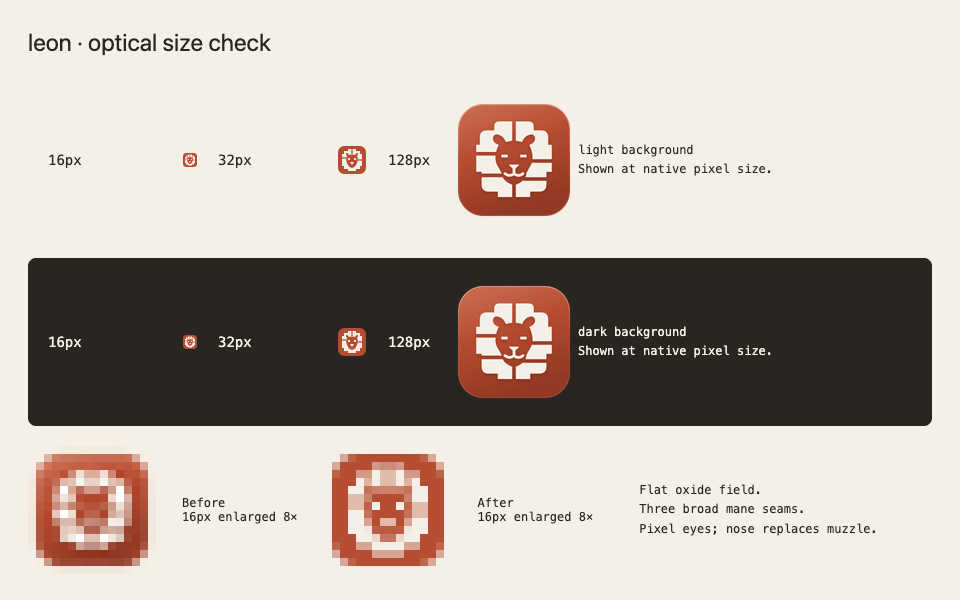

# leon identity

**Chosen direction: Pane mane.** A calm, front-facing lion with six offset, rectangular mane panels. The lion makes the name immediate; its split mane connects the animal to leon's many terminal panes. Level eyes and a closed muzzle give it a quiet, watchful expression. The stepped silhouette is compact, not a shield or a heraldic crest.

**Tagline:** Keep your work in view.


## Four lion directions explored

The built-in Codex imagegen [concept sheet](exploration/directions.png) and [exact prompt and evaluation](exploration/prompts.md) record four routes. The [reference comparison](research.md) explains how the final lion differs from existing lion brands and the reference app.

1. **Pane mane — selected.** Names the animal and the product's pane structure in one compact mark. Six deliberately offset partitions give it its own silhouette.
2. **Quiet face.** Simple and legible, but the pointed oval mane is less distinctive and closer to the generic crest category.
3. **Single line.** Elegant profile, but fine lines weaken at 16 px and profiles have more automotive/luxury resemblance risk. The generated study also failed to become literally one continuous stroke.
4. **Lion L.** Reads as an initial before an animal; decorative mane locks overwhelm the product connection.

The chosen concept was redrawn, not traced. The production lion starts with a 100-unit grid: a stepped 84×84 occupied area (x=8–92, y=6–90), a broad negative-space face, rounded ears, six mane panels separated by 4-unit channels, 7×3-unit eyes, and a 12-unit nose. The lower channels meet the face rather than becoming tiny interior slots. These hand-authored shapes were combined with vector boolean subtraction and rounded to two-decimal SVG coordinates. The face uses a small round-ended muzzle stroke; all other details are filled geometry. No generated raster or third-party logo path is embedded in the identity SVGs.

## Name, lockup, and usage

Use **leon** in product copy, **Leon.app** for the macOS bundle, and `leon` for commands. The existing bespoke lowercase lettering stays: its soft corners pair well with the lion's rounded ears and pane corners. The wordmark begins at x=100 instead of x=108 in the revised 360×90 lockup, tightening the gap without crowding the mane.

| Asset | Light surfaces | Dark surfaces |
| --- | --- | --- |
| Full lockup | [logo.svg](logo.svg) | [logo-dark.svg](logo-dark.svg) |
| Standalone lion | [logo-mark.svg](logo-mark.svg) | [logo-mark-dark.svg](logo-mark-dark.svg) |
| Wordmark | [wordmark.svg](wordmark.svg) | [wordmark-dark.svg](wordmark-dark.svg) |

Keep at least 12 design units of clear space around the occupied lion (about one seventh of its width). Use the full mark at 24 px or larger and the lockup at 108 px or larger. At 16 px use the [optical icon](icon/leon-small.svg), also embedded as the landing page favicon. Do not stretch, rotate, add a crown or shield, open the mouth, angle the eyes, or colour the mane panels separately. The flat lion uses one colour, including its muzzle stroke; for recolouring, change both `fill` and `color`. On a busy surface use a solid Parchment or Iron field. Keep lighting effects confined to the app icon.

The palette is retained deliberately. Oxide gives the lion warmth without a bright orange body; Iron and Parchment preserve the useful contrast and the existing page's tone. The animal does not require a new palette.

## Palette

| Token | Hex | Role |
| --- | --- | --- |
| Parchment | `#F5F0E7` | Light background, inverse text, icon symbol |
| Iron | `#292521` | Primary text, dark background |
| Oxide | `#B64C32` | Main mark and light-mode accent |
| Clay | `#E6AA91` | Dark-mode accent, working state |
| Umber | `#65594F` | Secondary light-mode text |
| Chalk | `#D8CEC2` | Secondary dark-mode text |
| Sand | `#EBE3D7` | Light raised surface |
| Coal | `#1F1C19` | Terminal pane surface |
| Sage | `#B8C6AC` | Done status on dark surfaces |
| Wheat | `#E8C77D` | Blocked status on dark surfaces |

Calculated from sRGB relative luminance using `(Llighter + 0.05) / (Ldarker + 0.05)`, rounded to two decimals. These approved text pairs meet WCAG AA's 4.5:1 normal-text threshold; the icon's lighting is decorative rather than a text colour specification.

| Text / background | Contrast |
| --- | ---: |
| Iron / Parchment | 13.40:1 |
| Umber / Parchment | 5.98:1 |
| Oxide / Parchment | 4.55:1 |
| Parchment / Oxide | 4.55:1 |
| Parchment / Iron | 13.40:1 |
| Chalk / Iron | 9.80:1 |
| Clay / Iron | 7.62:1 |
| Sage / Iron | 8.48:1 |
| Wheat / Iron | 9.34:1 |
| Chalk / Coal | 10.92:1 |

Use the lighter Clay accent on dark backgrounds. Do not use Oxide as small text on Iron. Pair every status colour with its word and a distinct symbol, as the demo does; colour alone is insufficient.

## Type

- **UI and marketing:** [Instrument Sans](https://fonts.google.com/specimen/Instrument+Sans), a free SIL Open Font License family, weights 400–700. Use 400 for body text, 500–600 for headings, and 600 for actions. The supplied 29 KB Latin WOFF2 and [licence](fonts/OFL.txt) are embedded in the standalone page and SVG marketing sources; no font service is called.
- **Terminal and code:** **Menlo**, the font already used by `FONT_FAMILY` in `crates/leon-app/src/view.rs`. It ships with macOS and is not redistributed here. Web fallback is `monospace`. Instrument Sans is a brand/UI recommendation, not a change to the app's existing system UI font.
- **Logo lettering:** bespoke vector paths. Do not typeset a replacement with a similar font.

## macOS app icon

The [editable 1024 master SVG](icon/leon-1024.svg) supplies the [1024×1024 PNG](icon/leon-1024.png), all ten [iconset slots](icon/Leon.iconset), and [Leon.icns](icon/Leon.icns). The opaque oxide tile has a restrained rim and raised parchment lion, with transparent exterior padding. Its broad foreground and shallow depth follow the current macOS layered direction, rendered as a static ICNS for the existing bundler. It is not a compiled Icon Composer `.icon` package and does not claim dynamic Liquid Glass appearances. [Unmasked background](icon/background.svg) and [foreground](icon/foreground.svg) are supplied for later native composition.



At 16 px the full master's muzzle and six seams become soft. The handwritten [optical small source](icon/leon-small.svg) enlarges the head, uses a flat oxide tile, reduces the mane to three broad seams, aligns the two eyes to whole pixels, and replaces the muzzle curves with a simple nose. Rounded ears and the stepped mane remain. Both 16 pt and 32 pt slots (including Retina 2×) use this source. Slots at 128 pt and above use the full dimensional master. The proof compares direct reduction against the optical version at 8×, plus native 16/32/128 px examples on light and dark.

The ICNS has been decoded with `iconutil` and all ten decoded slots checked for dimensions, alpha, and opaque-pixel fidelity against the source iconset (see the native small-slot edge conversion note in verification.md). `scripts/bundle.sh` already copies `brand/icon/Leon.icns`; no bundler or application code was changed. Root `README.md` was not edited; its existing hero path receives the new image automatically.

## Marketing kit

- [README hero](marketing/hero.png), **1600×600**, with [SVG source](marketing/hero.svg).
- [Social / OG image](marketing/og.png), **1200×630**, with [SVG source](marketing/og.svg).
- [Copy sheet](marketing/copy.md), unchanged: tagline, three alternatives, 50-word pitch, 150-word description.
- [Landing page](marketing/index.html): a single HTML file with inline CSS, inline lion lockups, optical favicon, embedded font and optimised app icon. Responsive at phone widths and follows the user's light/dark preference.

The illustrated terminal workflow and existing copy remain. Status is program-reported; layouts can restore, but quitting ends running programs. The page has six capabilities, the real source-install command, and agent instructions. No scripts or runtime external requests are required. Repository-relative documentation links work from the checkout; set deployment URLs and an absolute `og:image` only when a host is chosen.

## Rebuild and checks

On macOS with Node, Google Chrome, and `iconutil`:

```sh
npm install --prefix /tmp/leon-brand-build sharp playwright
NODE_PATH=/tmp/leon-brand-build/node_modules node brand/build-assets.cjs
```

The script renders the handwritten SVG master, regenerates the full iconset and ICNS, refreshes the landing page's icon embed, renders the SVG banners, and rebuilds the optical-size proof. PNG exports use indexed palettes and maximum compression effort. The generated concept sheet is a historical design input, not a build dependency. Production assets need no imagegen call to rebuild.

Verified at **1440, 390, and 320 CSS px**, each in light and dark mode in a browser and Chrome: correct requested widths, no document overflow, loaded font and icon, six capabilities, no scripts, external resource requests, or console errors. Both banners, the master and optical proof, and desktop/phone landing renders were visually inspected. See [verification.md](verification.md) for dimensions, byte sizes, contrast, and icon round-trip evidence; [FILES.md](FILES.md) lists the kit.

## Human review

**Pick Pane mane.** There is no unresolved pair of final marks: Quiet face is the runner-up concept, not a second production identity. Pane mane is the stronger choice because its stepped, partitioned outline belongs to a multi-pane terminal. Final aesthetic review should focus on animal recognition at 16 px and the icon's depth in a real Dock.
