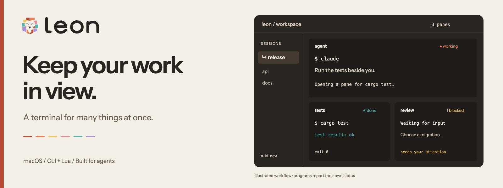

# leon identity

**Chosen direction: Pane mane / Fired mosaic.** A calm, front-facing lion with ten softly cornered rectangular mane panels. The lion makes the name immediate; distinct pane colours express many terminals running at once. Its broad brow, curved closed eyes, wide flat-topped nose, broad two-lobed muzzle and small heart-shaped chin follow the original concept 01. The ears are tucked out of sight. This replaces the first vector's narrow face, round ears and block-like mane.

**Tagline:** Keep your work in view.



## Exploration and refinement

The original [four-direction sheet](exploration/directions.png) records Pane mane, Quiet face, Single line and Lion L; [its prompt](exploration/prompts.md) is retained. The user chose Pane mane and requested closer fidelity to concept 01, then asked for a livelier colour treatment.

The built-in imagegen [colour sheet](exploration/colour-directions.png) compares three palettes. **Fired mosaic wins:** Oxide preserves continuity, warm crown colours meet cool side panes, and Iron gives the light face a strong silhouette. Orchard light feels botanical; Night signal feels more like a generic neon tool. The [exact colour prompt and selection notes](exploration/colour-prompts.md) record the generation. No reference company imagery was supplied to imagegen.


The [comparison](exploration/refine-compare.png) uses an unpainted crop from the original sheet and the rebuilt icon. Production geometry is handwritten SVG on a 100-unit grid, not a raster trace. Two crown panes, offset temple and side panes, and tapered lower panes closely frame a much wider face. Pane channels are approximately 2–3 units; the nose is about 18 units wide. Small corner curves soften the rectangles without turning the mane into a cog. The full-colour face is Parchment with Iron eyes and nose; monochrome variants use the face as negative space.

## Assets and usage

| Asset | Light surfaces | Dark surfaces |
| --- | --- | --- |
| Colour lockup | [logo.svg](logo.svg) | [logo-dark.svg](logo-dark.svg) |
| Colour lion | [logo-mark.svg](logo-mark.svg) | [logo-mark-dark.svg](logo-mark-dark.svg) |
| Single-colour lion | [logo-mark-mono.svg](logo-mark-mono.svg) | [logo-mark-mono-dark.svg](logo-mark-mono-dark.svg) |
| Original wordmark | [wordmark.svg](wordmark.svg) | [wordmark-dark.svg](wordmark-dark.svg) |

The bespoke lowercase wordmark and its 360×90 lockup spacing stay unchanged. Use **leon** in copy, **Leon.app** for the bundle and `leon` for commands. Keep 12 design units of clear space around the occupied lion. Use the detailed mark at 24 px or more and the lockup at 108 px or more; use the dedicated optical icon at 16 px.

Keep the panel colour assignments fixed. Repetition across ten panels is intentional: six colours distinguish groups of panes without a rainbow spectrum or confetti effect. Keep the face light and facial details Iron. Do not add ears, angry brows, teeth, a crown, a shield, or an outline around the entire animal. Do not stretch or rotate it. For engraving, one-ink print, or an unfamiliar background use the supplied monochrome lion, recoloured as one unit. Depth and lighting belong only to the app tile, not the flat logo.

## Palette and contrast

The base remains **Oxide #B64C32**, **Iron #292521**, and **Parchment #F5F0E7**. Five vivid accents extend it. The app tile changes to deep Iron so colour can frame a consistently light face; a warm oxide tile would blur the copper crown and weaken the varied panes. Flat panel colour and a restrained tile rim give this lion its own treatment, distinct from the reference app's rainbow character on a pale tile.

| Token | Hex | Role | On Iron | On Parchment |
| --- | --- | --- | ---: | ---: |
| Oxide | `#B64C32` | Anchor; crown and lower mane; light-mode links | 2.95:1 | 4.55:1 |
| Copper | `#E78155` | Crown and lower mane; working state on dark panels | 5.55:1 | 2.41:1 |
| Saffron | `#EBC45E` | Temple pane; blocked state on dark panels | 9.12:1 | 1.47:1 |
| Lagoon | `#55B5AE` | Side panes; done state on dark panels | 6.23:1 | 2.15:1 |
| Iris | `#AA91D6` | Lower side panes; decorative section rules | 5.60:1 | 2.39:1 |
| Rose | `#E28E9B` | Temple pane; error state token on dark panels | 6.21:1 | 2.16:1 |

Ratios use WCAG sRGB relative luminance. The five new accents pass 4.5:1 for normal text on Iron, and Iron text on those accents also passes. They **do not** pass for normal text on Parchment: use Iron/Umber text and the colours as decorative rules there. Oxide is suitable for normal text on Parchment, not Iron. The face/details pair is Parchment/Iron at **13.40:1**. Brand colours are not a replacement for status labels: use `● working` in Copper, `! blocked` in Saffron, `✓ done` in Lagoon and an explicit error word/symbol in Rose when an error exists. No extra error state is invented in the marketing demo.

| Retained supporting token | Hex | Use |
| --- | --- | --- |
| Clay | `#E6AA91` | Dark-mode links and monochrome lion; 7.62:1 on Iron |
| Umber | `#65594F` | Secondary light text; 5.98:1 on Parchment |
| Chalk | `#D8CEC2` | Secondary dark text; 9.80:1 on Iron |
| Sand | `#EBE3D7` | Light raised surfaces |
| Coal | `#1F1C19` | Terminal pane and deep icon shading |
| Sage | `#B8C6AC` | Legacy supporting palette, no longer the demo's done colour |
| Wheat | `#E8C77D` | Legacy supporting palette, no longer the demo's blocked colour |

## Type

- **UI and marketing:** [Instrument Sans](https://fonts.google.com/specimen/Instrument+Sans), a free SIL Open Font License family, weights 400–700. Use 400 for body text, 500–600 for headings, and 600 for actions. The supplied 29 KB Latin WOFF2 and [licence](fonts/OFL.txt) are embedded in the standalone page and SVG marketing sources; no font service is called.
- **Terminal and code:** **Menlo**, the font already used by `FONT_FAMILY` in `crates/leon-app/src/view.rs`. It ships with macOS and is not redistributed here. Web fallback is `monospace`. Instrument Sans is a brand/UI recommendation, not a change to the app's existing system UI font.
- **Logo lettering:** bespoke vector paths. Do not typeset a replacement with a similar font.

## macOS icon and small sizes

The editable [1024 SVG master](icon/leon-1024.svg) supplies the [1024 PNG](icon/leon-1024.png), all ten [iconset slots](icon/Leon.iconset), and [Leon.icns](icon/Leon.icns). The dark rounded tile, subtle rim and shallow raised foreground form a static ICNS for the existing bundler. The [unmasked background](icon/background.svg) and [foreground](icon/foreground.svg) are also supplied; this is not a native adaptive Icon Composer package.


The [optical source](icon/leon-small.svg) merges ten narrow mane panels into **six broader colour regions**, removes shading, thickens the curved closed eyes, and preserves the wide nose, broad light muzzle and pointed-heart chin. This keeps animal anatomy primary and colour secondary at 16 px. Both 16 pt and 32 pt slots, including their 2× variants, use the optical source; 128 pt and above use the detailed master. The same optical SVG is the page favicon. The proof compares direct 16 px reduction with the corrected source at 8×, alongside native-size checks on both backgrounds.

`iconutil` builds and decodes all ten slots. Native AppKit rendering was checked separately because the legacy decoder changes translucent exterior RGB in the two smallest 1× PNG round-trips; see [verification.md](verification.md). The app's existing bundler already copies the ICNS. No application code, bundler, or root README changed.

## Marketing and rebuild

- [Hero PNG](marketing/hero.png) and [SVG](marketing/hero.svg): **1600×600**.
- [OG PNG](marketing/og.png) and [SVG](marketing/og.svg): **1200×630**.
- [Landing page](marketing/index.html): single HTML, inline CSS, font and icon embedded; dark mode and phone layouts.
- [Copy sheet](marketing/copy.md): unchanged tagline, alternatives, 50-word pitch and 150-word description.

The page reuses the mane accents in section rules, the small hero colour strip, and labelled terminal statuses. Its text stays readable and its copy stays unchanged. The original illustrated workflow remains explicitly labelled; statuses are program-reported and quitting ends running programs. Checkout-relative documentation links and relative OG metadata need deployment URLs only when hosting is chosen.

```sh
npm install --prefix /tmp/leon-brand-build sharp playwright
NODE_PATH=/tmp/leon-brand-build/node_modules node brand/build-assets.cjs
```

On macOS with Google Chrome and `iconutil`, the script renders the SVG master, all slots and ICNS, both banners, embedded page icon, optical proof, and comparison sheet. Concept raster images remain saved historical inputs; no imagegen call is needed to rebuild production assets. PNGs are palette-optimised. [FILES.md](FILES.md) lists the kit; [verification.md](verification.md) records the checks.

**Human review:** compare the original concept and refined icon in `refine-compare.png`, then assess the optical lion at 16 px. Pane mane / Fired mosaic is the selected final direction; there is no unresolved palette tie-break.
