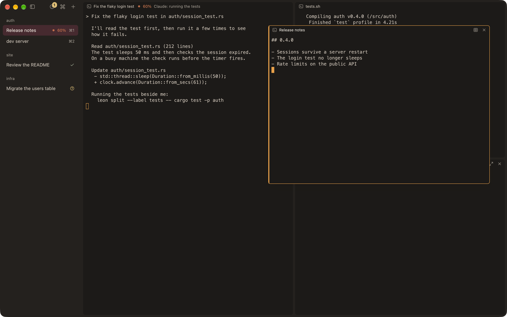
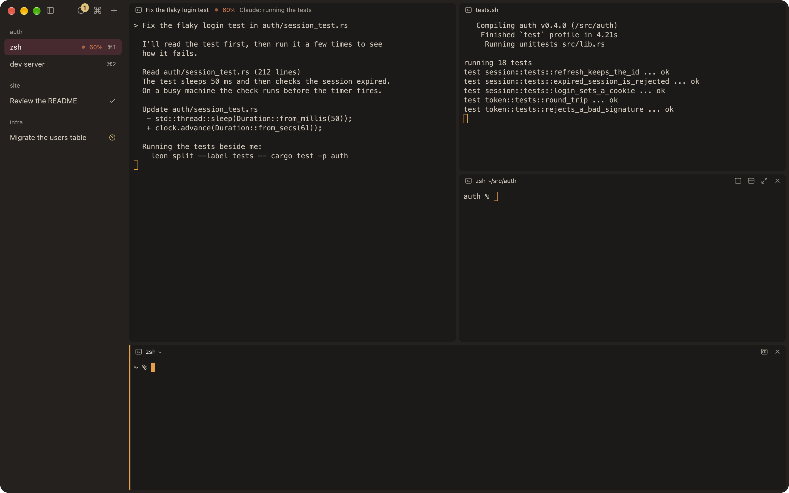

# Floats and drawers in the app

Part of [docs/architecture.md](../architecture.md). The model, server methods, CLI, Lua and
`leon attach` side (M20a) is in [Protocol and clients](protocol-and-clients.md); this is how the
app draws and moves them (M20b).

- **One copy of the overlays.** The shared client (`leon_app::remote`) keeps each window's
  `floating` and `docked` from `session.view` in `Session::overlays` (by window id), and each
  block's label. It reads only the fields it knows, since a newer server may add some and the
  core types refuse unknown ones, and a window whose placements fail `Overlays::check` (a float
  outside the window, a size past 1) gets none, so a remote server can't hand the layout NaN or
  off-screen rects. `leon attach` reads the same copy; it no longer fetches the view itself. The
  input target (`floats::target`: a focused overlay, even over a zoomed tile, else the zoomed
  tile, else the focused one) is shared by both.
- **Geometry** (`leon_app::floats`, GPUI-free). Visible drawers take their side's share of the
  pane area in list order, each clamped to what is left; the tiles are laid out in the rest; the
  channel between a drawer and the tiles is its divider. Floats sit at their bounds of the whole
  pane area, back to front. `Placed::hit` gives the topmost float under a point, then a drawer;
  the app uses it so cmd-hover over a float finds the float's grid, not the tile under it (GPUI's
  `occlude` already keeps clicks off the tiles below).
- **Drawing.** A float or drawer is the same tile as a pane (header with title, host and status;
  terminal; find bar), always with its header. Its header controls are unfloat and close instead
  of split and zoom. Floats get a 1 px border (Amber when focused, else the border colour) and a
  shadow, and are drawn after the drawers in z-order. A click focuses the pane under it
  (`session.focus_block`, which raises a float).
- **Dragging.** A float's header moves it, its edges and corners resize it (never under
  160×80 px, never out of the window), and a drawer's divider sets its size (0.05–0.95). Each
  step that changes the placement is one call, like a divider drag: `session.float_block` with
  the new bounds, or `session.dock_block` with the drawer's own side and new size. So the CLI and
  attach see the drag as it happens. `dock_block` on a drawer's own side keeps its place in the
  dock list (which decides the drawer that spans a corner); another side still moves it to the end.
- **Slides.** When a drawer of the active window is shown or hidden (`leon toggle`, ⌘J, the
  switcher), it slides from or to its edge over 120 ms, eased out. The tiles take their new size
  at once and the drawer is only translated, so its PTY is never resized mid-slide; one hiding
  stays drawn (and watched) until its slide ends. With Reduce Motion
  (`accessibilityDisplayShouldReduceMotion`) nothing slides. A tab seen the first time slides
  nothing, so opening the app is still.
- **Actions.** `pane.float`, `pane.new_floating`, `pane.unfloat`, `pane.scratch.toggle` (the
  `scratch` drawer, made on first use) and `pane.dock.left|right|bottom` are the app's own, in the
  palette and `leon actions`, with default keys in the README. Not yet: `pane.minimize_floating`,
  since hiding a float without a label needs a server method.
- **Going there.** The switcher lists every float and drawer as a block row (by label, else
  title, else program; `· hidden` when hidden). Going to one, or to an Activity row, is
  `session.focus_block`, which shows and raises a hidden overlay first.
