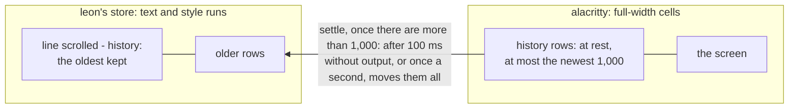

# Scrollback: alacritty's rows and leon's store

How a terminal keeps its history (`crates/leon-core/src/terminal_history.rs`). The numbering
clients see is in [Protocol and clients](protocol-and-clients.md), "Scrollback in the app".

A row keeps its line number when it moves, and `history` counts the rows on both sides.

- **Why a store.** alacritty keeps every history row at the pane's full width, 24 bytes a cell:
  10,000 lines at 80 columns hold 19.7 MB whatever they say, 48 MB at 200 columns. leon moves
  history into a store of its own, as each row's characters and runs of style (colours and flags,
  12 bytes a run, none for a row in the default style), with alacritty's own `CellExtra`
  (combining marks, underline colour, OSC 8 link) kept for the few cells that have one. A line of
  70 characters with a few colours costs about 170 bytes instead of 1,920: 10,000 such lines cost
  2.2 MB (`b1_store_memory.rs` counts it). Without a fork: rows are read through `Term::grid()`
  and dropped with `Grid::update_history`.
- **When rows move.** While output streams, alacritty keeps its rows as it does alone, so `cat`
  of a big file runs as fast as before: copying every row as it scrolls cost a one-character line
  seven times its parse. When output pauses for 100 ms, and at least once a second while it
  streams, `Store::settle` moves alacritty's history into the store once it holds more than
  `WINDOW` (1,000) rows. It moves all of it: alacritty's storage grows 1,000 rows at a time and
  only shrinks when more than 1,000 rows are dropped at once, so leaving 1,000 behind would keep
  2,000 allocated. So at rest alacritty holds the newest 1,000 rows at most (none just after a
  burst), and the store the rest. Only rows the cap keeps are copied.
- **Why nothing is lost.** alacritty's limit is the `scrollback` cap, so a row it drops as a burst
  scrolls (a synchronized update applies up to 2 MiB at once) is one the cap drops too; the store,
  older still, is emptied then. `counting` sees alacritty's limit reached and moves the count by
  `GAP`, past any number a client keeps.
- **Numbering.** The store's lines are numbered just above alacritty's oldest: line
  `scrolled - history` is the store's oldest, and `history` counts both. A row keeps its number as
  it moves, so nothing a client holds (its cache, a selection, a find result) changes. `lines`
  reads a range across both; `text` (`capture`, persistence, `leon attach`) is the store's text
  then alacritty's.
- **The alternate screen.** It has no history, as before: nothing moves while it shows (alacritty's
  primary grid is out of reach then), `history` is 0 and `text` is that screen alone.
- **Clears.** A slice of output ends at a history clear, so the screen showing after it is the one
  it cleared. `ESC c` resets both screens and clears the store; `CSI 3 J` (any leading zeros,
  further parameters ignored, as vte reads it) clears the store when it ran on the primary screen.
- **Resize.** alacritty re-wraps its own rows (at most the newest 1,000), within the cap like any
  push; the store's are never re-wrapped. A narrower pane cuts a stored row at its edge in `lines`
  (`text` keeps it whole); a wider one shows it as it was.
- **A taller or wider pane.** alacritty fills the rows a resize adds, and the rows its reflow
  joins on a widening, only from its own history, which at rest holds few rows or none. When it
  holds too few, `Store::lend` moves all of it into the store and then the store's newest lines
  back to it: whole lines, at least the rows added and, on a widening, the new height in lines
  (each is at least a row at the new width), at most the cap. It writes them through
  `Grid::scroll_up` (the screen put back from a copy), and alacritty's grow and reflow do the rest,
  as alone: what the pane shows doesn't depend on whether output paused. A line goes back wrapped
  at the pane's width, as alacritty's reflow wraps it; one stored at that width comes back row for
  row, keeping its numbers, while one stored at another width can take more or fewer rows, which
  moves the older lines' numbers, as alacritty's own reflow does. A resize's numbers are
  alacritty's alone, as before (`scrolled` stays at least `history`; a client starts over on a new
  size). `b1_store_grow.rs` compares each case with alacritty keeping the whole history.
- **The cap.** `leon.set("scrollback", N)` (0 to 100,000, default 10,000) caps the store and
  alacritty's rows together. The server applies it to every terminal on a reload and to each new
  one (a restored block's saved text included), and a lower value drops the oldest lines at once;
  on the alternate screen, the primary screen's rows in alacritty only when it shows again.
- **Cost.** A stored cell is its character (1 to 4 bytes); a 12-byte run per style change and a
  16-byte entry per cell with a mark or a link come on top. Ordinary text is about 2 bytes a cell;
  output that changes style and stacks a mark on every cell, the worst case, about 32, more than
  alacritty's 24 (still bounded by the cap times the width).
- **Find, selection and links** (`terminal_scratch.rs`) run alacritty's own code on the store's
  lines: those lines, and alacritty's rows where a range runs on into them, are copied into a plain
  alacritty grid as wide as the pane (a scratch) at most 1,000 rows at a time, cut where a logical
  line ends. Find searches the store a scratch at a time, then alacritty's rows, with one limit and
  one CPU budget. A selection's ends are widened (words, lines, half a wide character, a bracket's
  match within a few hundred lines) on a scratch around each, and its text is copied a scratch at a
  time, so a select-all of 100,000 lines holds one scratch. A link is read on a scratch of its line.
  With both ends in alacritty's rows nothing is copied. Tests compare each with alacritty alone
  keeping the whole history.
- **Known limits.** A stored tab is shown in `text` with alacritty's default 8-column stops (a
  program's own, set with HTS, aren't readable from outside). The underline colour is kept but not
  drawn, as before. A scratch is as wide as the pane: a stored row wider than it is cut (as `lines`
  shows it), and one that wrapped at a narrower width copies with a newline where it wrapped then.
  A logical line longer than a scratch (1,000 rows) is cut there for find and copying, and a
  regular expression that would match across two lines may miss where a scratch ends.
