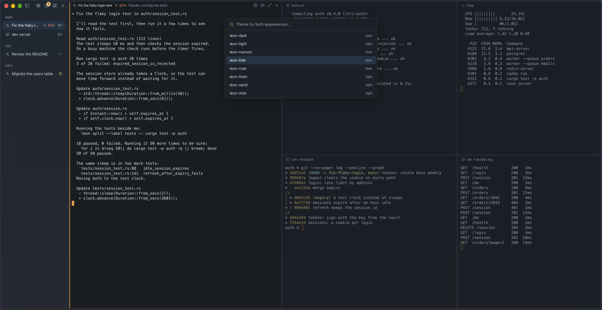

# CLI: config and themes

Part of the [command reference](../cli.md): the settings in init.lua and the colour themes they
name.

## Config

### `leon config`

Check or reload the Lua config (`init.lua`), and get or set its settings.

### `leon config check [PATH]`

Load a config without applying it: print counts and diagnostics, exit 1 if it fails or any
`leon.*` call was skipped. Needs no server. The default path is `$LEON_CONFIG`, else
`$XDG_CONFIG_HOME/leon/init.lua`, else `~/.config/leon/init.lua`. With `cursor_shader` set it
also translates that file and prints `cursor_shader: PATH: ok`, or the shader's error with its
line, an error too ([cursor-shaders.md](../cursor-shaders.md)); off macOS it says cursor shaders
are macOS only for now.

### `leon config reload`

Re-read the config on the server. A failed load keeps the last good one and exits 1.

```sh
leon config check
leon config check ./init.lua
leon config reload
```

### `leon config get [KEY]`

Print a setting as init.lua leaves it (its `leon.set` call, else the default), or every setting
and where each is set without KEY. Needs no server. The keys are `theme`, `font.family`,
`font.size`, `notifications.done`, `notifications.blocked`, `notifications.error`,
`copy_on_select`, `link_card`, `repeat_time`, `hint_patterns`, `resume`, `fade_inactive_panes`, `check_for_updates`, `translucency`, `serve_tailscale`,
`serve_tailscale_port`, `serve_tailscale_tags`, `cursor_shader`, `cursor_shader_duration` and `serve_web` ([docs/lua/settings.md](../lua/settings.md#settings) has what each does). With `--json`
the value is JSON.

### `leon config set KEY VALUE`

Set a setting in init.lua and keep the rest of the file: the value in the `leon.set("KEY", …)`
call that set it last is replaced, comments and all else left as they were, and a key not set yet
gets a `leon.set` line at the end (a missing init.lua is created). A running server reloads the
file. `theme` takes a NAME, or `dark=NAME,light=NAME` to follow the OS appearance; the booleans take
`true` or `false`; `hint_patterns` a JSON list of strings.

It refuses (exit 1, the file untouched) a value the setting doesn't take, and a key set by code it
can't rewrite: a call whose key or value isn't a literal (a variable, `"font." .. k`), or one in a
file `require` loaded. The message names the `file:line` to change by hand. The edited text is
loaded before it replaces the file; a symlinked init.lua stays a symlink.

```sh
leon config get
leon config get font.size
leon config set font.size 15
leon config set theme dark=leon-dark,light=leon-light
leon config set notifications.done false
```

## Themes

A theme is the terminal's 16 colours, background, foreground, cursor and selection, plus the app's
colours around the panes and the status colours. leon has eight built in, made for it from its
brand palette: `leon-dark` and `leon-light`, the dark `leon-maroon` (warm), `leon-tide` (cool) and
`leon-coal` (high contrast), and the light `leon-linen` (paper), `leon-sand` (soft) and
`leon-mist` (cool). Each keeps body text at 4.5:1 or better on its background, as do its ANSI
colours (1–6 and 9–14). Imported ones live as files in `themes/` beside init.lua (by default
`~/.config/leon/themes/NAME.theme`), in Ghostty's `key = value` syntax with leon's own colours
added. `leon config set theme NAME` picks one, and a running app draws with it within a second:
the panes, the window around them and the status colours. With `dark=A,light=B` the app switches when macOS
does. The app's Settings window (⌘,) sets the theme, font, notifications and copy on select the
same way: each change goes through `leon config set`'s code into init.lua, and a setting init.lua
sets by code it can't rewrite shows read-only there, with the message above.

The command palette's **Change Theme…** (⌘⇧T, the action `client.theme.change`) lists every theme,
built in and imported. The selected one draws the whole window as you move through the list; ↩
keeps it and esc goes back to the one you had. ↩ writes init.lua's `theme` the same way: when it
names one theme for both appearances, the new one is set for both; when it names a pair, only the
side macOS is on now changes (the list's field says which). A theme change fades in over a moment,
or switches at once with Reduce Motion.



### `leon theme`

List, import and show themes. Needs no server.

### `leon theme list`

Print each theme's name and whether it is dark or light, the built-in ones first.

### `leon theme import FILE [--name NAME]`

Read a Ghostty theme file or an iTerm2 `.itermcolors` file (an XML plist; convert a binary one with
`plutil -convert xml1`) and store it as a leon theme. `--name` names it; the default is the file's
name, less `.itermcolors` or `.theme`. The app's colours around the panes are mixed from the theme's
background and foreground, and the status colours come from `leon-dark` or `leon-light`, whichever
matches. A file that isn't a theme exits 1 with what is wrong and on which line, as does a name
that is taken (remove the old file first), built in, or not a plain file name.

### `leon theme show NAME`

Print a theme's colours as a leon theme file (`--json`: an object of `#rrggbb` strings).

```sh
leon theme list
leon theme import ~/Downloads/Harbor.itermcolors --name harbor
leon theme show leon-light
leon config set theme harbor
```
