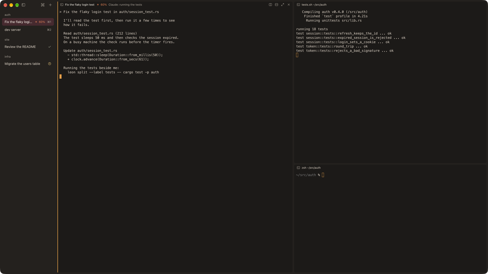
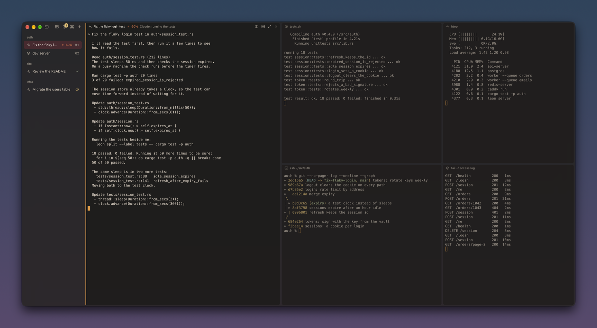
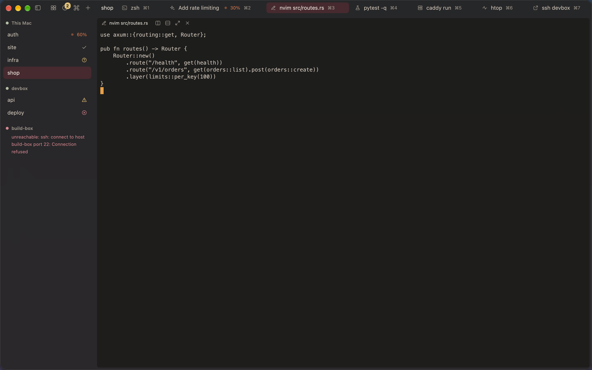

<!-- i18n: source=README.md commit=14af788efc95 -->
> これは翻訳です。[英語のページ](../../../README.md)が正式な内容で、こちらより新しい場合があります。

# leon

[English](../../../README.md) · [简体中文](../zh-CN/README.md) · 日本語 · [한국어](../ko/README.md) · [Español](../es/README.md) · [Português (Brasil)](../pt-BR/README.md)

<p align="center"></p>

**leon は、複数のターミナルプログラムやコーディングエージェントを同時に動かす人のためのターミナルマルチプレクサーです。** サーバーがセッション、タブ、分割したペイン、そしてその中のプログラムを動かし続けます。操作はネイティブの macOS アプリ、どのターミナルでも使える `leon` コマンド、Lua スクリプト、またはコーディングエージェントから行います。エージェントは自分の隣にペインを開き、そこでテストを実行して結果を読めます。プログラムは作業中・対応待ち・完了といった状態を報告できるので、どれに対応が必要かがわかります。macOS と Linux で動作し（アプリは今のところ macOS のみ）、Rust で書かれています。


## 機能

- **消えないレイアウト。** アプリを終了してもプログラムは動き続けます。ウィンドウを閉じても ⌘Q でもデタッチするだけで、再び開くと同じセッション、タブ、分割、ライブの画面に戻ります。サーバー自体が止まると、セッション、タブ、分割、各ペインのディレクトリが保存され、次の起動時にスクリプトで使うのと同じ ID で戻ります（中のプログラムは戻りません）。
- **`leon` コマンド。** `leon run`、`send`、`capture`、`wait` で、ペインを開き、入力し、画面を読み、プログラムを待ちます。終了コードは決まっていて、`--json` 出力もあります。`leon attach` はどのターミナルにも、ssh 越しでも、セッションを表示します。
- **macOS アプリ。** サイドバーまたはタイトルバーのタブ、分割、フローティングペイン、スクラッチドロワー（scratch drawer）、コマンドパレット、セッションスイッチャー、検索とコピーモードのあるスクロールバック、8 つのテーマ。
- **エージェント。** `leon skill setup` で Claude Code と Codex に自分の隣のペインで作業する方法を教えます。再起動後には、それぞれのペインが同じ会話の再開を提案します。
- **状態と通知。** OSC 7501 のレポートを書くプログラム（エージェントは書きます）の状態は、タブとペインに表示されます。アクティビティ（Activity）一覧、Dock のバッジ、通知で、何が対応待ちか、失敗したか、終わったかがわかります。
- **リモートホスト。** `-H devbox` で、自分の `ssh` を通して別のマシンの leon サーバーを操作します。アプリは各ホストのセッションを自分のものと並べて表示します。
- **Lua。** キーバインド、モード、独自のアクション、イベントに反応するスクリプト。
- **API。** すべてのクライアントは同じソケット API を使います。API は自己記述的で（`leon api list`）、独自のクライアントを書く人のための互換性の約束があります。

## インストール

### Homebrew

```sh
brew install --cask aindong/leon/leon   # macOS: Leon.app, with the leon command
brew install aindong/leon/leon          # the CLI alone, on macOS or Linux
```

どちらか一方を選んでください。cask の `leon` はアプリに入っているものです。新しいリリースは `brew upgrade` で入ります。Leon.app は Apple の公証を受けていないため、Homebrew がダウンロードに付ける隔離フラグがある間、macOS はアプリを開きません。cask のインストール後、アプリを開く前にフラグを外してください:

```sh
xattr -dr com.apple.quarantine /Applications/Leon.app
```

### リリースから

各リリースは <https://github.com/aindong/leon-cli/releases/latest> にあります: `Leon-<version>-macos-<arch>.zip`（Leon.app）、macOS と Linux 向けの CLI の tarball、そして `.deb` で、それぞれ arm64 と x86_64 があります。macOS では、アプリを `/Applications` に展開してから上の `xattr` コマンドを実行します（ブラウザでダウンロードしたファイルも隔離されます）。その前に開くと macOS は拒否します（Leon にマルウェアがないことを確認できない、と表示）。コマンドを実行して開き直してください。macOS 向けの CLI の tarball も、中の `leon` にフラグを付けたまま展開されます。展開後、そのフォルダーに `xattr -dr com.apple.quarantine` を実行してください。Linux では、お使いのマシン向けのファイルをダウンロードしてから:

```sh
dpkg -i leon_*.deb                               # Debian or Ubuntu, as root
tar xzf leon-*-linux.tar.gz -C ~/.local          # anywhere else: unpack it,
ln -s ~/.local/leon-*-linux/leon ~/.local/bin/   # and put its leon on your PATH
```

すべてのファイルには署名があります。確認方法は [docs/releases.md](../../releases.md#checking-a-download) にあります。

### アップデート

```sh
leon self-update --check   # is there a newer release?
leon self-update           # download it, check its signature, and replace this leon
```

leon は求められたときだけアップデートし、何かをインストールする前にリリースの署名を確認します。Homebrew で入れた leon は `brew upgrade` で、`.deb` で入れたものは新しい `.deb` をインストールしてアップデートします。どちらかは `leon self-update` が教えてくれます。動作中のサーバーは `leon server stop` するまで古いバージョンのままです。詳しくは [docs/updates.md](../../updates.md) を参照してください。

### ソースから

leon を自分でビルドするには、macOS では `scripts/install.sh`、Linux では `cargo` を使います。手順とリリースに含まれるファイルは [docs/install.md](install.md) にあります。

## 最初の5つのコマンド

どのターミナルからでもできる 2 分間のクイックスタートです（サーバーは自動で起動します）。Python は、操作したい任意のプログラムの代役です:

```sh
leon new demo                                    # 1. a session called "demo"
leon -s demo run --label py -- python3 -q        # 2. run a program in a new tab
leon -s demo wait -b py --text '>>>'             #    and wait for its prompt
leon -s demo send -b py 'print(6 * 7)'           # 3. type into it (no Enter yet)
leon -s demo send-key -b py enter                # 4. press Enter
leon -s demo wait -b py --text 42                #    and wait for the answer
leon -s demo capture -b py --trim                # 5. read its screen: 42
```

ターゲット（`-s` はセッション、`-b` はブロック。ブロックは leon でのペインの呼び名）には、ID、ラベル、位置、ID の末尾を指定します。leon のターミナルの中では `-s` を省略でき、コマンドは自分のセッションに対して動きます。`leon ls` はセッションの一覧を、`leon --help` はすべてを表示し、終了コードは一番下にあります。

## 分割する

```sh
leon -s demo split -b py --split below --ratio 30 -- top     # a pane under py, 30% high
leon -s demo focus up
leon -s demo zoom                                            # fill the window; again to undo
```

アプリでは、⌘D で右に、⌘⇧D で下に分割し、⌘⌥ と矢印キーでペイン間を移動し、区切り線のドラッグでサイズを変えます。`leon attach demo` はこのターミナルにセッションを表示します（ctrl+b d でデタッチ）。終わったら、`leon kill demo` でセッションとその中のプログラムを終了します。

## どのターミナルでも：`leon attach`

```text
leon attach                  # pick a session, tab or block (type to filter), Enter attaches
leon attach demo             # straight to the session "demo"
ssh -t box leon attach       # the same, on another machine's leon
```

`leon attach` はタブの分割ペインとステータスバーを表示し、キー入力をフォーカスのあるペインに送ります。プレフィックス ctrl+b のあとに（変更するには `--prefix` か設定の `leon.mode("attach", { prefix })`）:

| キー | 動作 |
|---|---|
| ctrl+b d | デタッチ。すべてのプログラムは動き続けます |
| ctrl+b ←↑↓→, ctrl+b h/j/k/l | その方向のペインにフォーカス |
| ctrl+b %, ctrl+b " | 右に分割、下に分割 |
| ctrl+b z | ペインをズーム（もう一度で元に戻す） |
| ctrl+b c | 新しいタブ |
| ctrl+b n, ctrl+b p | 次のタブ、前のタブ |
| ctrl+b s | ピッカーに戻る |

`init.lua` のキーバインドもここで使えます。ただし `cmd` キー（ターミナルからは送られてきません）と、プレフィックスキーそのものへのバインドは除きます。

## 開発マシンで作業する

サーバーと通信するコマンドは `-H` を付けると、自分の `ssh` を通して別のマシンの leon サーバーを操作します（アカウントもリレーも VPN も不要です。`~/.ssh/config` や `ProxyJump` も使えます）。相手のマシンでは `leon` を PATH か `~/.local/bin` に置いてください。そこで最初に実行したコマンドがサーバーを起動し、接続を切ってもプログラムは動き続けます。

```text
leon hosts add devbox ssh://me@devbox.example.com
leon -H devbox run -c /home/me/app -- make test   # runs on the devbox, in its /home/me/app
leon -H devbox attach               # its sessions, in this terminal
leon hosts check
leon hosts add --tailscale          # from your tailnet (Tailscale SSH: no keys)
```

接続が切れたときのこと、切れている間に打ったキー、アプリのサイドバーに並ぶホストについては [docs/remote-hosts.md](remote-hosts.md) にあります。


## エージェントに操作させる

```sh
leon skill setup
```

これで Claude Code と Codex に、スキルとセッション開始フックがインストールされます（設定ディレクトリがあるか、プログラムが PATH にあるものが対象で、どれに入れたかと理由が表示されます）。あとは leon のターミナルで「隣でテストを実行して」と頼めば、エージェントはあなたと同じことをします:

```sh
id=$(leon split --label tests --keep-open -- cargo test)
leon wait "$id"
leon capture -b "$id" --trim | tail -20
leon block close "$id"
```

エージェントは `LEON_SESSION` と `LEON_BLOCK` から自分の居場所を知り、開いたものにはラベルを付け、自分で作ったものだけを閉じます。[docs/agents.md](agents.md) を参照してください。

## 対応が必要なものを知る

プログラムは自分が何をしているか（作業中、対応待ち、完了）を報告し、アプリはそれを 2 か所に表示します。タブの行には記号が、ペインのヘッダーには記号とプログラム自身の言葉が出ます。



タブにペインが複数あるとき、フォーカスしていないペインは薄くなり、視線がフォーカス中のペインにとどまります。あなたが待っているものは薄くなりません。状態の記号は色を保ち、最後に見たあとで対応待ち・失敗・完了になったペインは元の濃さのままです。`leon.set("fade_inactive_panes", N)` で 0（オフ）から 0.8 の間で設定できます（デフォルトは 0.35）。

ウィンドウは半透明でテーマの色が付き、どんなデスクトップの上でも文字が読みやすくなっています。`leon.set("translucency", 0)` で不透明になります。



タブ、サイドバーの行、ペインのヘッダーには、中のプログラムを表すアイコンが付きます: エージェント、エディター、テスト、サーバー、モニター、ssh、シェル。



⌘K は、どのホストのどのセッション、タブ、ブロックにも切り替えます（最近使ったものが先）。⌘⇧A は対応が必要なものを一覧にします: 対応待ち（何を待っているかも表示）、エラー、まだ見ていない完了した実行、進行中の作業の順です。ツールバーのボタンと Dock には、対応待ちのブロックの数が表示されます。Leon.app は、ブロックが対応待ちになったり失敗したりしたとき、また別のアプリを使っている間に 30 秒以上の実行が終わったときにも通知を送り、クリックするとそのペインに移動します。OSC 7501 を出力できないツールは、`leon notify` で自分のブロックの状態を報告できます:

```text
leon notify --state blocked --title "Deploy" --body "approve the rollout?"
```


## アプリのショートカット

⌘N から ⌘Q まで、アプリのすべてのキーと変更方法は [docs/shortcuts.md](shortcuts.md) にあります。


## 設定

leon は `~/.config/leon/init.lua`（または `$LEON_CONFIG`）を読みます。設定には専用のコマンドがあり、アプリの設定ウィンドウ（Settings、⌘,）も同じファイルに書き込みます:

```sh
leon config set font.size 15
leon config set theme dark=leon-dark,light=leon-light
leon theme list
leon config check
```

同じファイルでキーバインド、モード、独自のアクションを定義し、`leon do` でスクリプトを実行します:

```lua
leon.action{
  name = "name_session",
  title = "Name this session",
  args = { label = "string" },
  run = function(ctx, args) return leon.session.set_label{ label = args.label } end,
}
```

```sh
leon config reload
leon do name_session label=api
leon do -e 'print(#leon.session.view().windows .. " tabs")'
```

`leon theme import FILE` で別のターミナルのテーマを取り込めます。[docs/lua.md](lua.md) と [docs/cli/settings.md](../../cli/settings.md) を参照してください。

## ロードマップ

leon 0.1.0 が最初のリリースです。マイルストーンごとの実装済みの内容は [docs/roadmap.md](../../roadmap.md) と [CHANGELOG.md](../../../CHANGELOG.md) にあります。次に来るもの:

- **Linux のアプリ。** Linux にはサーバー、CLI、`leon attach`、エージェント、Lua があります。GPUI アプリは今のところ macOS のみです。
- **1 つのタブに 2 つのクライアント。** アプリと `leon attach` が同じタブを表示しているとき、各ペインは最後にレイアウトを変えたクライアントのサイズになり、もう一方はそれを切り詰めるか余白で埋めます。
- **紛らわしいリンクのホスト名。** ⌘ クリックは `http(s)` のリンクを確認なしで開きます。ホスト名が別のホスト名に似た非 ASCII 文字を使っていてもそうです。アドレスを先に表示するのは、ほかの種類のリンクだけです。
- **`codex exec` の実行。** leon は単発の `claude -p` の実行を対話型のエージェントと区別できますが、`codex exec` の実行はまだ区別できず、対話型セッション向けの再開が提案されることがあります。

## ドキュメント

- [docs/cli.md](cli.md): すべてのコマンドとフラグ。
- [docs/lua.md](lua.md): 設定とスクリプト。例はテストで実行されます。
- [docs/agents.md](agents.md): leon を操作するエージェントと、OSC 7501 の状態フォーマット。
- [docs/recipes.md](recipes.md): Lua のレシピとしての、プロジェクトと git worktree のセッション。
- [docs/integrators.md](../../integrators.md): 任意の言語で leon のソケット API のクライアントを書く方法と、互換性の約束。[docs/api.md](../../api.md): すべてのメソッド。
- [docs/architecture.md](../../architecture.md): どのように作られているか。[docs/performance.md](../../performance.md): 実測したコスト。
- [docs/releases.md](../../releases.md): リリースの作り方と署名、マニフェストのフォーマット。
- [CHANGELOG.md](../../../CHANGELOG.md): 変更履歴。

## ビルドとテスト

```sh
cargo build
cargo test
cargo clippy --all-targets -- -D warnings
cargo fmt --check
```

GPUI は `runtime_shaders` フィーチャー付きでビルドされるため、Xcode の Metal ツールチェーンは不要です。ターミナルのテストは PTY で本物のシェルを動かし、ドキュメントのテストはこれらのドキュメントのコマンドを実行します。`scripts/linux-test.sh` は、アプリ以外のすべてのテストを Docker 上の Linux で実行します。リリースのテストは使い捨ての鍵で署名するため、`minisign` と `jq` が必要です。

## コントリビュート

バグ報告、アイデア、コード、翻訳を歓迎します。[CONTRIBUTING.md](../../../CONTRIBUTING.md) には環境の準備、ルール、変更が取り込まれるまでの流れが、[docs/i18n/README.md](../README.md) には README とガイドの翻訳方法があります。参加する人は全員[行動規範](../../../CODE_OF_CONDUCT.md)に従います。セキュリティの問題は、[SECURITY.md](../../../SECURITY.md) のとおり非公開で報告してください。

## ライセンス

[MIT](../../../LICENSE)。`brand/fonts` にある Instrument Sans フォントは [SIL Open Font License](../../../brand/fonts/OFL.txt) の下で提供されています。
