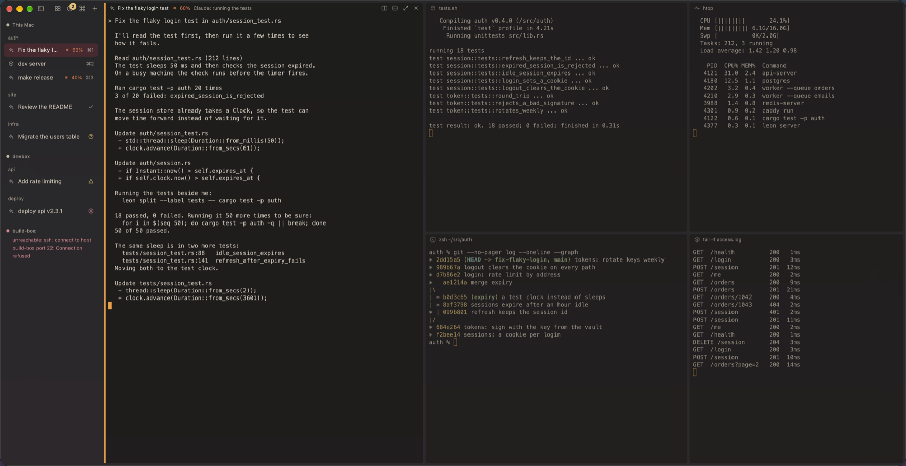

<!-- i18n: source=docs/remote-hosts.md commit=28ab3cd4a46d -->
> これは翻訳です。[英語のページ](../../remote-hosts.md)が正式な内容で、こちらより新しい場合があります。

# リモートホスト

leon が別のマシンの leon サーバーとどう連携するかを、[README](README.md#開発マシンで作業する) の最初の手順の続きとして説明します。コマンドは [cli/hosts.md](../../cli/hosts.md) にあります。

Wi-Fi が切れた接続は 1 分間再試行されます。`leon events` とアプリは、イベントを失うことも繰り返すこともなく再開し、`leon attach` はそのことを表示してから再接続し、画面を描き直します。接続が止まっている間や切れている間に打ったキーは、すべて届くか、まったく届かないかのどちらかで、ステータスバーには送られなかったキーの数が表示されます（止まり始めた瞬間に送ったキーは届くことがあります）。ssh の鍵か ssh エージェントを使ってください。接続ごとに別々の ssh セッションになります。

アプリは `leon hosts` のすべてのホストを、サイドバーの「このMac（This Mac）」の下に表示します。各ホストにはセッションとタブ、そして接続状態を示す点が付きます。リモートのペインはローカルのペインと同じように使え、ヘッダーにホスト名が表示されます。新しいセッション（New Session）、新しいタブ（New Tab）、分割は、フォーカス中のペインがあるマシンに対して動きます。コマンドパレットには、マシンごとの新しいセッションと、ホストを追加（Add Host…）（tailnet のマシン、またはラベルを入力してから `ssh://` のエンドポイント）があります。ホストのラベルをクリックすると折りたためます。アプリの ssh はパスワードを尋ねません。パスワードが必要なホストは `needs login: run leon hosts check devbox in a terminal` と表示します。一度それを実行すれば（ホスト鍵を受け入れ、鍵のロックを解除する）、アプリの次の試行で接続できます。接続が切れている間、そのホストのペインは最後の画面を表示したまま、「reconnecting」の注記が付きます。

