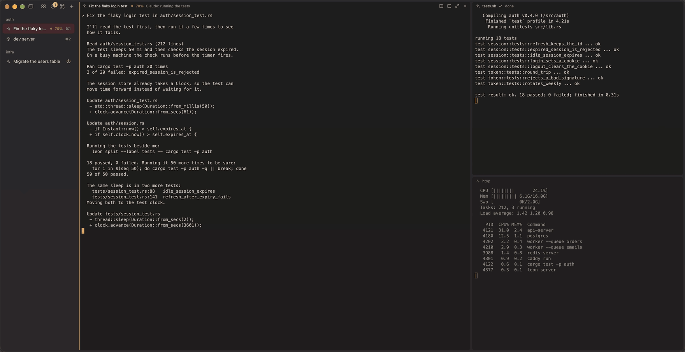
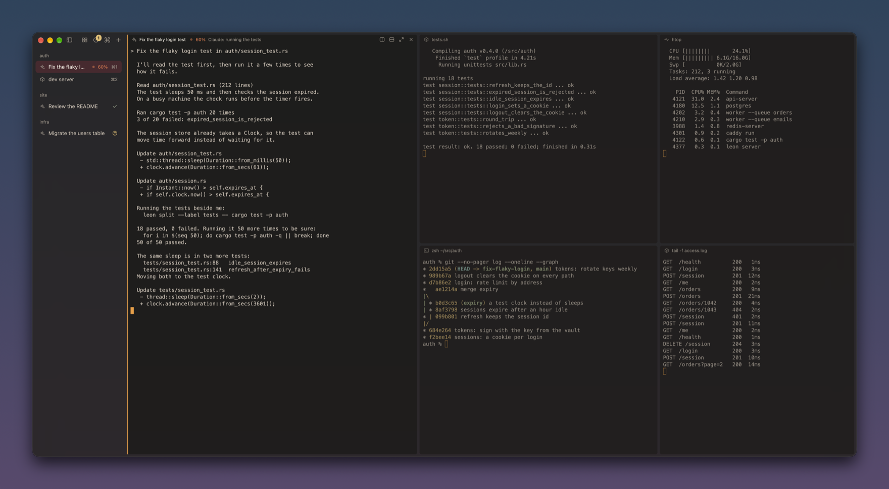
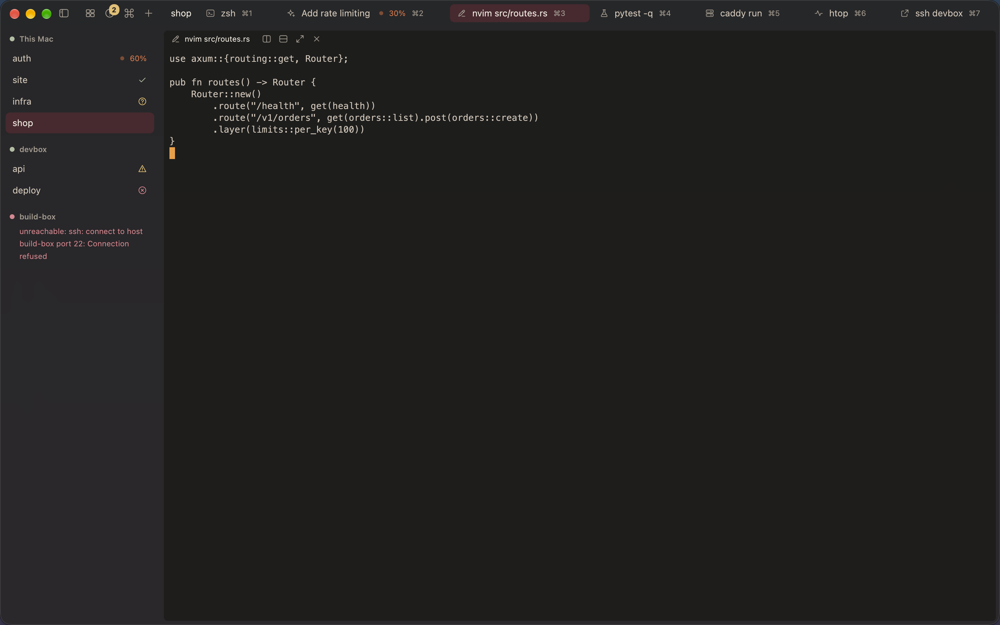

<!-- i18n: source=README.md commit=28ab3cd4a46d -->
> 이 문서는 번역본입니다. 기준은 [영어 문서](../../../README.md)이며, 영어 문서가 더 최신일 수 있습니다.

# leon

[English](../../../README.md) · [简体中文](../zh-CN/README.md) · [日本語](../ja/README.md) · 한국어 · [Español](../es/README.md) · [Português (Brasil)](../pt-BR/README.md)

<p align="center"></p>

**leon은 여러 터미널 프로그램과 코딩 에이전트를 한꺼번에 실행하는 사람을 위한 터미널 멀티플렉서입니다.** 서버가 세션, 탭, 분할된 페인과 그 안의 프로그램을 계속 실행해 둡니다. 이것들은 네이티브 macOS 앱, 어느 터미널에서나 쓰는 `leon` 명령, Lua 스크립트, 또는 코딩 에이전트를 통해 다룰 수 있습니다. 에이전트는 자기 옆에 페인을 열고 거기서 테스트를 실행한 뒤 결과를 읽을 수 있습니다. 프로그램은 작업 중인지, 응답을 기다리는지, 끝났는지를 알릴 수 있어서 어느 것이 내 확인을 기다리는지 한눈에 보입니다. macOS와 Linux에서 실행되며(앱은 현재 macOS 전용), Rust로 작성되었습니다.




## 기능

- **유지되는 레이아웃.** 앱을 종료해도 프로그램은 계속 실행됩니다. 창을 닫거나 ⌘Q를 눌러도 분리(detach)될 뿐이며, 앱을 다시 열면 같은 세션, 탭, 분할, 실시간 화면으로 돌아옵니다. 서버 자체가 멈추면 세션, 탭, 분할, 각 페인의 디렉터리가 저장되었다가 다음 시작 때 스크립트에서 쓰던 것과 같은 ID로 돌아옵니다(그 안의 프로그램은 돌아오지 않습니다).
- **`leon` 명령.** `leon run`, `send`, `capture`, `wait`로 페인을 열고, 입력하고, 화면을 읽고, 프로그램을 기다립니다. 종료 코드가 정해져 있고 `--json` 출력도 지원합니다. `leon attach`는 어느 터미널에서나, ssh를 통해서도 세션을 보여 줍니다.
- **macOS 앱.** 사이드바 또는 제목 표시줄 탭, 분할, 플로팅 페인, 스크래치 드로어(scratch drawer), 명령 팔레트, 세션 전환기, 찾기와 복사 모드를 갖춘 스크롤백, 그리고 여덟 가지 테마.
- **에이전트.** `leon skill setup`은 Claude Code와 Codex에 자기 옆 페인에서 일하는 법을 알려 주고, 재시작 후에는 그 페인들이 같은 대화를 이어 가자고 제안합니다.
- **상태와 알림.** OSC 7501 보고를 출력하는 프로그램(에이전트는 출력합니다)은 그 상태가 탭과 페인에 표시됩니다. 활동(Activity) 목록, Dock 배지, 알림이 무엇이 응답을 기다리는지, 실패했는지, 끝났는지 알려 줍니다.
- **원격 호스트.** `-H devbox`는 내 `ssh`를 통해 다른 머신의 leon 서버를 다루며, 앱은 각 호스트의 세션을 내 세션 옆에 보여 줍니다.
- **Lua.** 키 바인딩, 모드, 직접 만든 액션, 그리고 이벤트에 반응하는 스크립트.
- **API.** 모든 클라이언트는 같은 소켓 API를 사용합니다. 이 API는 스스로를 설명하며(`leon api list`), 직접 클라이언트를 만드는 사람을 위한 호환성 약속이 있습니다.

## 설치

### Homebrew

```sh
brew install --cask aindong/leon/leon   # macOS: Leon.app, with the leon command
brew install aindong/leon/leon          # the CLI alone, on macOS or Linux
```

둘 중 하나만 고르세요. cask의 `leon`은 앱 안에 들어 있는 것입니다. 새 릴리스는 `brew upgrade`로 받습니다. Leon.app은 Apple의 공증을 받지 않았기 때문에, Homebrew가 다운로드에 붙이는 격리 플래그가 남아 있는 동안 macOS는 앱을 열지 않습니다. cask 설치가 끝나면 앱을 열기 전에 플래그를 제거하세요.

```sh
xattr -dr com.apple.quarantine /Applications/Leon.app
```

### 릴리스에서 설치

각 릴리스는 <https://github.com/aindong/leon-cli/releases/latest>에 있습니다. `Leon-<version>-macos-<arch>.zip`(Leon.app), macOS용과 Linux용 CLI tarball, 그리고 `.deb`가 있으며, 각각 arm64와 x86_64용이 있습니다. macOS에서는 앱을 `/Applications`에 압축 해제한 뒤 위의 `xattr` 명령을 실행합니다(브라우저로 받은 파일도 격리됩니다). 그 전에 열면 macOS가 거부합니다(Leon에 악성 소프트웨어가 없는지 확인할 수 없다고 표시합니다). 명령을 실행하고 다시 여세요. macOS용 CLI tarball도 그 안의 `leon`에 플래그를 그대로 가지고 옵니다. 압축을 푼 뒤 해당 폴더에 `xattr -dr com.apple.quarantine`을 실행하세요. Linux에서는 내 머신에 맞는 파일을 받은 뒤 다음을 실행합니다.

```sh
dpkg -i leon_*.deb                               # Debian or Ubuntu, as root
tar xzf leon-*-linux.tar.gz -C ~/.local          # anywhere else: unpack it,
ln -s ~/.local/leon-*-linux/leon ~/.local/bin/   # and put its leon on your PATH
```

모든 파일에는 서명이 있습니다. 확인 방법은 [docs/releases.md](../../releases.md#checking-a-download)에 있습니다.

### 업데이트

```sh
leon self-update --check   # is there a newer release?
leon self-update           # download it, check its signature, and replace this leon
```

leon은 요청할 때만 업데이트하며, 무엇이든 설치하기 전에 릴리스의 서명을 확인합니다. Homebrew로 설치한 leon은 `brew upgrade`로, `.deb`로 설치한 것은 새 `.deb`를 설치해서 업데이트합니다. 어느 쪽인지는 `leon self-update`가 알려 줍니다. 실행 중인 서버는 `leon server stop`을 할 때까지 이전 버전을 유지합니다. 자세한 내용은 [docs/updates.md](../../updates.md)에 있습니다.

### 소스에서 빌드

leon을 직접 빌드하려면 macOS에서는 `scripts/install.sh`, Linux에서는 `cargo`를 사용합니다. 단계와 릴리스에 포함되는 파일은 [docs/install.md](install.md)에 있습니다.

## 처음 쓰는 다섯 가지 명령

어느 터미널에서나 할 수 있는 2분짜리 빠른 시작입니다(서버는 알아서 시작됩니다). 여기서 Python은 다루고 싶은 아무 프로그램을 대신합니다.

```sh
leon new demo                                    # 1. a session called "demo"
leon -s demo run --label py -- python3 -q        # 2. run a program in a new tab
leon -s demo wait -b py --text '>>>'             #    and wait for its prompt
leon -s demo send -b py 'print(6 * 7)'           # 3. type into it (no Enter yet)
leon -s demo send-key -b py enter                # 4. press Enter
leon -s demo wait -b py --text 42                #    and wait for the answer
leon -s demo capture -b py --trim                # 5. read its screen: 42
```

대상(`-s`는 세션, `-b`는 블록. 블록은 leon에서 페인을 부르는 이름입니다)은 ID, 레이블, 위치, 또는 ID의 끝부분으로 지정합니다. leon 터미널 안에서는 `-s`를 생략할 수 있으며, 명령은 내 세션에 적용됩니다. `leon ls`는 세션 목록을, `leon --help`는 모든 것을 보여 주며 종료 코드는 맨 아래에 있습니다.

## 분할하기

```sh
leon -s demo split -b py --split below --ratio 30 -- top     # a pane under py, 30% high
leon -s demo focus up
leon -s demo zoom                                            # fill the window; again to undo
```

앱에서는 ⌘D가 오른쪽으로, ⌘⇧D가 아래로 분할하고, ⌘⌥와 화살표로 페인 사이를 이동하며, 구분선을 끌면 크기가 바뀝니다. `leon attach demo`는 이 터미널에 세션을 보여 줍니다(ctrl+b d로 분리). 다 쓰고 나면 `leon kill demo`로 세션과 그 안의 프로그램을 끝냅니다.

## 어느 터미널에서나: `leon attach`

```text
leon attach                  # pick a session, tab or block (type to filter), Enter attaches
leon attach demo             # straight to the session "demo"
ssh -t box leon attach       # the same, on another machine's leon
```

`leon attach`는 탭의 분할된 페인과 상태 표시줄을 보여 주고, 키 입력을 포커스된 페인으로 보냅니다. 접두 키 ctrl+b 다음에(바꾸려면 `--prefix` 또는 설정의 `leon.mode("attach", { prefix })`):

| 키 | 동작 |
|---|---|
| ctrl+b d | 분리. 모든 프로그램은 계속 실행됩니다 |
| ctrl+b ←↑↓→, ctrl+b h/j/k/l | 그 방향의 페인으로 포커스 |
| ctrl+b %, ctrl+b " | 오른쪽으로 분할, 아래로 분할 |
| ctrl+b z | 페인 확대(다시 누르면 되돌림) |
| ctrl+b c | 새 탭 |
| ctrl+b n, ctrl+b p | 다음 탭, 이전 탭 |
| ctrl+b s | 선택기로 돌아가기 |

`init.lua`의 키 바인딩도 여기서 동작합니다. 단, `cmd` 키(터미널은 이 키를 보내지 않습니다)와 접두 키 자체에 건 바인딩은 예외입니다.

## 개발 머신에서 작업하기

서버와 통신하는 명령에 `-H`를 붙이면, 내 `ssh`를 통해 다른 머신의 leon 서버를 대신 다룹니다(계정, 릴레이, VPN이 필요 없고 `~/.ssh/config`와 `ProxyJump`도 동작합니다). 상대 머신에서는 `leon`을 PATH나 `~/.local/bin`에 두세요. 그곳에서 처음 실행한 명령이 서버를 시작하며, 연결을 끊어도 프로그램은 계속 실행됩니다.

```text
leon hosts add devbox ssh://me@devbox.example.com
leon -H devbox run -c /home/me/app -- make test   # runs on the devbox, in its /home/me/app
leon -H devbox attach               # its sessions, in this terminal
leon hosts check
leon hosts add --tailscale          # from your tailnet (Tailscale SSH: no keys)
```

연결이 끊겼을 때, 끊긴 동안 입력한 키, 앱 사이드바의 호스트에 대한 내용은 [docs/remote-hosts.md](remote-hosts.md)에 있습니다.


## 에이전트에게 맡기기

```sh
leon skill setup
```

이 명령은 Claude Code와 Codex에 스킬과 세션 시작 훅을 설치합니다(설정 디렉터리가 있거나 프로그램이 PATH에 있는 에이전트가 대상이며, 어느 것에 왜 설치했는지 알려 줍니다). 그런 다음 leon 터미널에서 일하다가 "옆에서 테스트 돌려 줘"라고 하면, 에이전트는 사람이 하듯이 합니다.

```sh
id=$(leon split --label tests --keep-open -- cargo test)
leon wait "$id"
leon capture -b "$id" --trim | tail -20
leon block close "$id"
```

에이전트는 `LEON_SESSION`과 `LEON_BLOCK`으로 자기 위치를 알고, 여는 것에 레이블을 붙이며, 자기가 만든 것만 닫습니다. [docs/agents.md](agents.md)를 참고하세요.

## 내 확인이 필요한 것 알기

프로그램은 자신이 무엇을 하는지(작업 중, 응답 대기, 완료) 알리고, 앱은 이를 두 곳에 표시합니다. 탭의 행에는 기호가, 페인의 헤더에는 기호와 프로그램이 직접 쓴 문구가 나타납니다.


탭에 페인이 여러 개 있으면 포커스가 없는 페인은 흐리게 표시되어, 시선이 포커스된 페인에 머뭅니다. 내가 기다리는 것은 절대 흐려지지 않습니다. 상태 기호는 색을 유지하고, 마지막으로 본 뒤에 응답 대기가 되었거나, 실패했거나, 완료된 페인은 원래 밝기로 남습니다. `leon.set("fade_inactive_panes", N)`으로 0(끔)부터 0.8까지 설정합니다(기본값 0.35).

창은 반투명하고 테마 색으로 물들어 있으며, 어떤 바탕화면 위에서도 글자를 읽기 쉽습니다. `leon.set("translucency", 0)`으로 불투명하게 만들 수 있습니다.



각 탭, 사이드바 행, 페인 헤더에는 그 안의 프로그램을 나타내는 아이콘이 있습니다. 에이전트, 편집기, 테스트, 서버, 모니터, ssh, 셸입니다.



⌘K는 어느 호스트의 어떤 세션, 탭, 블록으로든 전환하며 최근 것이 먼저 나옵니다. ⌘⇧A는 내 확인이 필요한 것을 보여 줍니다. 먼저 응답 대기 중인 것(무엇을 기다리는지 함께), 다음으로 오류, 아직 보지 않은 완료된 실행, 그리고 진행 중인 작업 순입니다. 이 목록의 도구 막대 버튼에는 응답 대기 중인 블록 수가 표시되고, Dock에도 표시됩니다. Leon.app은 블록이 응답 대기가 되거나 실패할 때, 그리고 다른 앱을 쓰는 동안 30초 이상 걸린 실행이 끝날 때도 알림을 보내며, 알림을 클릭하면 그 페인으로 이동합니다. OSC 7501을 출력할 수 없는 도구는 `leon notify`로 자기 블록의 상태를 알릴 수 있습니다.

```text
leon notify --state blocked --title "Deploy" --body "approve the rollout?"
```


## 앱 단축키

⌘N부터 ⌘Q까지 앱의 모든 키와 바꾸는 방법은 [docs/shortcuts.md](shortcuts.md)에 있습니다.


## 설정

leon은 `~/.config/leon/init.lua`(또는 `$LEON_CONFIG`)를 읽습니다. 설정에는 전용 명령이 있고, 앱의 설정 창(Settings, ⌘,)도 같은 파일에 씁니다.

```sh
leon config set font.size 15
leon config set theme dark=leon-dark,light=leon-light
leon theme list
leon config check
```

같은 파일에서 키 바인딩, 모드, 직접 만든 액션을 정의하며, `leon do`로 스크립트를 실행합니다.

```lua
leon.action{
  name = "name_session",
  title = "Name this session",
  args = { label = "string" },
  run = function(ctx, args) return leon.session.set_label{ label = args.label } end,
}
```

```sh
leon config reload
leon do name_session label=api
leon do -e 'print(#leon.session.view().windows .. " tabs")'
```

`leon theme import FILE`로 다른 터미널의 테마를 가져올 수 있습니다. [docs/lua.md](lua.md)와 [docs/cli/settings.md](../../cli/settings.md)를 참고하세요.

## 로드맵

leon 0.1.0이 첫 릴리스입니다. 마일스톤별로 들어간 내용은 [docs/roadmap.md](../../roadmap.md)와 [CHANGELOG.md](../../../CHANGELOG.md)에 있습니다. 다음에 올 것들은 이렇습니다.

- **Linux용 앱.** Linux에는 서버, CLI, `leon attach`, 에이전트, Lua가 있습니다. GPUI 앱은 현재 macOS 전용입니다.
- **한 탭에 두 클라이언트.** 앱과 `leon attach`가 같은 탭을 보여 줄 때, 각 페인은 마지막으로 레이아웃을 바꾼 클라이언트의 크기를 따르고, 다른 클라이언트는 이를 잘라 내거나 여백을 채웁니다.
- **비슷하게 생긴 링크 호스트.** ⌘-클릭은 `http(s)` 링크를 묻지 않고 엽니다. 호스트 이름이 다른 이름과 비슷해 보이는 비 ASCII 문자를 쓰더라도 마찬가지이며, 다른 종류의 링크만 주소를 먼저 보여 줍니다.
- **`codex exec` 실행.** leon은 일회성 `claude -p` 실행을 대화형 에이전트와 구별하지만 `codex exec` 실행은 아직 구별하지 못해서, 대화형 세션용 재개가 제안될 수 있습니다.

## 문서

- [docs/cli.md](cli.md): 모든 명령과 플래그.
- [docs/lua.md](lua.md): 설정과 스크립트. 예제는 테스트가 실행합니다.
- [docs/agents.md](agents.md): leon을 다루는 에이전트와 OSC 7501 상태 형식.
- [docs/recipes.md](recipes.md): Lua 레시피로 만드는 프로젝트 세션과 git worktree 세션.
- [docs/integrators.md](../../integrators.md): 어떤 언어로든 leon 소켓 API의 클라이언트를 작성하는 방법과 호환성 약속. [docs/api.md](../../api.md): 모든 메서드.
- [docs/architecture.md](../../architecture.md): 어떻게 만들어졌는지. [docs/performance.md](../../performance.md): 측정한 비용.
- [docs/releases.md](../../releases.md): 릴리스를 만들고 서명하는 방법과 매니페스트 형식.
- [CHANGELOG.md](../../../CHANGELOG.md): 변경 내역.

## 빌드와 테스트

```sh
cargo build
cargo test
cargo clippy --all-targets -- -D warnings
cargo fmt --check
```

GPUI는 `runtime_shaders` 기능으로 빌드되므로 Xcode의 Metal 툴체인이 필요 없습니다. 터미널 테스트는 PTY 안에서 실제 셸을 실행하고, 문서 테스트는 이 문서들에 있는 명령을 실행합니다. `scripts/linux-test.sh`는 앱을 제외한 모든 것의 테스트를 Docker 안의 Linux에서 실행합니다. 릴리스 테스트는 일회용 키로 서명하므로 `minisign`과 `jq`가 필요합니다.

## 라이선스

[MIT](../../../LICENSE). `brand/fonts`의 Instrument Sans 글꼴은 [SIL Open Font License](../../../brand/fonts/OFL.txt)를 따릅니다.
