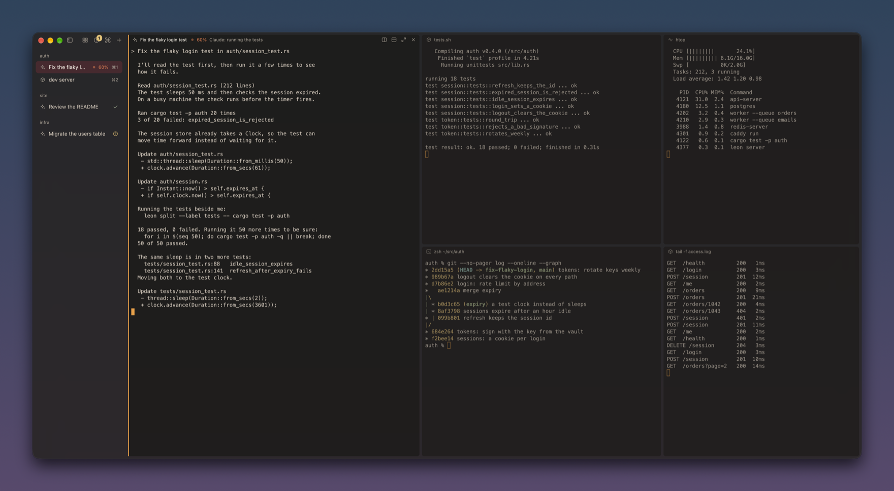
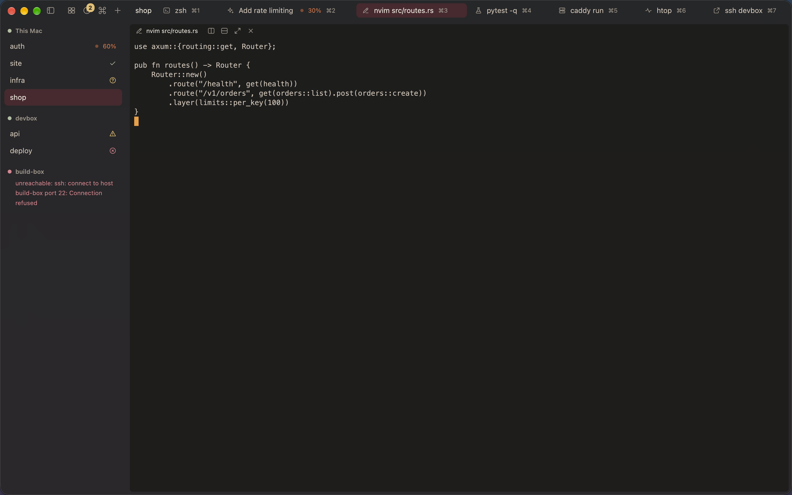

<!-- i18n: source=README.md commit=14af788efc95 -->
> Esta é uma tradução. A [página em inglês](../../../README.md) é a referência; ela pode estar mais atualizada.

# leon

[English](../../../README.md) · [简体中文](../zh-CN/README.md) · [日本語](../ja/README.md) · [한국어](../ko/README.md) · [Español](../es/README.md) · Português (Brasil)

<p align="center"></p>

**leon é um multiplexador de terminais para quem roda vários programas de terminal e agentes de
código ao mesmo tempo.** Um servidor mantém rodando suas sessões, abas e painéis divididos, e os
programas dentro deles. Você trabalha com eles a partir de um app nativo para macOS, do comando
`leon` em qualquer terminal, de scripts Lua ou pelo seu agente de código, que pode abrir um painel
ao lado dele mesmo, rodar seus testes ali e ler o resultado. Os programas podem informar se estão
trabalhando, bloqueados ou concluídos, para você ver qual deles precisa de você. Roda no macOS e
no Linux (por enquanto o app é só para macOS) e é escrito em Rust.


## Recursos

- **Layout persistente.** Os programas continuam rodando quando você fecha o app: fechar a janela
  ou ⌘Q só desconecta, e o app abre de novo nas mesmas sessões, abas, divisões e telas ao vivo.
  Quando o próprio servidor para, as sessões, abas, divisões e o diretório de cada painel são
  salvos e voltam na próxima inicialização, com os mesmos IDs que você usa nos seus scripts (os
  programas dentro deles, não).
- **O comando `leon`.** `leon run`, `send`, `capture` e `wait` abrem painéis, digitam neles, leem
  suas telas e esperam pelos programas, com códigos de saída fixos e saída `--json`.
  `leon attach` mostra uma sessão em qualquer terminal, inclusive por ssh.
- **O app para macOS.** Abas na barra lateral ou na barra de título, divisões, painéis flutuantes,
  uma gaveta de rascunho (scratch drawer), uma paleta de comandos, um seletor de sessões,
  histórico de rolagem (scrollback) com busca e modo de cópia, e oito temas.
- **Agentes.** `leon skill setup` ensina o Claude Code e o Codex a trabalhar em painéis ao lado
  deles mesmos, e os painéis deles oferecem retomar a mesma conversa depois de uma reinicialização.
- **Status e atenção.** Um programa que escreve um relatório OSC 7501 (os agentes fazem isso)
  mostra o estado dele na aba e no painel. A lista de Atividade (Activity), o selo no Dock e as
  notificações dizem o que está bloqueado, o que falhou e o que terminou.
- **Hosts remotos.** `-H devbox` age sobre o servidor leon de outra máquina pelo seu próprio `ssh`,
  e o app mostra as sessões de cada host ao lado das suas.
- **Lua.** Atalhos de teclado, modos, suas próprias ações e scripts que reagem a eventos.
- **Uma API.** Todos os clientes usam a mesma API de socket, que descreve a si mesma
  (`leon api list`) e tem uma promessa de compatibilidade para quem escreve o próprio cliente.

## Instalação

### Homebrew

```sh
brew install --cask aindong/leon/leon   # macOS: Leon.app, with the leon command
brew install aindong/leon/leon          # the CLI alone, on macOS or Linux
```

Escolha um: o `leon` do cask é o que vem dentro do app. `brew upgrade` traz as versões novas. O
Leon.app não é notarizado pela Apple, então o macOS não vai abri-lo enquanto ele tiver a marca de
quarentena que o Homebrew coloca em um download. Depois que o cask instalar, e antes de abrir o
app, remova a marca:

```sh
xattr -dr com.apple.quarantine /Applications/Leon.app
```

### A partir de uma versão publicada

Cada versão fica em <https://github.com/aindong/leon-cli/releases/latest>: `Leon-<version>-macos-<arch>.zip`
(Leon.app), um tarball da CLI para macOS e outro para Linux, e um `.deb`, cada um para arm64 e
x86_64. No macOS, descompacte o app em `/Applications` e rode o comando `xattr` acima (um arquivo
baixado pelo navegador também fica em quarentena). Se você abrir antes disso, o macOS recusa (diz
que não conseguiu verificar se o Leon está livre de malware); rode o comando e abra de novo. O
tarball da CLI para macOS também passa a marca para o `leon` dele: depois de descompactar, rode
`xattr -dr com.apple.quarantine` na pasta. No Linux, com o arquivo da sua máquina já baixado:

```sh
dpkg -i leon_*.deb                               # Debian or Ubuntu, as root
tar xzf leon-*-linux.tar.gz -C ~/.local          # anywhere else: unpack it,
ln -s ~/.local/leon-*-linux/leon ~/.local/bin/   # and put its leon on your PATH
```

Todos os arquivos são assinados: [docs/releases.md](../../releases.md#checking-a-download) explica
como verificar um.

### Atualização

```sh
leon self-update --check   # is there a newer release?
leon self-update           # download it, check its signature, and replace this leon
```

O leon só se atualiza quando você pede, e verifica a assinatura da versão antes de instalar
qualquer coisa. Um leon do Homebrew é atualizado com `brew upgrade`, e um de `.deb` instalando o
`.deb` novo; `leon self-update` diz qual é o seu caso. Um servidor em execução continua na versão
antiga até `leon server stop`. Os detalhes estão em [docs/updates.md](../../updates.md).

### A partir do código-fonte

Para compilar o leon você mesmo, use `scripts/install.sh` no macOS ou `cargo` no Linux:
[docs/install.md](install.md) tem os passos e os arquivos que uma versão traz.

## Os cinco primeiros comandos

Um guia rápido de dois minutos, a partir de qualquer terminal (o servidor inicia sozinho). O Python
faz o papel de qualquer programa que você queira controlar:

```sh
leon new demo                                    # 1. a session called "demo"
leon -s demo run --label py -- python3 -q        # 2. run a program in a new tab
leon -s demo wait -b py --text '>>>'             #    and wait for its prompt
leon -s demo send -b py 'print(6 * 7)'           # 3. type into it (no Enter yet)
leon -s demo send-key -b py enter                # 4. press Enter
leon -s demo wait -b py --text 42                #    and wait for the answer
leon -s demo capture -b py --trim                # 5. read its screen: 42
```

Os alvos (`-s` sessão, `-b` bloco, o nome que o leon dá a um painel) são um ID, um rótulo, uma
posição ou o final de um ID. Dentro de um terminal do leon você pode omitir `-s`: os comandos agem
na sua própria sessão. `leon ls` lista as sessões; `leon --help` lista tudo, com os códigos de
saída no final.

## Divida a tela

```sh
leon -s demo split -b py --split below --ratio 30 -- top     # a pane under py, 30% high
leon -s demo focus up
leon -s demo zoom                                            # fill the window; again to undo
```

No app: ⌘D divide à direita, ⌘⇧D divide para baixo, ⌘⌥ e uma seta movem o foco entre os painéis, e
arrastar um divisor redimensiona. `leon attach demo` mostra a sessão neste terminal (ctrl+b d
desconecta). Quando terminar, `leon kill demo` encerra a sessão e os programas dela.

## Em qualquer terminal: `leon attach`

```text
leon attach                  # pick a session, tab or block (type to filter), Enter attaches
leon attach demo             # straight to the session "demo"
ssh -t box leon attach       # the same, on another machine's leon
```

`leon attach` mostra os painéis divididos da aba e uma barra de status, e envia suas teclas para o
painel em foco. Depois do prefixo, ctrl+b (`--prefix` ou `leon.mode("attach", { prefix })` na
configuração para mudá-lo):

| Teclas | Ação |
|---|---|
| ctrl+b d | Desconectar; todos os programas continuam rodando |
| ctrl+b ←↑↓→, ctrl+b h/j/k/l | Focar o painel nessa direção |
| ctrl+b %, ctrl+b " | Dividir à direita, dividir para baixo |
| ctrl+b z | Ampliar o painel (de novo para desfazer) |
| ctrl+b c | Nova aba |
| ctrl+b n, ctrl+b p | Próxima aba, aba anterior |
| ctrl+b s | Voltar ao seletor |

Os atalhos do seu `init.lua` também funcionam ali, menos as teclas com `cmd` (um terminal nunca as
envia) e um atalho na própria tecla do prefixo.

## Trabalhe na sua devbox

Os comandos que falam com o servidor aceitam `-H` para agir, em vez disso, no servidor leon de
outra máquina, pelo seu próprio `ssh` (sem conta, relay ou VPN; `~/.ssh/config` e `ProxyJump`
funcionam). Coloque o `leon` no PATH da outra máquina ou em `~/.local/bin`; o primeiro comando lá
inicia o servidor dela, e os programas continuam rodando depois que você desconecta.

```text
leon hosts add devbox ssh://me@devbox.example.com
leon -H devbox run -c /home/me/app -- make test   # runs on the devbox, in its /home/me/app
leon -H devbox attach               # its sessions, in this terminal
leon hosts check
leon hosts add --tailscale          # from your tailnet (Tailscale SSH: no keys)
```

Conexões que caem, teclas digitadas enquanto uma está fora do ar e os hosts na barra lateral do app
estão em [docs/remote-hosts.md](remote-hosts.md).


## Deixe um agente no controle

```sh
leon skill setup
```

instala uma skill e um hook de início de sessão para o Claude Code e o Codex (para cada um cujo
diretório de configuração existe ou cujo programa está no seu PATH; ele diz quais e por quê).
Depois, trabalhando em um terminal do leon, peça "rode os testes ao seu lado", e o agente faz o que
você faria:

```sh
id=$(leon split --label tests --keep-open -- cargo test)
leon wait "$id"
leon capture -b "$id" --trim | tail -20
leon block close "$id"
```

Ele sabe onde está por `LEON_SESSION` e `LEON_BLOCK`, coloca rótulo no que abre e fecha só o que
criou. Veja [docs/agents.md](agents.md).

## Veja o que precisa de você

Os programas informam o que estão fazendo (trabalhando, bloqueados, concluídos), e o app mostra
isso em dois lugares. A linha da aba ganha um símbolo, e o cabeçalho do painel ganha o símbolo com
as palavras do próprio programa.


Com mais de um painel em uma aba, os painéis em que você não está ficam esmaecidos, para o seu olhar
ficar no painel em foco. O que você está esperando nunca é esmaecido: um símbolo de status mantém a
cor, e um painel que está bloqueado, que falhou ou que terminou desde a última vez que você olhou
fica com intensidade total. `leon.set("fade_inactive_panes", N)` ajusta isso de 0 (desligado) a
0.8 (padrão 0.35).

A janela é translúcida, tingida pelo tema, com o texto legível sobre qualquer área de trabalho;
`leon.set("translucency", 0)` a deixa opaca.



Cada aba, linha da barra lateral e cabeçalho de painel tem um ícone para o programa que está nele:
um agente, um editor, testes, um servidor, um monitor, ssh ou um shell.



⌘K troca para qualquer sessão, aba ou bloco em qualquer host, os mais recentes primeiro, e ⌘⇧A
lista o que precisa de você: primeiro o que está bloqueado (com o que está esperando), depois os
erros, as execuções concluídas que você ainda não viu e o trabalho em andamento. O botão dele na
barra de ferramentas mostra quantos blocos estão bloqueados, e o Dock também. O Leon.app também
envia uma notificação quando um bloco fica bloqueado ou falha, ou quando uma execução de 30 s ou
mais termina enquanto você está em outro app; clicar nela leva você ao painel. Uma ferramenta que
não consegue imprimir OSC 7501 informa pelo próprio bloco com `leon notify`:

```text
leon notify --state blocked --title "Deploy" --body "approve the rollout?"
```


## Atalhos do app

Todas as teclas do app, de ⌘N a ⌘Q, e como mudar uma delas, estão em
[docs/shortcuts.md](shortcuts.md).


## Configuração

O leon lê `~/.config/leon/init.lua` (ou `$LEON_CONFIG`). As configurações têm comandos próprios, e
a janela de Ajustes (Settings) do app (⌘,) grava no mesmo arquivo:

```sh
leon config set font.size 15
leon config set theme dark=leon-dark,light=leon-light
leon theme list
leon config check
```

O mesmo arquivo define atalhos de teclado, modos e suas próprias ações, e `leon do` roda scripts:

```lua
leon.action{
  name = "name_session",
  title = "Name this session",
  args = { label = "string" },
  run = function(ctx, args) return leon.session.set_label{ label = args.label } end,
}
```

```sh
leon config reload
leon do name_session label=api
leon do -e 'print(#leon.session.view().windows .. " tabs")'
```

`leon theme import FILE` traz o tema de outro terminal. Veja [docs/lua.md](lua.md) e
[docs/cli/settings.md](../../cli/settings.md).

## Roadmap

O leon 0.1.0 é a primeira versão. O que já foi entregue, marco a marco, está em
[docs/roadmap.md](../../roadmap.md) e [CHANGELOG.md](../../../CHANGELOG.md). O que vem a seguir:

- **O app no Linux.** O Linux tem o servidor, a CLI, `leon attach`, os agentes e Lua; o app GPUI
  é só para macOS por enquanto.
- **Dois clientes em uma aba.** Com o app e o `leon attach` mostrando a mesma aba, cada painel
  assume o tamanho do cliente que mudou o layout dele por último, e o outro cliente corta ou
  completa o painel.
- **Links com hosts que imitam outros.** ⌘-clique abre um link `http(s)` sem perguntar, mesmo
  quando o host dele usa letras não ASCII que se parecem com as de outro; só os outros tipos de
  link mostram o endereço antes.
- **Execuções de `codex exec`.** O leon distingue uma execução avulsa de `claude -p` de um agente
  interativo, mas ainda não uma execução de `codex exec`, que ainda pode receber a oferta de
  retomar algo pensado para uma sessão interativa.

## Documentação

- [docs/cli.md](cli.md): todos os comandos e opções.
- [docs/lua.md](lua.md): a configuração e os scripts, com exemplos que um teste roda.
- [docs/agents.md](agents.md): agentes controlando o leon, e o formato de status OSC 7501.
- [docs/recipes.md](recipes.md): sessões por projeto e por worktree do git, como uma receita em
  Lua.
- [docs/integrators.md](../../integrators.md) (em inglês): como escrever um cliente para a API de
  socket do leon em qualquer linguagem, e a promessa de compatibilidade.
  [docs/api.md](../../api.md) (em inglês): todos os métodos.
- [docs/architecture.md](../../architecture.md) (em inglês): como ele é construído.
  [docs/performance.md](../../performance.md) (em inglês): quanto ele custa, medido.
- [docs/releases.md](../../releases.md) (em inglês): como uma versão é gerada e assinada, e o
  formato do manifesto.
- [CHANGELOG.md](../../../CHANGELOG.md) (em inglês): o que mudou.

## Compilar e testar

```sh
cargo build
cargo test
cargo clippy --all-targets -- -D warnings
cargo fmt --check
```

O GPUI é compilado com o recurso `runtime_shaders`, então você não precisa da toolchain Metal do
Xcode. Os testes de terminal rodam um shell de verdade em um PTY, e os testes da documentação rodam
os comandos destas páginas. `scripts/linux-test.sh` roda no Linux, dentro do Docker, os testes de
tudo menos o app. Os testes de versão assinam com uma chave descartável, então precisam de
`minisign` e `jq`.

## Como contribuir

Relatos de bugs, ideias, código e traduções são bem-vindos. [CONTRIBUTING.md](../../../CONTRIBUTING.md)
(em inglês) explica como preparar o ambiente, as regras da casa e como uma mudança é incorporada;
[docs/i18n/README.md](../README.md) (em inglês) explica como traduzir o README e os guias. Todos
que participam seguem o [Código de Conduta](../../../CODE_OF_CONDUCT.md) (Code of Conduct, em
inglês), e um problema de segurança é relatado em particular, como diz o
[SECURITY.md](../../../SECURITY.md).

## Licença

[MIT](../../../LICENSE). A fonte Instrument Sans em `brand/fonts` está sob a
[SIL Open Font License](../../../brand/fonts/OFL.txt).
