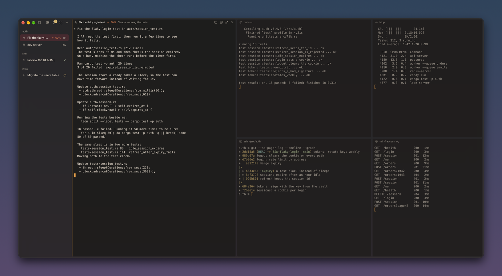
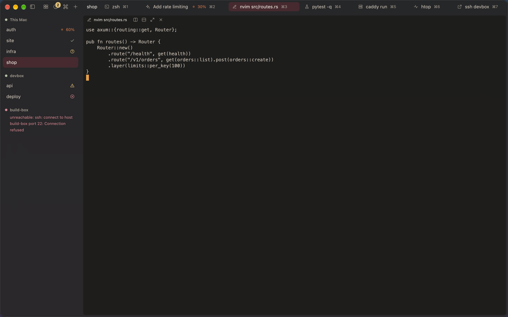
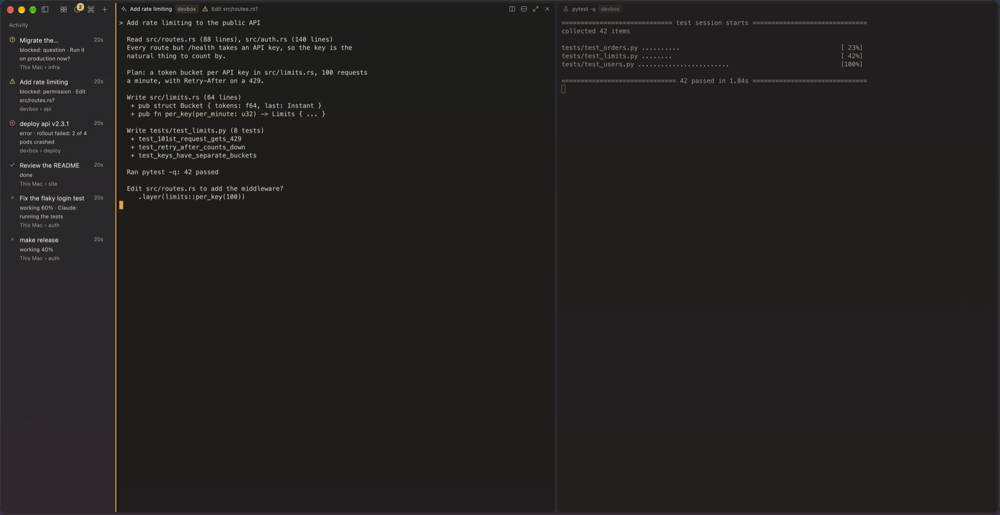

<!-- i18n: source=README.md commit=14af788efc95 -->
> 本页是译文，以[英文原文](../../../README.md)为准，英文版可能更新。

# leon

[English](../../../README.md) · 简体中文 · [日本語](../ja/README.md) · [한국어](../ko/README.md) · [Español](../es/README.md) · [Português (Brasil)](../pt-BR/README.md)

<p align="center"></p>

**leon 是一个终端复用器，为同时运行多个终端程序和编程智能体的人而设计。** 服务器负责保持你的会话、标签页和分屏窗格，以及其中的程序持续运行。你可以通过原生 macOS 应用、任意终端里的 `leon` 命令、Lua 脚本来操作它们，也可以交给你的编程智能体：它能在自己旁边打开一个窗格，在里面跑测试并读取结果。程序可以报告自己是在工作、被阻塞还是已完成，这样你就能看出哪一个需要你。leon 支持 macOS 和 Linux（应用目前仅限 macOS），用 Rust 编写。


## 功能

- **持久的布局。** 应用退出后程序继续运行：关闭窗口或 ⌘Q 只是断开连接，再次打开应用时会回到同样的会话、标签页、分屏和实时画面。当服务器本身停止时，会话、标签页、分屏以及每个窗格的目录都会被保存，并在下次启动时恢复，ID 与你脚本中使用的保持一致（其中的程序不会恢复）。
- **`leon` 命令。** `leon run`、`send`、`capture` 和 `wait` 用来打开窗格、向其中输入、读取屏幕内容、等待程序，退出码固定，并支持 `--json` 输出。`leon attach` 可以在任意终端中显示一个会话，通过 ssh 也可以。
- **macOS 应用。** 侧边栏或标题栏标签页、分屏、浮动窗格、临时抽屉（scratch drawer）、命令面板、会话切换器、支持查找和复制模式的回滚缓冲区，以及八种主题。
- **智能体。** `leon skill setup` 会教 Claude Code 和 Codex 在自己旁边的窗格中工作，重启后它们的窗格会提示恢复同一段对话。
- **状态与提醒。** 写出 OSC 7501 报告的程序（智能体都会）会在其标签页和窗格上显示状态。活动列表（Activity）、程序坞（Dock）角标和通知会告诉你哪些被阻塞、失败或已完成。
- **远程主机。** `-H devbox` 通过你自己的 `ssh` 操作另一台机器上的 leon 服务器，应用会把每台主机的会话显示在你本机会话旁边。
- **Lua。** 按键绑定、模式、自定义动作，以及响应事件的脚本。
- **API。** 所有客户端都使用同一个 socket API，它可以自我描述（`leon api list`），并为编写自己客户端的人提供兼容性承诺。

## 安装

### Homebrew

```sh
brew install --cask aindong/leon/leon   # macOS: Leon.app, with the leon command
brew install aindong/leon/leon          # the CLI alone, on macOS or Linux
```

二选一：cask 中的 `leon` 就是应用里自带的那个。`brew upgrade` 会安装新版本。Leon.app 没有经过 Apple 公证，因此只要它带着 Homebrew 给下载文件加上的隔离标记，macOS 就不会打开它。cask 安装完成后、首次打开应用之前，先去掉这个标记：

```sh
xattr -dr com.apple.quarantine /Applications/Leon.app
```

### 从发布版安装

每个发布版都在 <https://github.com/aindong/leon-cli/releases/latest>：`Leon-<version>-macos-<arch>.zip`（Leon.app）、macOS 和 Linux 的 CLI tarball，以及一个 `.deb`，均提供 arm64 和 x86_64 版本。在 macOS 上，把应用解压到 `/Applications`，然后运行上面的 `xattr` 命令（从浏览器下载的文件同样会被隔离）。如果在此之前就打开，macOS 会拒绝（提示无法验证 Leon 不含恶意软件）；运行该命令后再打开即可。macOS 的 CLI tarball 也会把这个标记带到其中的 `leon` 上：解包后，对它所在的文件夹运行 `xattr -dr com.apple.quarantine`。在 Linux 上，下载适合你机器的文件后：

```sh
dpkg -i leon_*.deb                               # Debian or Ubuntu, as root
tar xzf leon-*-linux.tar.gz -C ~/.local          # anywhere else: unpack it,
ln -s ~/.local/leon-*-linux/leon ~/.local/bin/   # and put its leon on your PATH
```

每个文件都有签名：[docs/releases.md](../../releases.md#checking-a-download) 说明了如何校验。

### 更新

```sh
leon self-update --check   # is there a newer release?
leon self-update           # download it, check its signature, and replace this leon
```

leon 只在你要求时才更新，并且在安装任何东西之前都会校验发布版的签名。通过 Homebrew 安装的 leon 用 `brew upgrade` 更新，通过 `.deb` 安装的则安装新的 `.deb`；`leon self-update` 会告诉你属于哪一种。正在运行的服务器会保持旧版本，直到执行 `leon server stop`。详情见 [docs/updates.md](../../updates.md)。

### 从源码构建

自己构建 leon：在 macOS 上用 `scripts/install.sh`，在 Linux 上用 `cargo`。[docs/install.md](install.md) 列出了具体步骤，以及发布版包含的文件。

## 最初的五条命令

两分钟快速上手，可在任意终端中执行（服务器会自动启动）。这里用 Python 代表任何你想操控的程序：

```sh
leon new demo                                    # 1. a session called "demo"
leon -s demo run --label py -- python3 -q        # 2. run a program in a new tab
leon -s demo wait -b py --text '>>>'             #    and wait for its prompt
leon -s demo send -b py 'print(6 * 7)'           # 3. type into it (no Enter yet)
leon -s demo send-key -b py enter                # 4. press Enter
leon -s demo wait -b py --text 42                #    and wait for the answer
leon -s demo capture -b py --trim                # 5. read its screen: 42
```

目标（`-s` 表示会话，`-b` 表示块，即 leon 对窗格的叫法）可以是 ID、标签、位置或 ID 的末尾部分。在 leon 终端内可以省略 `-s`：命令会作用于你自己的会话。`leon ls` 列出会话；`leon --help` 列出全部内容，退出码在最下面。

## 分屏

```sh
leon -s demo split -b py --split below --ratio 30 -- top     # a pane under py, 30% high
leon -s demo focus up
leon -s demo zoom                                            # fill the window; again to undo
```

在应用中：⌘D 向右拆分，⌘⇧D 向下拆分，⌘⌥ 加方向键在窗格间移动，拖动分隔线可以调整大小。`leon attach demo` 在当前终端中显示该会话（ctrl+b d 断开）。用完之后，`leon kill demo` 会结束该会话及其中的程序。

## 在任意终端中：`leon attach`

```text
leon attach                  # pick a session, tab or block (type to filter), Enter attaches
leon attach demo             # straight to the session "demo"
ssh -t box leon attach       # the same, on another machine's leon
```

`leon attach` 会显示标签页的分屏窗格和一个状态栏，并把你的按键发送到获得焦点的窗格。前缀键 ctrl+b 之后（用 `--prefix` 或配置中的 `leon.mode("attach", { prefix })` 修改）：

| 按键 | 作用 |
|---|---|
| ctrl+b d | 断开；所有程序继续运行 |
| ctrl+b ←↑↓→, ctrl+b h/j/k/l | 将焦点移到该方向的窗格 |
| ctrl+b %, ctrl+b " | 向右拆分、向下拆分 |
| ctrl+b z | 放大窗格（再按一次还原） |
| ctrl+b c | 新建标签页 |
| ctrl+b n, ctrl+b p | 下一个、上一个标签页 |
| ctrl+b s | 回到选择器 |

你在 `init.lua` 中的按键绑定在这里同样有效，但 `cmd` 键（终端从不发送它）和绑定在前缀键本身上的除外。

## 在开发机上工作

与服务器通信的命令都可以加 `-H`，改为通过你自己的 `ssh` 操作另一台机器上的 leon 服务器（无需账号、中继或 VPN；`~/.ssh/config` 和 `ProxyJump` 都能用）。把 `leon` 放到那台机器的 PATH 或 `~/.local/bin` 中；在那里执行的第一条命令会启动它的服务器，断开连接后程序也会继续运行。

```text
leon hosts add devbox ssh://me@devbox.example.com
leon -H devbox run -c /home/me/app -- make test   # runs on the devbox, in its /home/me/app
leon -H devbox attach               # its sessions, in this terminal
leon hosts check
leon hosts add --tailscale          # from your tailnet (Tailscale SSH: no keys)
```

连接中断、连接断开期间输入的按键，以及应用侧边栏中的主机，详见 [docs/remote-hosts.md](remote-hosts.md)。


## 让智能体来操作

```sh
leon skill setup
```

会为 Claude Code 和 Codex 安装一个技能（skill）和一个会话启动钩子（只要它的配置目录存在或程序在你的 PATH 上；它会说明装给了谁以及原因）。之后在 leon 终端中工作时，说一句“在你旁边跑一下测试”，智能体就会像你一样去做：

```sh
id=$(leon split --label tests --keep-open -- cargo test)
leon wait "$id"
leon capture -b "$id" --trim | tail -20
leon block close "$id"
```

它通过 `LEON_SESSION` 和 `LEON_BLOCK` 知道自己在哪里，会给自己打开的东西加上标签，并且只关闭自己创建的东西。见 [docs/agents.md](agents.md)。

## 知道什么需要你处理

程序会报告自己在做什么（工作中、阻塞、完成），应用会在两个地方显示：标签页所在的行会出现一个符号，窗格标题栏会显示该符号和程序自己的描述。


一个标签页中有多个窗格时，你不在的那些窗格会变淡，让你的视线停留在获得焦点的窗格上。你正在等待的东西永远不会变淡：状态符号保持颜色，自你上次查看后阻塞、失败或已完成的窗格保持完整亮度。`leon.set("fade_inactive_panes", N)` 可以在 0（关闭）到 0.8 之间设置（默认 0.35）。

窗口是半透明的，带有主题色调，文字在任何桌面背景上都清晰可读；`leon.set("translucency", 0)` 可以让它不透明。



每个标签页、侧边栏行和窗格标题栏都有一个图标，表示其中的程序：智能体、编辑器、测试、服务器、监视器、ssh 或 shell。



⌘K 可以切换到任意主机上的任意会话、标签页或块，最近使用的排在最前；⌘⇧A 列出需要你处理的内容：先是被阻塞的（附带它在等什么），然后是错误、你还没看过的已完成运行，以及进行中的工作。工具栏上对应的按钮会显示有多少个块被阻塞，程序坞也会显示。Leon.app 还会在某个块被阻塞或失败时，或在你使用其他应用期间一次持续 30 秒以上的运行结束时发送通知；点击通知会跳转到对应窗格。无法输出 OSC 7501 的工具可以用 `leon notify` 为自己的块报告状态：

```text
leon notify --state blocked --title "Deploy" --body "approve the rollout?"
```



## 应用快捷键

应用的每一个按键，从 ⌘N 到 ⌘Q，以及如何修改，都在 [docs/shortcuts.md](shortcuts.md) 中。


## 配置

leon 读取 `~/.config/leon/init.lua`（或 `$LEON_CONFIG`）。设置项有专门的命令，应用的设置窗口（Settings，⌘,）写入的也是同一个文件：

```sh
leon config set font.size 15
leon config set theme dark=leon-dark,light=leon-light
leon theme list
leon config check
```

同一个文件还定义按键绑定、模式和自定义动作，`leon do` 用来运行脚本：

```lua
leon.action{
  name = "name_session",
  title = "Name this session",
  args = { label = "string" },
  run = function(ctx, args) return leon.session.set_label{ label = args.label } end,
}
```

```sh
leon config reload
leon do name_session label=api
leon do -e 'print(#leon.session.view().windows .. " tabs")'
```

`leon theme import FILE` 可以导入其他终端的主题。见 [docs/lua.md](lua.md) 和 [docs/cli/settings.md](../../cli/settings.md)。

## 路线图

leon 0.1.0 是第一个发布版。按里程碑划分的已完成内容见 [docs/roadmap.md](../../roadmap.md) 和 [CHANGELOG.md](../../../CHANGELOG.md)。接下来要做的：

- **Linux 上的应用。** Linux 上已有服务器、CLI、`leon attach`、智能体和 Lua；GPUI 应用目前仅限 macOS。
- **同一标签页上的两个客户端。** 当应用和 `leon attach` 显示同一个标签页时，每个窗格采用最后一次改变其布局的客户端的尺寸，另一个客户端会裁剪或填充它。
- **形似的链接主机名。** ⌘-点击会直接打开 `http(s)` 链接而不询问，即使它的主机名使用了与其他主机名形似的非 ASCII 字母；只有其他类型的链接会先显示地址。
- **`codex exec` 运行。** leon 能区分一次性的 `claude -p` 运行与交互式智能体，但还不能识别 `codex exec` 运行，后者仍可能收到本应只给交互式会话的恢复提示。

## 文档

- [docs/cli.md](cli.md)：所有命令和参数。
- [docs/lua.md](lua.md)：配置和脚本，示例都由测试运行。
- [docs/agents.md](agents.md)：智能体如何操控 leon，以及 OSC 7501 状态格式。
- [docs/recipes.md](recipes.md)：用 Lua 配方实现项目会话和 git worktree 会话。
- [docs/integrators.md](../../integrators.md)：用任意语言为 leon 的 socket API 编写客户端，以及兼容性承诺。[docs/api.md](../../api.md)：所有方法。
- [docs/architecture.md](../../architecture.md)：它是如何构建的。[docs/performance.md](../../performance.md)：实测的资源开销。
- [docs/releases.md](../../releases.md)：发布版如何制作和签名，以及清单格式。
- [CHANGELOG.md](../../../CHANGELOG.md)：变更记录。

## 构建与测试

```sh
cargo build
cargo test
cargo clippy --all-targets -- -D warnings
cargo fmt --check
```

GPUI 以 `runtime_shaders` 特性构建，因此不需要 Xcode 的 Metal 工具链。终端测试会在 PTY 中运行真实的 shell，文档测试会运行这些文档里的命令。`scripts/linux-test.sh` 在 Docker 中运行除应用以外所有部分的 Linux 测试。发布测试使用一次性密钥签名，因此需要 `minisign` 和 `jq`。

## 参与贡献

欢迎提交 bug 报告、想法、代码和翻译。[CONTRIBUTING.md](../../../CONTRIBUTING.md) 介绍了环境搭建、项目规则以及改动如何合入；[docs/i18n/README.md](../README.md) 说明了如何翻译 README 和各篇指南。所有参与者都遵守[行为准则](../../../CODE_OF_CONDUCT.md)（Code of Conduct），安全问题请按 [SECURITY.md](../../../SECURITY.md) 所述私下报告。

## 许可证

[MIT](../../../LICENSE)。`brand/fonts` 中的 Instrument Sans 字体采用 [SIL Open Font License](../../../brand/fonts/OFL.txt)。
