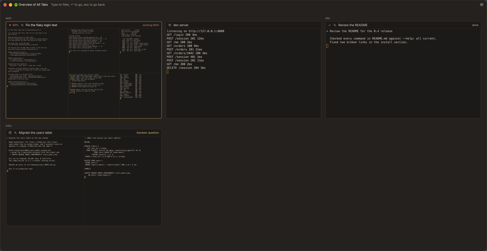

<!-- i18n: source=docs/shortcuts.md commit=a525beb0ae17 -->
> 本页是译文，以[英文原文](../../shortcuts.md)为准，英文版可能更新。

# 应用快捷键

Leon.app 的按键（接续 [README](README.md#应用快捷键)）。[lua/keys.md](../../lua/keys.md) 说明了如何修改它们。

| 按键 | 作用 |
|---|---|
| ⌘N | 新建会话 |
| ⌘T | 新建标签页 |
| ⌘D | 向右拆分 |
| ⌘⇧D | 向下拆分 |
| ⌘⌥←, ⌘⌥→, ⌘⌥↑, ⌘⌥↓ | 将焦点移到该方向的窗格 |
| ⌘⇧↩ | 放大窗格（再按一次还原） |
| ⌘W | 关闭窗格 |
| ⌘⌥F, ⌘⌥⇧F | 让窗格浮动在其他窗格之上、放回平铺布局（拖动标题栏移动，拖动边缘调整大小） |
| ⌘J | 显示或隐藏临时抽屉（scratch drawer）：底部的一个 shell，在获得焦点的窗格所在目录中打开，隐藏时也会继续运行 |
| ⌘⌃←, ⌘⌃→, ⌘⌃↓ | 把窗格停靠为左侧、右侧或底部的抽屉（拖动边缘调整大小） |
| ⌘⇧], ⌘⇧[ | 下一个、上一个标签页 |
| ⌘1 … ⌘9 | 跳到第 1–9 个标签页 |
| ⌘C, ⌘V | 复制所选内容、粘贴 |
| ⌘A | 全选窗格中的内容，包括回滚缓冲区 |
| ⌘F | 在窗格中查找：↩ 和 ⇧↩ 逐个跳转，⌥C 区分大小写，⌥R 正则，esc 关闭 |
| ⌘G, ⌘⇧G | 下一个、上一个匹配 |
| ⌘⇧C | 复制模式（Copy Mode）：在回滚缓冲区中使用 vi 按键（h j k l、w b、0 $、g ⇧G、⌃U ⌃D），v 和 ⇧V 选择，/ 和 ? 搜索并用 n 和 ⇧N 跳转，y 复制，esc 或 q 退出 |
| ⌘⇧H | 提示（Hints）：屏幕上每个 URL、路径、哈希、IP 和长数字都会带上一个标签；输入标签即复制，输入大写则把它输入到窗格中 |
| ⇧PageUp, ⇧PageDown | 向后、向前滚动一页 |
| ⌘↑, ⌘↓ | 滚动到最早的一行、回到底部 |
| ⌘B | 显示或隐藏侧边栏 |
| ⌘⇧S | 标签页放在侧边栏或标题栏（下次启动时保持） |
| ⌘⇧P | 命令面板：输入以查找动作，↩ 执行，esc 关闭 |
| ⌘, | 设置（Settings）：所有设置按分区排列，可搜索，↑ 和 ↓ 在分区间移动，esc 或 ⌘W 关闭（写入 init.lua） |
| ⌘⇧T | 更换主题，移动时实时预览；↩ 保留，esc 返回 |
| ⌘K | 切换到任意 主机 › 会话 › 标签页（或按标题找块）：↩ 跳转过去，⌘↩ 把它移到当前窗格旁边（限同一台机器） |
| ⌘⇧A | 活动列表（Activity）：所有主机上需要你处理的块（阻塞、错误、完成、工作中）；点击即可跳转 |
| ⌘⇧\, ⌘\ | 概览（Overview）：所有标签页（⌘\：仅当前会话的），实时显示；方向键和 ↩ 跳转，输入即可筛选；停在某个标签页上会预览它 |
| ⌘=, ⌘⇧=, ⌘-, ⌘0 | 放大、放大、缩小、恢复默认字号（作用于显示中的窗格） |
| ⌘Q | 退出；所有程序继续运行（leon › 退出并结束所有会话（Quit and End All Sessions…）会结束它们） |

以上是默认设置。在 `init.lua` 中用 `leon.bind` 可以逐个替换按键，用 `leon.unbind` 可以移除（⌘Q 除外）。像 `ctrl+b>c` 这样的按键序列会提示接下来可以按什么。鼠标悬停在任何按钮上都会显示它的动作和快捷键。滚轮会在窗格的回滚缓冲区中向后滚动；拖动即可选择，option+拖动选择矩形区域；按住 ⌘ 并点击链接即可打开。请求使用鼠标的程序（编辑器或 `htop`）会收到点击和滚轮事件；按住 shift 仍可进行选择。
