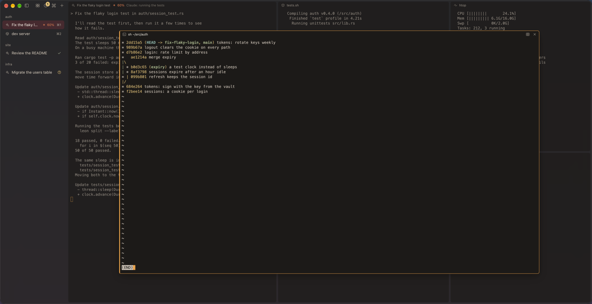

# Lua: keys and modes

Part of [Lua: config and scripts](../lua.md). The app's own keys are in [shortcuts.md](../shortcuts.md).

## Key bindings

`leon.bind(key, action[, args])` binds a key to an action. Keys are modifiers plus one key joined
by `+`: `cmd`, `ctrl`, `alt` (also `opt`), `shift`, and a character or `enter escape tab space
backspace delete left right up down home end pageup pagedown f1`–`f12`. A shifted symbol works as
typed or unshifted: `ctrl+b>%` and `ctrl+b>shift+5`, `cmd++` and `cmd+shift+=` are the same keys
(on a US layout). Key names ignore case, so a capital letter is written `shift+f`. A **sequence**
joins keys with `>`, like tmux's prefix key.

```lua
leon.bind("cmd+t", "client.tab.new")
leon.bind("ctrl+b>c", "client.tab.new")
leon.bind("ctrl+b>%", "pane.split", { direction = "right" })
leon.bind("ctrl+b>\"", "pane.split", { direction = "down" })
leon.bind("ctrl+b>z", "pane.zoom")
```

The app sends every key through these bindings, on top of its own defaults ([shortcuts.md](../shortcuts.md)): a binding replaces the default on the same key, and a sequence whose first key
is a default turns that key into its prefix. While a sequence is half typed the app shows what can
follow; Escape, or a key that continues nothing, cancels it. Keys nothing binds go to the pane.
The app runs its own actions (`client.*`, `pane.*`, `session.*`, listed in its command palette,
⌘⇧P); your actions and function bindings run in the server. `leon keymap` shows what is bound.

`leon.unbind(key)` removes a key's bindings, including the app's defaults, and returns how many it
removed. `leon.bindings()` lists the bindings made so far.

### Repeat keys

A 4th argument `{ repeats = true }` makes a sequence repeatable, like tmux's `bind -r`: after
`ctrl+b>h` runs, `h` alone runs it again for `repeat_time` (500 ms unless you set it), and each
repeat starts the time over. Any repeatable key after the same prefix works in that window, so
`ctrl+b h h l` goes left twice and right once. Another key ends the window and does what it would
have done with no prefix typed. (`repeat` is a Lua keyword, so the option is `repeats`;
`["repeat"] = true` works too.) The app's default keys don't repeat. A repeatable Lua function
runs again each time, the same as when its whole sequence is typed.

```lua
leon.bind("ctrl+b>h", "pane.focus.left", nil, { repeats = true })
leon.bind("ctrl+b>l", "pane.focus.right", nil, { repeats = true })
leon.set("repeat_time", 400)
```

### A tmux-style preset

Prefix `ctrl+b`, then the key tmux uses. `hjkl` repeat, so `ctrl+b h h h` walks three panes left.
`ctrl+b [` is copy mode (⌘⇧C in the app) and `ctrl+b F` hints (⌘⇧H). In `leon attach` the same
sequences come after its prefix, except copy mode and hints, which only the app has so far.

```lua
-- tmux-style keys: ctrl+b, then tmux's key
leon.bind("ctrl+b>%", "pane.split.right")
leon.bind("ctrl+b>\"", "pane.split.down")
leon.bind("ctrl+b>h", "pane.focus.left", nil, { repeats = true })
leon.bind("ctrl+b>j", "pane.focus.down", nil, { repeats = true })
leon.bind("ctrl+b>k", "pane.focus.up", nil, { repeats = true })
leon.bind("ctrl+b>l", "pane.focus.right", nil, { repeats = true })
leon.bind("ctrl+b>z", "pane.zoom")
leon.bind("ctrl+b>x", "pane.close")
leon.bind("ctrl+b>c", "client.tab.new")
leon.bind("ctrl+b>n", "client.tab.next")
leon.bind("ctrl+b>p", "client.tab.previous")
leon.bind("ctrl+b>[", "client.copy_mode")
leon.bind("ctrl+b>shift+f", "client.hints")
leon.set("repeat_time", 500)
```

### Moving between vim and leon (vim-navigator)

The same ctrl+h/j/k/l move between vim's windows and leon's panes. leon's side is a function
binding: when vim (or nvim) is the pane's foreground program the key goes on to vim, else leon
moves the focus. It asks `ps` for the pane's terminal, about 10 ms a key.

```lua
-- vim-navigator: ctrl+h/j/k/l go to vim when vim or nvim is in front, else to leon's panes
local function vim_in_front()
  local p = leon.block.call("dev.leon.terminal", "process", {})
  if not p then return false end
  local r = leon.exec({ "ps", "-o", "tty=", "-p", tostring(p.pid) }, { timeout = 1 })
  local tty = r.ok and r.stdout:match("%S+")
  if not tty then return false end
  r = leon.exec({ "ps", "-o", "stat=,args=", "-t", tty }, { timeout = 1 })
  for stat, program in (r.stdout or ""):gmatch("(%S+)%s+(%S+)[^\n]*") do
    local name = program:match("([^/]+)$")
    if stat:find("+", 1, true) and (name == "vim" or name == "nvim" or name == "vi") then
      return true
    end
  end
  return false
end

for key, dir in pairs{ h = "left", j = "down", k = "up", l = "right" } do
  leon.bind("ctrl+" .. key, function(ctx)
    if vim_in_front() then return false end -- not handled: the key goes on to vim
    leon.session.focus_direction{ direction = dir }
    return true
  end)
end
```

vim's side moves between its windows and, at an edge, runs `leon focus`. Every leon pane has
`LEON_BLOCK` and `LEON_SESSION` set, so `leon focus left` moves in the pane's own session, and
outside leon the mapping stays inside vim:

```vim
" ~/.vimrc: at the edge of vim's windows, hand the move to leon
function! s:Go(key, dir) abort
  let l:was = winnr()
  execute 'wincmd ' . a:key
  if winnr() == l:was && !empty($LEON_BLOCK)
    call system('leon focus ' . a:dir)
  endif
endfunction
nnoremap <silent> <C-h> :call <SID>Go('h', 'left')<CR>
nnoremap <silent> <C-j> :call <SID>Go('j', 'down')<CR>
nnoremap <silent> <C-k> :call <SID>Go('k', 'up')<CR>
nnoremap <silent> <C-l> :call <SID>Go('l', 'right')<CR>
```

## Modes

Modes are read by the server, but neither the app nor `client.key` acts on them yet (`leon attach`
uses one, `attach`, below). A mode is a
set of keys that only work while the mode is on. Enter it with `client.mode.enter`; Escape leaves
it. An **exclusive** mode swallows keys it doesn't bind, so stray typing doesn't reach the
terminal.

```lua
leon.mode("resize", { exclusive = true })
leon.bind("cmd+r", "client.mode.enter", { name = "resize" })
leon.bind("resize/left", "pane.resize", { direction = "left" })
leon.bind("resize/right", "pane.resize", { direction = "right" })
leon.bind("resize/up", "pane.resize", { direction = "up" })
leon.bind("resize/down", "pane.resize", { direction = "down" })
```

### `leon attach`'s prefix

`leon attach` (the terminal client) reads the mode named `attach`: its `prefix` is the key that
starts a command (default `ctrl+b`; `leon attach --prefix KEY` overrides it), and its bindings are
the keys after it. They replace or add to the built-in ones (`d` detach, arrows and `hjkl` focus,
`%` and `"` split, `z` zoom, `c` new tab, `n`/`p` next and previous tab, `s` the picker);
`leon.unbind("attach/KEY")` removes one. A sequence that starts with the prefix (`ctrl+b>c` above)
comes before a built-in key, and an `attach/` binding before both. The app ignores the mode.

```lua
leon.mode("attach", { prefix = "ctrl+a" })
leon.bind("attach/x", "pane.close")
leon.bind("attach/t", "client.tab.new")
```

## Function bindings

A key can run a Lua function directly. Return `true` if you handled the key; otherwise the key goes
on to the next binding, and finally to the terminal.

```lua
leon.bind("ctrl+x", function(ctx, ev)
  leon.session.set_label{ label = "busy" }
  return true
end)

-- Run a program and use its output. Actions run in the server's working directory, so the
-- caller says where: leon do branch_label dir="$PWD"
leon.action{
  name = "branch_label",
  title = "Label the session with the git branch",
  args = { dir = "string" },
  run = function(ctx, args)
    local r = leon.exec({ "git", "rev-parse", "--abbrev-ref", "HEAD" }, { cwd = args.dir, timeout = 2 })
    if not r.ok then error(args.dir .. " is not a git repo", 0) end
    leon.session.set_label{ label = (r.stdout:gsub("%s+$", "")) }
  end,
}
```

## Floating panes and a scratch shell key

`leon.float{block_id=...}` floats the current block when `block_id` is omitted;
`leon.float{new=true, layout={block={label="notes"}}}` starts a new floating shell.
Both accept `bounds={x=0.1,y=0.1,width=0.8,height=0.8}`. `leon.dock{side="right",
size=0.25}` pins the current block; sides are `left`, `right`, `bottom`.
`leon.toggle{label="scratch",create=true}` creates a bottom drawer on first use,
then hides/shows it. Hidden programs keep running. These helpers fill `session_id`
from context and return the API result or `nil, err`. To return a float to the
split tree use `leon.session.unfloat_block{block_id=...}`.

Put this in init.lua for a scratch shell on Ctrl+G (the recipe is tested):

<!-- m20-scratch -->
```lua
leon.action{
  name = "scratch_shell",
  title = "Toggle scratch shell",
  run = function()
    local result, err = leon.toggle{label="scratch", create=true}
    if not result then error(err, 0) end
    return result
  end,
}
leon.bind("ctrl+g", "scratch_shell")
```
<!-- /m20-scratch -->

The label must be unique within the session. Creating a drawer fails if the bottom
side already has one. Existing programs and their visibility restore with saved
sessions, using the usual fresh-shell/resume policy after server restart.

### A popup on a key

`float=true` makes the toggle create a float instead of a drawer: a popup over your work. It
runs `options.command` (default a login shell) in the focused pane's directory, at `bounds`
(default `{x=0.1,y=0.1,width=0.8,height=0.8}`). The same key hides it and shows it again, and
the hidden program keeps running. When the program exits the popup closes, and the next press
makes a new one; `options={exit={on_completion=false}}` keeps it open instead. Opening it takes
the focus; hiding or closing it gives the focus back to the pane that had it.

There is one popup per label per session: pressed in a pane in another directory, the key shows
the popup you already have, still where it was made, so a half-read log isn't lost. Quit the
program to start the next one where you are. This one shows the git history in a pager on
Ctrl+Alt+G (`q` quits it; put your own git UI in `command`):

<!-- popup-git -->
```lua
leon.action{
  name = "git_popup",
  title = "Toggle git popup",
  run = function()
    local result, err = leon.toggle{
      label = "git", create = true, float = true,
      options = { command = { "sh", "-c", "git log --graph --oneline --decorate --color=always | less -Rc" } },
    }
    if not result then error(err, 0) end
    return result
  end,
}
leon.bind("ctrl+alt+g", "git_popup")
```
<!-- /popup-git -->

The same from a shell: `leon toggle git --create --float -- sh -c 'git log --graph --oneline | less -Rc'`.


`less` needs `-c` to show a log shorter than the popup from the top: without it, it writes the log
at the bottom of the screen and leaves the rest blank.

Attach also accepts the client action names `pane.float` and `pane.new_floating` in
`leon.bind`; their GUI counterparts are part of M20b.
