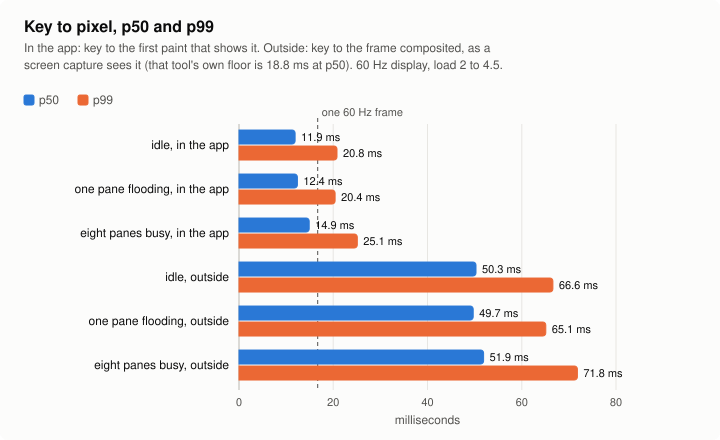
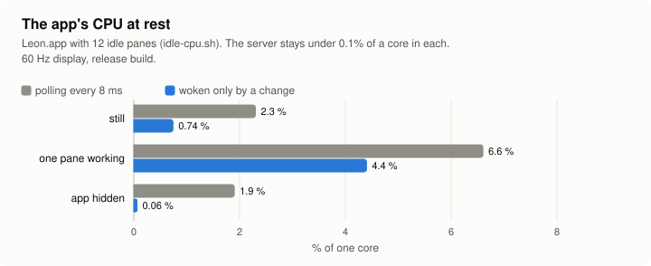

# Performance: the app end to end

The app itself, measured from outside and inside: key to pixel, frames, start-up, memory, idle
CPU, scale, a 2-hour agent soak, and the overview with 50 tabs. The speed bench and the machine
are in docs/performance.md; the charts' data is in [docs/perf/](perf/).

## The app end to end (scripts/perf)

The bench stops at the app's screen model. `scripts/perf/` measures the app itself, under load,
with one command each; every run starts its own release leon with private `LEON_RUNTIME_DIR`,
`LEON_STATE_DIR`, `LEON_CONFIG` and `HOME` (`/bin/sh`, whose prompt is a coloured bar), waits for
the 1-minute load to fall under 3 before each step, and notes the load beside each number in
`.agent/perf/<run>/`. Two clocks, both on the boot clock (`CLOCK_UPTIME_RAW`):

- **In the app**: `LEON_FRAME_LOG=PATH` (off unless set) logs each frame (render start, last pane
  painted, the next display tick) and each key: AppKit's stamp on the event, the key sent to the pane, the first
  paint of the focused pane whose cursor moved, and the next display tick. That tick is when GPUI
  can next present, not when the frame was shown.
- **From outside**: `winframes.swift` captures one window with ScreenCaptureKit and hashes each
  frame, so only changed frames count. It posts synthetic keys to a pid and times each to the
  first frame whose echo bar (`echo.py` flips it red and green per key) has that key's colour:
  key posted to frame composited, which is all of the app's path plus the window server's. Not
  seen: scan-out. The floor is a window of the tool's own that repaints the moment a key arrives.
  `external.sh` runs these outside measurements on any terminal given as a launch command.

Apple M6 (12 cores), macOS 27, a 60 Hz display, release build, load 2 to 4.5 (a remote-desktop
session was streaming the screen, which slows every outside number the same way):

| Measurement | Command | Result |
|---|---|---|
| key to pixel, idle / one pane flooding / eight panes busy | `keylat.sh` | in app, painted: p50 11.9 / 12.4 / 14.9 ms, p99 20.8 / 20.4 / 25.1 ms; outside: p50 50.3 / 49.7 / 51.9 ms, p99 66.6 / 65.1 / 71.8 ms; floor p50 18.8 ms |
| a 50 ms echo delay | `keylat.sh --loads idle --delay 50` | in app +54 ms, outside +48 ms: both clocks see it |
| `cat` 100 MB of text and colour, 1 / 8 panes | `flood.sh` | 55.5 / 57.3 frames a second shown (the capture's own floor 54.7 / 55.6), none missed; frame build p50 1.0 / 1.4 ms; screen current 46 ms after the last byte |
| start-up to the prompt drawn, no server / server up | `startup.sh` | 159 / 154 ms (window on screen 188 / 190 ms); `leon run --wait -- true` 13 ms; `leon server start` 32 ms |
| memory (footprint) | `memory.sh` | server 7.3 MiB idle, +0.53 MiB a pane, +20.7 MiB per 10,000 lines of scrollback in an 80-column pane; app 137 MiB, +0.06 MiB a pane; a 1 GB flood peaks the app at 163 MiB and it is back to 135 MiB within 30 s; a font change with 9 hidden 10,000-line panes adds 0.1 MiB to the server (387 to 414 MiB when hidden panes were refit too) |
| CPU with 12 idle panes: still / one pane working / app hidden | `idle-cpu.sh` | server under 0.1% of a core in each; app 2.3% / 6.6% / 1.9%, 80 / 58 / 32 wake-ups a second at first; since the poll runs only when woken, 0.74% / 4.4% / 0.06%, 18 / 18 / 0.3 (load 1.4 to 2.3) |
| 25 and 100 panes, 50 sessions, 10 tabs | `scale.sh` | 100 panes made in 1.4 s, the 100th split as fast as the first (9 ms, the CLI's own start included); 60 frames a second with all 100 printing, frame build p50 5.1 ms; server 88 MiB; a session 11 ms |
| 2-hour agent soak: 12 agents in 4 sessions, a session made and killed and an attach client every minute | `soak.sh 120` | app 162 to 180 MiB throughout (+1.2 MiB/h over the last hour); server 354 to 432 MiB, then 667 to 896 MiB after the 9 hidden panes were fitted to the window's width at minute 48 (their 10,000-line histories now 213 columns; likely a font change, which fitted hidden panes then and now fits only the panes on screen); its live heap was the same at minutes 60 and 120 (748 MB, +448 bytes), so the footprint's sawtooth is freed memory the allocator keeps; `leaks` found none in the server and 56 small objects (2.5 KB) in the app, all leaked by GPUI (docs/performance-memory.md) |

Where the time goes, from `sample`: the app used to poll its model every 8 ms (`POLL`) even when
nothing changed or it was hidden; now its main thread sleeps until woken, and what an idle shown
window still costs is GPUI's display link, which ticks at 60 Hz while the window is visible. A
pulsing status indicator re-lays out the whole window on each of its frames. During a flood the server's parse thread spent more time in leon's own passes over
the bytes (the slice scans in `terminal_view::feed`, the X10 mouse scanner, the OSC 7501 scanner)
than in alacritty's parser (fixed since: docs/performance-cat.md). A keystroke's echo is painted 12 ms after the key (most of it waiting for the next
display tick), then shown about two display frames later: GPUI draws on the display link and
presents through a three-drawable Metal layer.

## The overview with 50 tabs

`scripts/perf/overview.sh [--runs N] [--tabs N]` makes 50 tabs in 10 sessions, opens the
overview (⌘⇧\) through System Events and reads `LEON_FRAME_LOG`'s `overview` and
`overview-filled` lines: from the key's AppKit stamp to the display tick after the first overview
frame, and after the first frame in which every card has its tab's screen (the server pushes each
tab's screen once the overview watches it). It fails when the filled median reaches 100 ms. Two
runs of five opens on the machine above, at a load of 10.5 and 8.7 (an upper bound): first frame
p50 16.1 / 17.1 ms, every card filled p50 32.5 / 33.8 ms (max 46.2 ms); frames while open take
1 to 3 ms to build (max 7.5 ms), since each thumbnail is a cached view that draws again only when
its screen changes.
