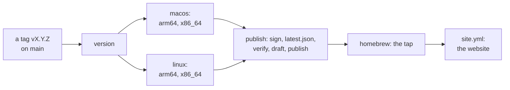

# Releases

Pushing a tag `vX.Y.Z` builds every release file, signs it, publishes a GitHub Release and updates
the Homebrew tap. This page is for whoever cuts a release, and for anyone writing code that reads
one: the manifest format below is a contract.

## What a release holds

Eight files, for version `V`:

- `Leon-V-macos-arm64.zip`, `Leon-V-macos-x86_64.zip`: Leon.app, signed ad hoc and not notarized.
  The zip holds `Leon.app` at its top level; the binary is `Leon.app/Contents/MacOS/leon`.
- `leon-V-arm64-macos.tar.gz`, `leon-V-x86_64-macos.tar.gz`: the CLI alone for macOS.
- `leon-V-aarch64-linux.tar.gz`, `leon-V-x86_64-linux.tar.gz`: the CLI for Linux.
- `leon_V_arm64.deb`, `leon_V_amd64.deb`: the CLI as a Debian package.

Each tarball holds one directory named like the tarball without `.tar.gz`, and in it `leon`,
`README.md`, `LICENSE`, `THIRD-PARTY-NOTICES.txt` and `docs/`. The CLI ships as tarballs, not bare
binaries, so that it never travels without its license notices.

Beside them: `SHA256SUMS`, `latest.json` (the manifest), and a `.minisig` signature for every one
of those ten files.

## Cutting a release

Before the first release, do the one-time setup under [Secrets](#secrets).

1. Set the version in `Cargo.toml`. Give `CHANGELOG.md` a `## [X.Y.Z]` section and move what is
   under `[Unreleased]` into it: the release notes are that section's text and nothing else, its
   relative links made absolute to the tag on GitHub.
2. Try it on your Mac: `scripts/release-dry-run.sh` builds the release (`scripts/release.sh`),
   signs it with a key made for the run, checks it, and then changes a byte to see the check fail.
   It needs Docker for the Linux packages; `--linux none` skips them.
3. Work lands on `dev`. A release is a pull request from `dev` to `main`: merge it, and wait for
   CI to pass on that commit of `main`. The release workflow builds and packages; it does not run
   the test suite again.
4. Tag that commit of `main` and push the tag:
   `git checkout main && git pull && git tag vX.Y.Z && git push origin vX.Y.Z`.

`.github/workflows/release.yml` then runs:



- **version**: `scripts/release-version.sh --on-main` fails unless the tag is `v` plus the version
  in `Cargo.toml` and the tagged commit is on `main`. Each build also checks that `leon --version`
  prints that version.
- **macos**: `scripts/release.sh --linux none` on `macos-latest` (arm64) and `macos-15-intel`
  (x86_64). That runner is the last Intel image GitHub offers; when it goes, x86_64 macOS needs a
  cross-compile.
- **linux**: `scripts/package-linux.sh` on `ubuntu-24.04` and `ubuntu-24.04-arm`.
- **publish**: `scripts/release-manifest.sh --complete` signs everything and writes the manifest;
  `scripts/release-verify.sh --complete` checks the result against the keys leon pins; the
  release is created as a draft with `scripts/release-notes.sh`'s text, and only then published,
  so the latest release never has files missing.
- **homebrew**: `scripts/release-homebrew.sh` rewrites the tap's cask and formula.

When the run succeeds, `.github/workflows/site.yml` deploys [the website](#the-website) from the
new release.

A version with a `-` in it (`0.2.0-rc.1`) becomes a pre-release and leaves the tap alone.

### When a run fails

- **"this commit (…) is not on main"** (version): the tag is on a commit that `main` does not hold,
  such as a commit of `dev`. Delete the tag (`git push origin :vX.Y.Z`), merge `dev` into `main`
  with a pull request, and tag `main`.
- **"the tag is … but Cargo.toml says …"** (version): the tag and the version disagree. Delete the
  tag and fix whichever is wrong.
- **"pins no key"** or **"its signature is not by a key in …"** (publish): the secret and
  `crates/leon/release-keys.pub` don't belong together. See [Secrets](#secrets).
- **"a release or a draft for vX.Y.Z exists already"** (publish): an earlier run got as far as
  creating it. If it is a draft, delete it (`gh release delete vX.Y.Z`) and re-run the failed
  jobs. If it is already published, leave it: the release is out, and deleting it would break the
  address updaters read. Only the tap can be behind then; write it by hand with
  `scripts/release-homebrew.sh` from that release's `latest.json`.

Nothing is published before every check has passed.

The on-`main` check guards against a mistaken tag; it is not access control. It accepts any commit
that `main` holds, and nothing compares the version with the latest release, so tag the newest
commit of `main`.

### A test run

Start the workflow by hand (`workflow_dispatch`: the Actions tab, or `gh workflow run release.yml
--ref BRANCH`, on any branch; GitHub allows this once the workflow file is on the default branch,
`dev`). The release stays a **draft**, no tag is created, and the tap is not touched. Delete the
draft afterwards (`gh release delete vX.Y.Z`). Never publish a test draft: that would put out a
build of a branch nobody checked, signed with the real key, and create its tag.

A test run signs with the real key, so the files in its draft are as trusted as a release's.
Start one only from a commit you would release. The signatures stay in the draft, which only
people with write access can see. The built files without signatures are kept for a day as run
artifacts, which on a public repository anyone signed in can download.

## Secrets

Repository secrets, under Settings, Secrets and variables, Actions:

- **`LEON_RELEASE_KEY`** (required): the minisign secret key. Run `scripts/release-keys.sh` once,
  yourself. It makes the key pair in a private temp dir, hands the secret key to `gh secret set`
  from the file, deletes the temp dir, and adds the public key to `crates/leon/release-keys.pub`
  under a comment naming the secret. Commit that file. The secret key is never printed and exists
  nowhere else afterwards; the script refuses to replace a secret that already exists.
- **`HOMEBREW_TAP_TOKEN`** (optional): lets the workflow push to the tap. Without it the tap job
  prints a notice and does nothing. To make it:
  1. GitHub, Settings, Developer settings, Personal access tokens, **Fine-grained** tokens,
     Generate new token.
  2. Resource owner: `aindong`. Repository access: Only select repositories,
     `aindong/homebrew-leon`.
  3. Repository permissions: Contents, **Read and write**. Nothing else.
  4. `gh secret set HOMEBREW_TAP_TOKEN --repo aindong/leon-cli`, and paste the token.

  Fine-grained tokens expire. With an expired token the tap job fails; make a new one and re-run
  that job.
- **`APPLE_DEVELOPER_ID`**: not used yet. See [Developer ID](#developer-id).

**Who can reach them.** A repository secret can be read by any workflow in the repository, so
anyone who can push a branch can take the signing key and the tap token, not only use them. Give
push access only to people you would trust with a release. To narrow it further, put both secrets
in an Environment that only `v*` tags may use and that needs a reviewer, and add a tag rule for
`v*`. That is not set up, and `scripts/release-keys.sh` would then have to set the Environment's
secret instead of the repository's.

## Signatures

Every file is signed with [minisign](https://jedisct1.github.io/minisign/) (ed25519). HTTPS alone
only proves which server answered; the signature proves that a holder of the key signed this file.

- The public keys leon trusts are the lines of `crates/leon/release-keys.pub`. A file is good if
  its `.minisig` verifies against any one of them.
- The workflow checks its own signatures against that file before it creates the release, so a
  secret that doesn't match the pinned key stops the run instead of shipping.
- Why minisign: the updater has to check the CLI on Linux as well as the app on macOS, so one
  verifier has to work everywhere. The `minisign-verify` crate (no dependencies) verifies these
  signatures in Rust. In a trial, minisign 0.11 and 0.12 and the crate all accepted the same
  signature, and all rejected the file with one byte changed. The alternative considered, the
  EdDSA appcast of a macOS app-update framework, covers only the app and needs that framework
  inside it.

`scripts/release-files.sh` is sourced by the other release scripts: the list of the eight file
names and where releases are published.

## The manifest

`latest.json` describes one release. Its address never changes:

    https://github.com/aindong/leon-cli/releases/latest/download/latest.json

and its signature is at the same address with `.minisig` added. GitHub's "latest" is never a
draft or a pre-release.

| Field | Type | Meaning |
|---|---|---|
| `schema` | number | `1`. See the promise below. |
| `version` | string | The release's version, as in `Cargo.toml`: `0.1.0`. |
| `tag` | string | The git tag: `v` plus the version. |
| `commit` | string | The commit it was built from, 12 hex digits, as `leon --version` prints it. |
| `date` | string | When it was signed, UTC: `2026-11-15T12:59:18Z`. |
| `notes_url` | string | The release's page, with its notes. |
| `min_os` | object | The oldest systems the files run on. |
| `min_os.macos` | string | The lowest macOS version, `11.0`. Absent when the release has no macOS file. |
| `min_os.linux_glibc` | string | The lowest glibc version, `2.34`, read from the `.deb`. Absent when the release has none. |
| `files` | array | One entry per release file. |
| `files[].name` | string | The file's name. |
| `files[].kind` | string | `app` (the zip of Leon.app), `cli` (a tarball) or `deb`. |
| `files[].os` | string | `macos` or `linux`. |
| `files[].arch` | string | Always `arm64` or `x86_64`, also where the file's name says `aarch64` or `amd64`. |
| `files[].url` | string | Where to download it. |
| `files[].size` | number | Its size in bytes. |
| `files[].sha256` | string | Its SHA-256, 64 hex digits. |
| `files[].signature` | string | The whole text of its `.minisig` file. |

A reader picks the entry whose `kind`, `os` and `arch` match. Compare `version` and the `min_os`
values part by part as numbers, not as text.

**The promise.** Within schema `1`, fields are only ever added: ignore the ones you don't know.
Nothing documented here is removed, renamed or given another meaning. If that ever has to
happen, the new format gets a new file name and `latest.json` stays as it is, because installed
leons keep reading it.

**For an updater.**

- Build the keys in: read `crates/leon/release-keys.pub` at compile time. `leon self-update`
  does, and follows every rule here ([updates.md](updates.md)).
- Verify `latest.json` against those keys before reading anything from it.
- Refuse a `version` that isn't newer than the running one, by semver order. An old release is
  still validly signed, so this is the only thing that stops a downgrade. It cannot tell an old
  manifest served forever from "no new release".
- Take a file only if its sha256 is the one in the verified manifest and its own signature
  verifies. The signature alone does not say which version the file belongs to.
- Check that `tag` is `v` plus `version`, and refuse a manifest with two entries for the same
  `kind`, `os` and `arch`.

## Checking a download

With the repository: put a release's files in a directory and run `scripts/release-verify.sh
--complete DIR`. It checks the sums, the manifest and every signature against the pinned keys,
and fails on any file in the directory that the manifest doesn't list.

Without it, one file at a time, with a key from `crates/leon/release-keys.pub`:

    minisign -Vm Leon-0.1.0-macos-arm64.zip -P <public key>

## Key rotation

A leon trusts the keys that were in `crates/leon/release-keys.pub` when it was built, so a new key
can be introduced before the old one stops signing.

1. `scripts/release-keys.sh --name LEON_RELEASE_KEY_2` makes a second key under a second secret
   and pins its public key beside the first. Commit the file.
2. Cut a release. It is still signed with the old key, and the leon in it trusts both.
3. Once people have had time to update, change `secrets.LEON_RELEASE_KEY` in
   `.github/workflows/release.yml` to `secrets.LEON_RELEASE_KEY_2`. Releases are now signed with
   the new key.
4. Later, remove the old key's two lines from the keys file (the comment above each key names
   its secret) and delete the old secret.

A leon older than step 2 cannot verify a release from step 3 on. It updates through Homebrew or
a download from the Releases page.

**If the key leaks**, don't follow those steps: step 2 would ship one more release signed with
the leaked key. Instead, in one commit, remove the leaked key's lines and pin a new key
(`scripts/release-keys.sh --name …`), point the workflow at the new secret, and delete the old
secret. Only then cut a release. Nothing can make installed leons stop trusting the leaked key:
whoever holds it can sign a manifest with any version number, so those leons are protected only
by the attacker not being able to put files on this repository's Releases page. They have to
update by hand.

## Homebrew

The tap is `aindong/homebrew-leon`:

    brew install --cask aindong/leon/leon   # Leon.app, with the leon command
    brew install aindong/leon/leon          # the CLI alone, macOS and Linux

The cask links the `leon` inside the app, so the two are not meant to be installed together.
Homebrew loads a third-party tap only when it is trusted; installing by the full name, as above,
trusts that one item ([Tap Trust](https://docs.brew.sh/Tap-Trust)).

**Quarantine.** Homebrew marks every cask download as quarantined, and macOS will not open an
app that is quarantined and not notarized. Homebrew removed its `--no-quarantine` flag, and its
policy for official casks says a cask "must not require System Integrity Protection or
Gatekeeper to be disabled or bypassed" (<https://docs.brew.sh/Acceptable-Casks>). That policy
binds Homebrew's own tap, not this one, but a cask that strips the flag in a hook does what
Homebrew chose to stop doing. So the cask leaves the flag alone and prints the command for you
to run:

    xattr -dr com.apple.quarantine /Applications/Leon.app

Run it before the first launch. A quarantined `leon` started from a shell does not fail: it
waits behind a system dialog. The formula is not affected; only casks are quarantined.

**The tap is outside the signatures.** Homebrew checks a download against the sha256 written in
the tap and nothing else, and it runs the tap's Ruby. Whoever can push to the tap controls what
`brew install` and `brew upgrade` do. If `HOMEBREW_TAP_TOKEN` leaks: revoke it, read the tap's
history and revert what you didn't write.

The workflow rewrites `Casks/leon.rb` and `Formula/leon.rb` from the manifest and pushes them.
To check them by hand: `brew style` and `brew audit --strict` on a local checkout of the tap.
`scripts/release-homebrew.sh --url-base file:///some/dir` writes them to download from a
directory instead, to try an install before a release exists.

## Developer ID

leon has no Apple Developer ID, so Leon.app is signed ad hoc and not notarized. That is why a
download needs the `xattr` command above.

The workflow has a step where Developer ID signing and notarization will go. It is not built.
Without the `APPLE_DEVELOPER_ID` secret it prints a notice and the release goes on; with the
secret set it fails, so nobody takes an ad-hoc build for a notarized one. Building it means
signing inside `scripts/release.sh`, between the bundle and the zip.

## The website

<https://aindong.github.io/leon-cli/> shows the latest release: its README, `docs/` and
`CHANGELOG.md` at that release's tag, built with the `website/` and `brand/` files of the commit
the workflow runs on, so a fix to the site itself needs no release. It has the landing page
(`brand/marketing/index.html`), the README as its overview, a page for each doc and translation,
What's new (a page for each `## [X.Y.Z]` section of the changelog, the text its GitHub release has)
and the demo. Links into the source go to GitHub at the release's tag.

`.github/workflows/site.yml` runs after a Release run that a tag push started and that succeeded,
and by hand (Actions, Site, Run workflow), which is also the way after publishing a release by
hand. It always runs from the default branch, the only ref allowed to deploy to Pages. It asks GitHub for
`releases/latest`, which is never a draft or a pre-release, checks that its tag is `vX.Y.Z`
(`website/latest-tag.sh`), builds, and deploys with GitHub's own Pages actions. Its token can read
the repository and write only to Pages.

To build it yourself, `website/build.sh` (it needs `python3`, and installs the pinned, hashed
`website/requirements.txt` into `target/site-venv`), `website/build.sh serve` to preview it, and
`target/site-venv/bin/python website/test_site.py` for its tests. CI's `site` job runs both on
every change but one to translations, images or `brand/` alone, which starts no CI run: after
changing only the landing page or the font, run them yourself.

### Demo videos

Videos are too large for git, and a versioned release takes no extra files:
`release-verify.sh --complete` fails on one, and the updater reads those releases. They live in one release of their
own, tagged `media`, made once as a pre-release so that `releases/latest` never picks it
(`website/fetch-media.sh` refuses to use it otherwise):

```sh
gh release create media --prerelease --latest=false --title "leon media" --notes "Videos for the website's demo page. Not a release of leon."
gh release upload media demo.mp4 demo.jpg --clobber
```

`NAME.mp4` shows on the demo page with `NAME.jpg` (or `.png`) as its poster, and `demo.mp4`, the
narrated tour, comes first. Names use lower-case letters, digits, `.`, `_` and `-`; other files
are left out. The next run of the site shows them: run Site by hand after an upload.

### Setting it up once

These are the repository's settings, for its owner:

- Settings, Pages, Source: **GitHub Actions** (or `gh api -X POST repos/aindong/leon-cli/pages -f build_type=workflow`).
- Settings, Environments, `github-pages`: leave its rule as GitHub makes it, the default branch
  only. Don't add tags: a run from a tag runs that tag's files, so anyone who can push a tag could
  publish site code nobody reviewed.
