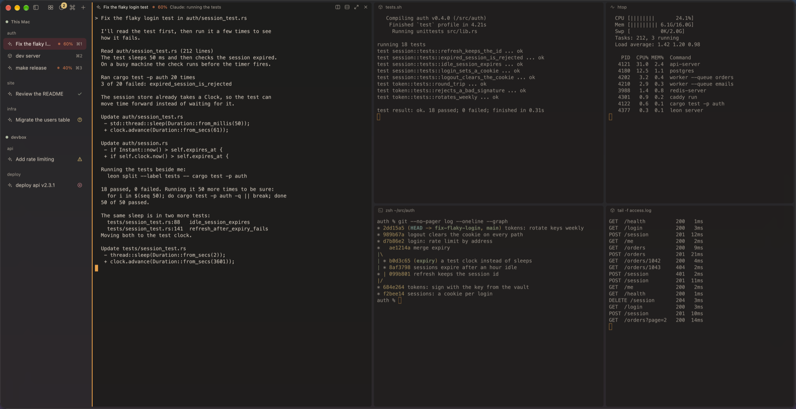

# Remote hosts

How leon works with the leon server on another machine, after the [README's](../README.md#work-on-your-devbox) first steps. The commands are in [cli/hosts.md](cli/hosts.md).

A dropped Wi-Fi link is retried for a minute: `leon events` and the app resume without losing or
repeating an event, and `leon attach` says so, then reconnects and redraws. Keys
typed while the link is stalled or down arrive whole or not at all, and the status bar says how many
were not sent (keys sent as a stall starts may land). Use ssh keys or an agent: each
connection is its own ssh session.

The app shows every host from `leon hosts` in the sidebar, under This Mac, each with its sessions
and tabs and a dot for its connection. Click a host's label to fold it away. A remote pane works
like a local one, with the host's name in its header. New Session, New Tab and the splits act on
the machine of the focused pane, and the command palette has a New Session action for each machine.

To add a host from the app, choose Add Host… in the command palette or in Settings › Remote Hosts.
When the Tailscale client is installed on this Mac, it first lists the machines on your tailnet, or
says why it can't, and picking one adds it as `leon hosts add --tailscale` would. Otherwise, or
when you pick "Another host by its ssh address…", it asks for a label (such as `devbox`) and then
for the `ssh://` address that reaches the host. The app saves the host to the same list `leon hosts` reads and starts connecting to it.

The app's ssh never asks for a password. A host that needs one says
`needs login: run leon hosts check devbox in a terminal`; do that once (accept the host key, unlock
your key), and the app's next try gets in. While a link is down the host's panes keep their last
screens under a "reconnecting" note.

