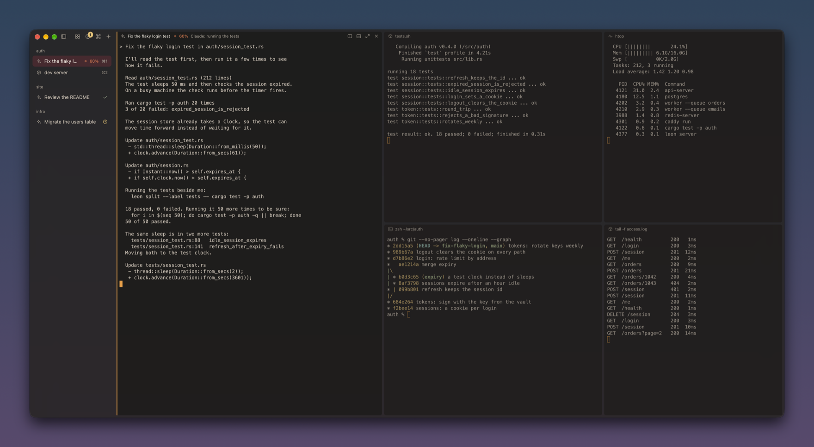
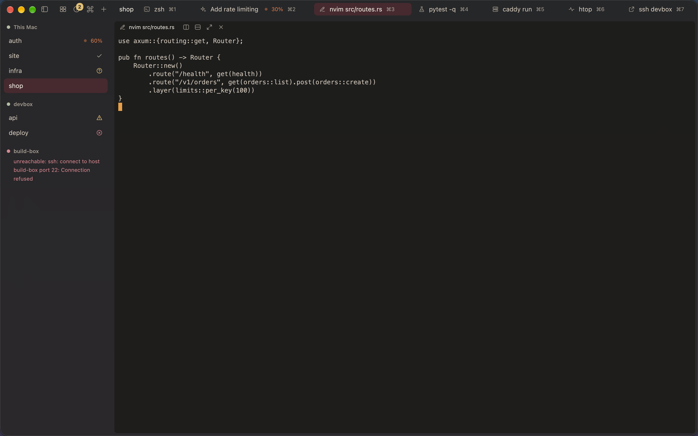

# App shortcuts

Leon.app's keys, from the [README](../README.md#app-shortcuts), and [how the app shows what needs you](#know-what-needs-you).
[lua/keys.md](lua/keys.md) says how to change the keys.

| Keys | Action |
|---|---|
| ⌘N | New session |
| ⌘T | New tab |
| ⌘D | Split right |
| ⌘⇧D | Split down |
| ⌘⌥←, ⌘⌥→, ⌘⌥↑, ⌘⌥↓ | Focus the pane that way |
| ⌘⇧↩ | Zoom the pane (again to undo) |
| ⌘W | Close the pane |
| ⌘⌥W | Close the tab (asks first when a program other than a shell runs in it) |
| ⌘⌥⇧W | Close the session (asks first the same way) |
| ⌘⌥F, ⌘⌥⇧F | Float the pane above the others, put it back in the tiles (drag its header to move it, an edge to resize it) |
| ⌘J | Show or hide the scratch drawer: a shell at the bottom, opened in the focused pane's directory, that keeps running while hidden |
| ⌘⌃←, ⌘⌃→, ⌘⌃↓ | Dock the pane as a drawer on the left, right or bottom (drag its edge to resize it) |
| ⌘⇧], ⌘⇧[ | Next, previous tab |
| ⌘1 … ⌘9 | Go to tab 1–9 |
| ⌘C, ⌘V | Copy the selection, paste |
| ⌘A | Select everything in the pane, scrollback too |
| ⌘F | Find in the pane: ↩ and ⇧↩ step, ⌥C case, ⌥R regex, esc closes |
| ⌘G, ⌘⇧G | Next, previous match |
| ⌘⇧C | Copy mode: vi keys over the scrollback (h j k l, w b, 0 $, g ⇧G, ⌃U ⌃D), v and ⇧V select, / and ? search with n and ⇧N, y copies, esc or q leaves |
| ⌘⇧H | Hints: a label on every URL, path, hash, IP and long number on screen; type one to copy it, in upper case to type it into the pane |
| ⇧PageUp, ⇧PageDown | Scroll a page back, forward |
| ⌘↑, ⌘↓ | Scroll to the oldest line, back to the bottom |
| ⌘B | Show or hide the sidebar |
| ⌘⇧S | Tabs in the sidebar or in the titlebar (saved for the next launch) |
| ⌘⇧P | Command palette: type to find an action, ↩ runs it, esc closes |
| ⌘, | Settings: every setting in sections, with search, ↑ and ↓ between sections, esc or ⌘W closes (into init.lua) |
| ⌘⇧T | Change theme, shown live as you move; ↩ keeps it, esc goes back |
| ⌘⇧K | Connect to a machine: your hosts, your tailnet's machines, Add a host…, this Mac's web page ([remote-hosts.md](remote-hosts.md#connect-from-the-sidebars-footer)) |
| ⌘K | Switch to any host › session › tab (or a block by its title): ↩ goes there, ⌘↩ moves it beside this pane (same machine) |
| ⌘⇧A | Activity: every block that needs you on every host (blocked, error, done, working); click one to go there |
| ⌘⇧\\, ⌘\\ | Overview: every tab (⌘\\: this session's), live; arrows and ↩ go, typing filters; resting on a tab previews it |
| ⌘=, ⌘⇧=, ⌘-, ⌘0 | Bigger, bigger, smaller, default font size (shown panes) |
| ⌘Q | Quit; every program keeps running (leon › Quit and End All Sessions… ends them) |


These are defaults. A `leon.bind` in your `init.lua` replaces one key by key, and `leon.unbind`
removes one (⌘Q stays). Key sequences such as `ctrl+b>c` show a hint of what can follow. Every
button names its action and shortcut on hover. The wheel scrolls a pane back through its
scrollback; drag to select, option+drag for a rectangle; hold ⌘ over a link to open it with a click.
Rest the mouse on a link, or right-click it, for a card with its address (a long one cut short;
Copy copies all of it), Copy and Open in Browser (`link_card` in [lua/settings.md](lua/settings.md#settings) turns it off); it closes on a key,
a scroll, or the mouse leaving it. Double-click a tab's or a session's name to rename it in
place; right-click it for Rename and Close (a × on hover closes it too). A program that asks for the mouse (an editor or `htop`) gets
clicks, right-clicks too, and the wheel; hold shift to select anyway.

## Know what needs you

Programs report what they're doing (working, blocked, done), and the app shows it in two places.
The tab's row gets a symbol, and the pane's header gets the symbol with the program's own words.


With more than one pane in a tab, the panes you aren't in are faded, so your eye stays on
the focused one. What you are waiting for is never faded: a status symbol keeps its
colour, and a pane that is blocked, has failed, or finished since you last looked stays at full
strength. `leon.set("fade_inactive_panes", N)` sets it from 0 (off) to 0.8 (default 0.35).

The window is translucent, tinted by the theme, with text readable over any desktop;
`leon.set("translucency", 0)` makes it opaque.



Each tab, sidebar row and pane header has an icon for the program in it: an agent, an editor,
tests, a server, a monitor, ssh or a shell.



⌘K switches to any session, tab or block on any host, the most recent first, and ⌘⇧A lists what
needs you: blocked first (with what it is waiting for), then errors, finished runs you haven't
looked at, and work in progress. The toolbar button for it shows how many blocks are blocked, and so
does the Dock. Leon.app also sends a notification when a block becomes blocked or fails, and when
a run of 30 seconds or more ends while you're in another app. Clicking the notification takes you
to the pane. A tool that can't write [OSC 7501](agents.md#the-osc-7501-format) to its terminal,
such as a hook or a job with no tty, can report its block's status with `leon notify`. That status
shows in all the same places:

```text
leon notify --state blocked --title "Deploy" --body "approve the rollout?"
```


