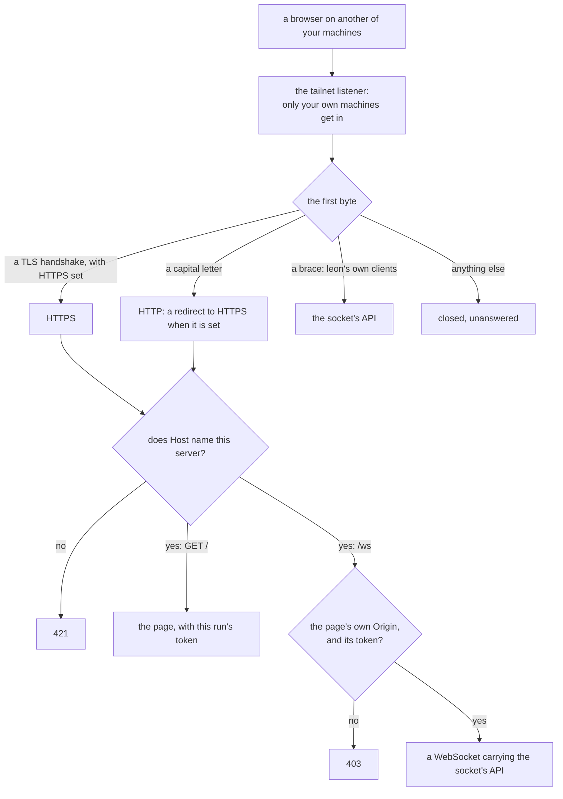

# leon in the browser

Open your sessions in a web browser on another of your own machines, over your
[Tailscale](cli/hosts.md#serve-over-tailscale) network only. Part of [Remote hosts](remote-hosts.md).

Today the page is **view only**: it lists your sessions and each session's tabs, and draws the
chosen tab's panes live, in leon's colours and your `font.family` when the browser has that font.
Typing, copy and paste, and a phone layout come next.

## Turn it on

On the machine whose sessions you want to see:

```text
leon config set serve_tailscale true
leon config set serve_web true
leon server status       # web      http://devbox.example-tailnet.ts.net:7297/
```

Open that URL in a browser on another of your machines. `serve_web` does nothing unless
`serve_tailscale` is on: the page is served by the same listener, on the same port
(`serve_tailscale_port`), to the same machines. Turn it off with `leon config set serve_web false`.

Use the MagicDNS name or one of the machine's Tailscale addresses (`http://100.x.y.z:7297/`). The
short name (`http://devbox:7297/`) is refused on purpose; see below.

## Who gets in

- **Only your own machines**, by the rules in [cli/hosts.md](cli/hosts.md#serve-over-tailscale):
  before a byte is read, the server asks the local tailscaled who is calling and lets in only
  another machine signed in as you (or one with a tag you listed). Everyone else gets a closed
  connection.
- **Never anywhere else.** No public link, no relay, no Funnel. leon never changes Tailscale's
  settings and never asks it for a certificate. Nothing listens on your LAN, on `0.0.0.0` or on
  loopback.
- **Not a web page you happen to visit.** A page from another site, open in your own browser,
  could try to reach the server through your machine. It is stopped three ways:
  - every request must name this server (its MagicDNS name or address) as its Host;
  - the WebSocket the page uses must come from the page's own Origin;
  - it must carry a token that only the page holds (a fresh one each time serving starts),
    which another site can't read.

  Pages also carry a strict Content-Security-Policy, can't be framed, and load nothing from
  anywhere else: every file is built into leon.
- **What a page can do** is what a caller over the tailnet can do: the page speaks the same API as
  the socket. The page itself only reads today.

A connection from the browser, step by step:



## HTTPS

Without a certificate the page is plain HTTP. Tailscale's WireGuard already encrypts and
authenticates the link, so nothing crosses the network in the clear, but browsers treat an
`http://` page as not secure, and some features need a secure page: the clipboard API (copy and
paste buttons; selecting text and ⌘C still work) and browser notifications.

For HTTPS, make a certificate for the machine's MagicDNS name with `tailscale cert`, once, and
tell leon where the two files are. leon only reads them: it never runs `tailscale cert` and never
asks Tailscale for a certificate. Making one is your call: it needs HTTPS turned on for your
tailnet in Tailscale's admin console, and it puts the machine's name in public certificate logs.

On a Mac:

```text
mkdir -p ~/.config/leon/certs
tailscale cert --cert-file ~/.config/leon/certs/web.crt --key-file ~/.config/leon/certs/web.key devbox.example-tailnet.ts.net
leon config set serve_web_cert '~/.config/leon/certs/web.crt'
leon config set serve_web_key '~/.config/leon/certs/web.key'
leon server status       # web      https://devbox.example-tailnet.ts.net:7297/
```

On Linux only root (or the user named with `sudo tailscale set --operator=$USER`) may ask for a
certificate, and the files `sudo` writes are root's, so give them to yourself:

```text
sudo tailscale cert --cert-file ~/.config/leon/certs/web.crt --key-file ~/.config/leon/certs/web.key devbox.example-tailnet.ts.net
sudo chown "$USER" ~/.config/leon/certs/web.crt ~/.config/leon/certs/web.key
chmod 600 ~/.config/leon/certs/web.key
```

- **Renewal:** Tailscale's certificates last 90 days, and `tailscale cert` doesn't renew the files
  by itself. Run the same command again before then (a monthly cron line is enough); leon notices
  the new files within 2 s, with no restart.
- **With HTTPS set**, the page is served only over HTTPS, at the names the certificate covers;
  plain `http://` only redirects there. When the files are missing, unreadable, expired, for
  another name, or the key can be read by others, nothing is served over HTTPS, `leon server
  status` says why on a `web` line with the command to run, and a renewal that goes wrong keeps
  the last good certificate while it is still valid.
- The key must be yours and mode 600, as `tailscale cert` writes it. Keep both files in a
  directory only you can write, such as `~/.config/leon/certs`.

## When it doesn't load

- `leon server status` shows no `web` line: `serve_tailscale` or `serve_web` is off, or Tailscale
  isn't running or signed in (the `tailnet` line says why).
- The page says "Disconnected": the server stopped or restarted, or serving stopped; the page
  reloads itself once the server answers again, and picks up the new token.
- Nothing loads at all: the caller isn't one of your machines (the server log has a `refused`
  line naming the reason), or your tailnet policy blocks the port.
